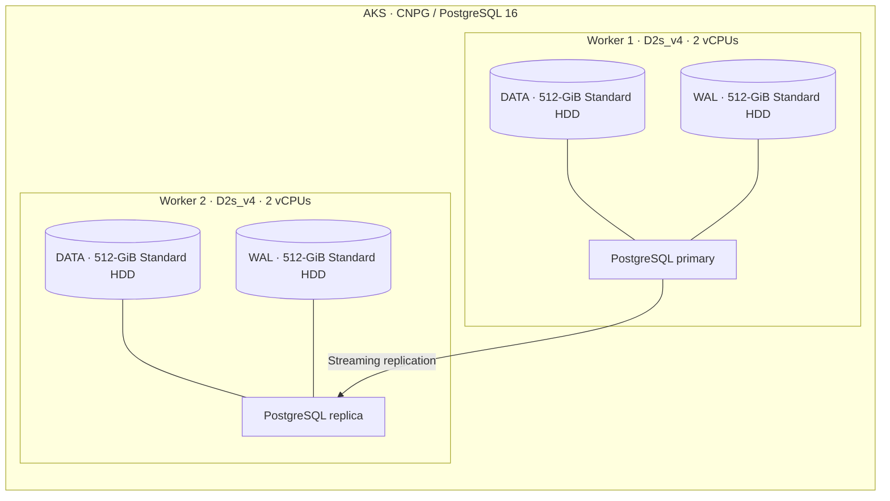
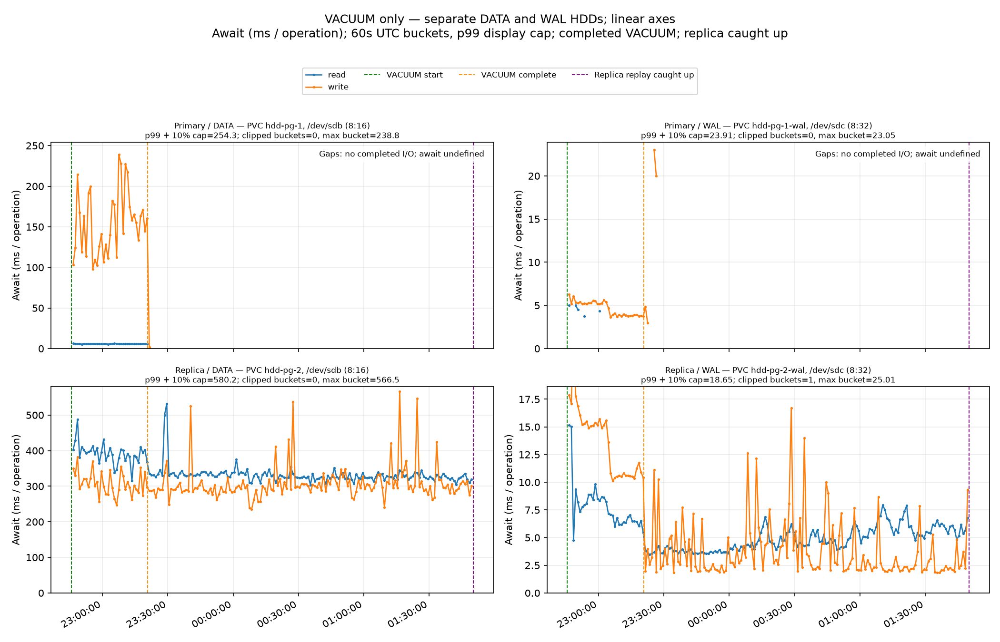
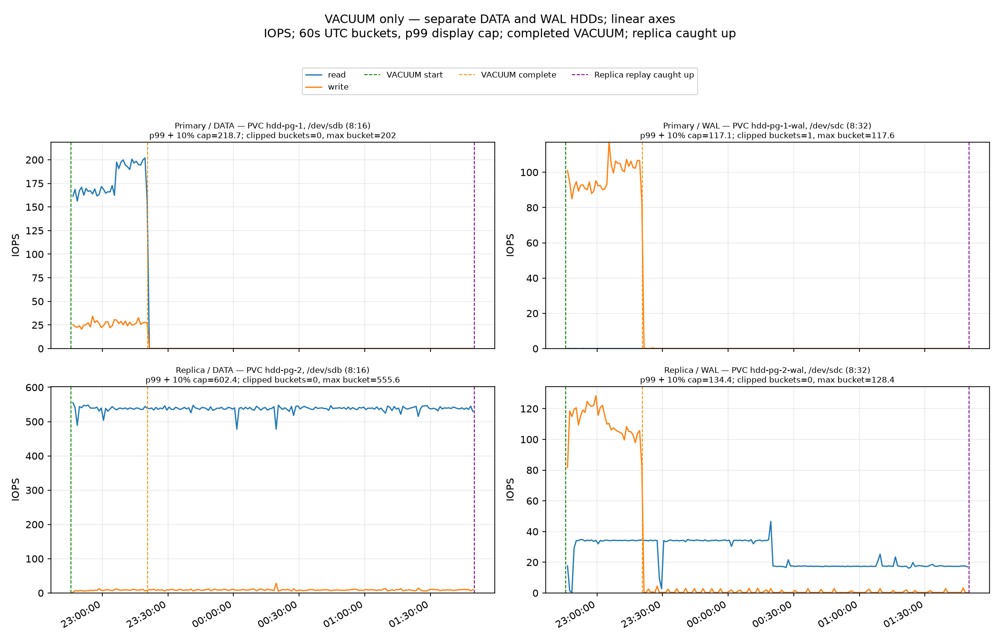
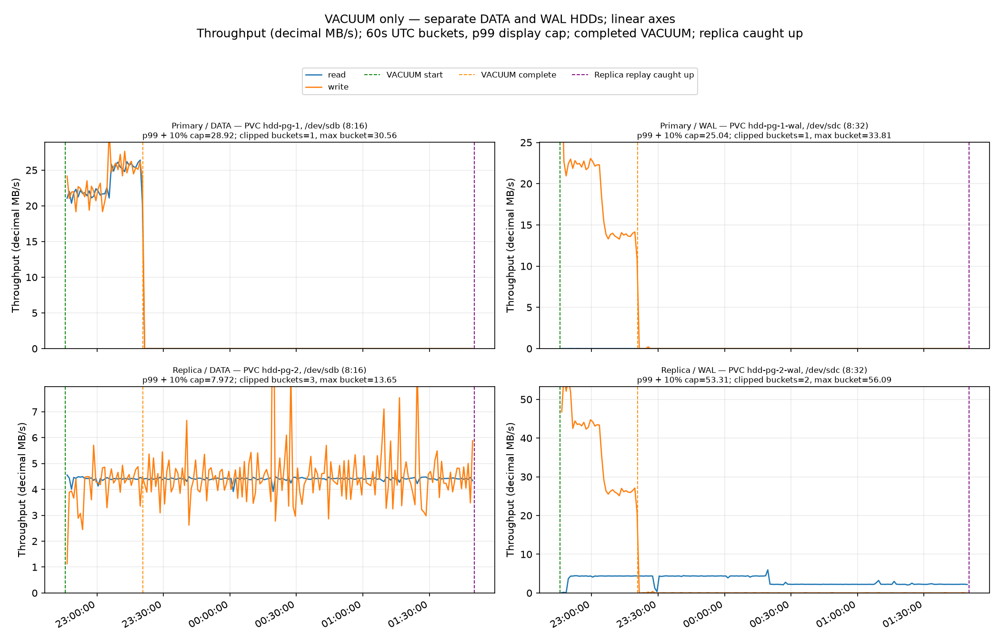

# 23-GiB VACUUM and complete replica replay



Run `20261004T205730Z`, measured 4–5 October 2026 (UTC). This report contains only this run's results.

The primary completed VACUUM in **35 min 8.6 s**, but the replica needed another **2 h 29 min 25.8 s** to catch up. Across the complete **3 h 4 min 34.4 s** timeline, replica DATA reads averaged **537 IOPS / 4.40 MB/s / 343 ms await**; DATA writes averaged **311 ms await**. No WAL sender timeouts, receiver disconnects or streaming restarts were observed despite `wal_sender_timeout=5s` and `wal_receiver_timeout=5s`.

## Setup

Two `Standard_D2s_v4` AKS workers (2 vCPUs each) in East US ran PostgreSQL 16.15 with CNPG 1.30.1. Primary and replica ran on separate nodes, each with separate **512-GiB Standard HDD (`Standard_LRS`) DATA and WAL disks**, host caching disabled, ext4 and the SCSI guest interface.

The primary was restored from the retained Azure disk snapshot. Preparation built an exactly **23-GiB heap** (24,696,061,952 bytes), with approximately 7,536,640 live and 7,536,640 dead tuples. CNPG created a paired DATA/WAL `volumeSnapshot` backup, then seeded the replica from that pair. Replica replay was caught up before measurement; a checkpoint and its replay were also verified before VACUUM.

The workload was only:

```sql
VACUUM (VERBOSE, FREEZE) public.vacuum_target;
```

Explicit `FREEZE` ensures freshly inserted surviving tuples are frozen. The requested settings retained CNPG defaults: `wal_level=logical`, `full_page_writes=on`, `recovery_prefetch=try`, `vacuum_cost_delay=0`. Other relevant settings were `maintenance_work_mem=64MB`, `maintenance_io_concurrency=10`, `shared_buffers=256MB`, `max_wal_size=1GB`, and `checkpoint_timeout=5min`. I/O timing instrumentation was enabled. Synchronous replication was `ANY 1` with preferred durability and `synchronous_commit=on`. Autovacuum was enabled globally and disabled for this table. Every sample on both instances recorded **zero application sessions**.

## Timeline

| Event | UTC | Time from VACUUM start |
|---|---|---:|
| VACUUM starts | Oct 4, 22:45:38.774 | 0 |
| Heap scan ends; index vacuum observed | Oct 4, 23:04:39.721 | 19 min 1 s |
| Heap cleanup observed | Oct 4, 23:04:54.745 | 19 min 16 s |
| Primary VACUUM completes, exit 0 | Oct 4, 23:20:47.346 | 35 min 9 s |
| Replica catch-up verified | Oct 5, 01:50:13.157 | 3 h 4 min 34 s |

Phase transitions are sampled observations; VACUUM start and completion are SQL timestamps. The replica **replays VACUUM's WAL** rather than executing its own VACUUM. Peak sampled replay backlog was **25.95 GiB**, immediately after primary completion. Collection continued throughout the replay tail; the last three samples showed replica replay and primary flush both at `56/F5000000`, above VACUUM's completion LSN `56/F43BE000`.

The verbose VACUUM log reports one index pass, all **3,014,656 heap pages** scanned and frozen, **7,536,640 live tuples frozen**, 7,536,638 tuples removed, and no remaining removable dead tuples. VACUUM reported **36.932 GB of WAL**, 15,115,207 records and 6,071,356 full-page images. The cluster WAL-counter increase was 36.932 GB and includes background WAL; neither measure is physical disk throughput.

## Disk measurements

Each cell is **IOPS / decimal MB/s / operation-weighted await in ms**. The first window covers primary VACUUM; the second covers primary completion through replica catch-up. These windows distinguish WAL generation from the much longer replay tail.

| Device / operation | Primary VACUUM window | Replica replay tail |
|---|---:|---:|
| Primary DATA read | 178.77 / 23.35 / 5.79 | 0.04 / 0.00 / 3.51 |
| Primary DATA write | 26.34 / 23.54 / 153.23 | 0.02 / 0.01 / 330.73 |
| Primary WAL read | 0.01 / 0.00 / 4.33 | 0.00 / 0.00 / — |
| Primary WAL write | 97.85 / 18.86 / 4.64 | 0.03 / 0.00 / 5.09 |
| Replica DATA read | 537.39 / 4.40 / 391.31 | 536.98 / 4.40 / 331.32 |
| Replica DATA write | 7.90 / 4.09 / 303.67 | 8.95 / 4.56 / 312.43 |
| Replica WAL read | 31.72 / 3.94 / 7.68 | 23.84 / 3.05 / 4.69 |
| Replica WAL write | 110.52 / 36.76 / 13.84 | 0.78 / 0.02 / 3.96 |

During primary VACUUM, replica DATA read IOPS were **3.01×** primary DATA read IOPS (537.4 versus 178.8). After primary completion, primary I/O dropped almost to zero while replica DATA reads stayed near 537 IOPS. Over the entire timeline, replica DATA read/write await averaged **342.8/310.9 ms**. Maximum valid approximately five-second interval averages were **1,195 ms read await** and **1,368 ms write await**. These are interval averages, not individual-I/O maxima.

## Full-timeline graphs

All figures use linear y-axes and separate panels for primary/replica DATA/WAL, with read and write traces. Lines use 60-second UTC buckets; await is weighted by completed operation count, while IOPS and throughput are weighted by elapsed time. Axes use a p99 display ceiling to keep most data visible; off-scale buckets are indicated. Raw values and numeric statistics are not clipped. Primary await gaps after VACUUM represent buckets with no completed I/O, where await is undefined; primary collection continued through replica catch-up. Point markers make isolated await observations visible.







## Replication monitoring and measurement quality

Continuous primary and replica PostgreSQL log followers ran through the measurement, alongside final log retrieval. Both captures produced **zero matching WAL sender timeout, WAL receiver timeout, stream-disconnect or stream-start events**. This establishes what was observed in the collected logs; the logs are mostly checkpoint/restartpoint records, and their lack of matching messages does not prove that no transient interruption occurred. This test ran with zero application sessions.

The collector recorded **2,217 samples** at a target five-second cadence, with a maximum gap of **6.97 seconds** and **zero rejected intervals**. VACUUM-window coverage was 100%; whole-timeline coverage exceeded 99.9996%. Await comes from Linux block-device counter deltas and describes guest completed-I/O time, including queueing, rather than an Azure service latency measurement. The short phase-label uncertainties do not affect the SQL-defined VACUUM window. Elapsed durations here use the SQL completion and catch-up timestamps; the recorded `replayDrainSeconds` starts when the collector enters its drain loop, about 4.6 seconds after SQL completion.

Both VACUUM exit status and replica catch-up passed. Automatic teardown was deliberately blocked by the instruction to preserve every snapshot, so the controller's cleanup failure is separate from the successful test. **Snapshots and test infrastructure remain retained.**

Evidence: [preflight](results/20261004T205730Z/preflight.json), [VACUUM log](results/20261004T205730Z/vacuum.log), [timing](results/20261004T205730Z/timing.json), [summary](results/20261004T205730Z/summary.json), [events](results/20261004T205730Z/events.jsonl), [compressed raw counters](results/20261004T205730Z/samples.jsonl.gz), and [continuous log monitor](results/20261004T205730Z/monitoring/monitor-summary.json).
