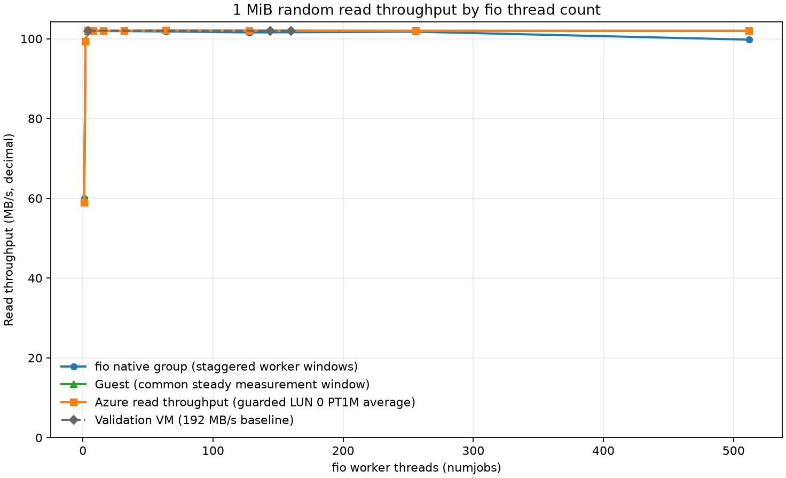
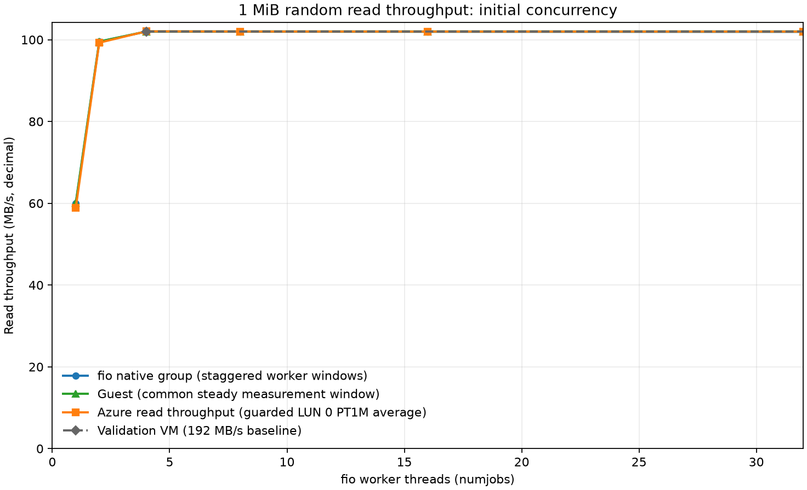
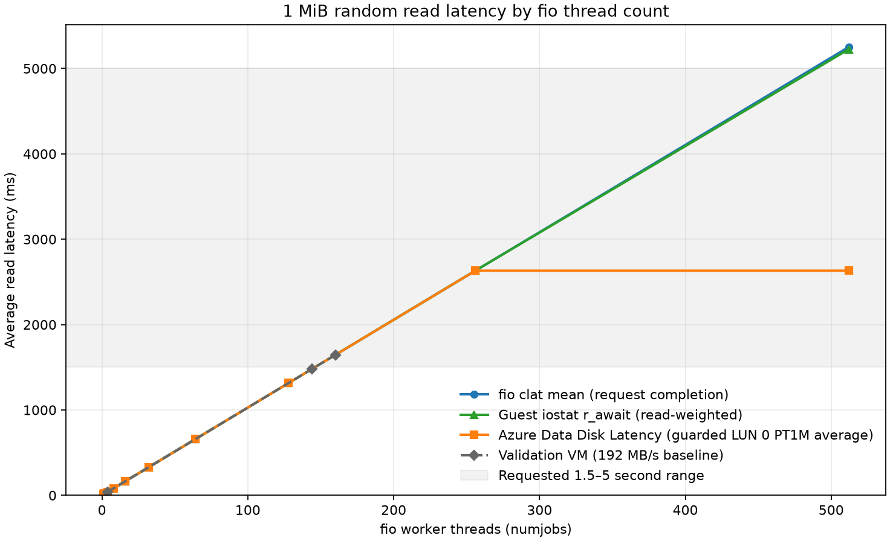

# fio Standard HDD 1 MiB random read scaling results

Analyzed **10** run(s). The analyzer uses only captured measurements; missing samples remain blank.

## Results

The workload issues read-only 1 MiB random reads (`fio --bs=1m`, where fio's default `kb_base=1024`). See [`summary.csv`](summary.csv) for fio logical IOPS, decimal MB/s, fio total and completion latency, guest block-device `r/s`, throughput, `r_await` and queue depth, and Azure read operations/throughput/latency/queue depth. [`azure-minute-points.csv`](azure-minute-points.csv) preserves every returned Azure metric minute point from the VM, disk, and host metric queries.

The thread counts shown are fio `numjobs`; each worker uses a synchronous engine with one outstanding 1 MiB request. The displayed Azure values are averages of complete PT1M LUN 0 buckets whose returned timestamp is at least 60 seconds after `measurement_start` and whose full PT1M interval fits before `measurement_end`. The extra leading guard is a conservative response to the first run's low Azure operation rate despite steady guest I/O; it mitigates that observed mismatch but is not a proven timestamp correction. The CSV also retains the original full-window averages as `azure_full_window_*`; per-metric bucket counts show how many points contributed. Guest `r_await` is weighted by completed block-device reads over complete iostat intervals. Azure averages are not fio percentiles and may differ because of sampling and aggregation windows.

All graph axes are linear. Throughput uses decimal MB/s; the CSV also records Azure-minus-fio differences. The two throughput graphs show the full run and the initial concurrency range through 32 workers.

When available, the dashed grey diamond overlay shows guest iostat data from the separate validation VM (192 MB/s uncached bandwidth baseline), loaded from the neighboring `fio-hdd-1m-headroom/artifacts` bundle at 4, 144, and 160 worker threads. It shows only captured guest throughput and `r_await`; those validation runs do not enter this report's table or `summary.csv`. Missing guest measurements are omitted, and no points are interpolated.

| IO threads | fio MB/s | Guest MB/s | Azure MB/s | Guest block requests/s | fio logical IOPS | Guest await (ms) | Azure latency (ms) |
|---:|---:|---:|---:|---:|---:|---:|---:|
| 1 | 60.015 | 60.037 | 58.955 | 57.3 | 57.2 | 17.4 | 17.2 |
| 2 | 99.551 | 99.533 | 99.270 | 95.0 | 94.9 | 21.0 | 20.9 |
| 4 | 101.977 | 102.002 | 102.038 | 97.3 | 97.3 | 41.0 | 40.8 |
| 8 | 101.959 | 101.999 | 102.000 | 97.3 | 97.2 | 82.2 | 81.9 |
| 16 | 101.931 | 101.999 | 101.990 | 97.3 | 97.2 | 164.4 | 164.2 |
| 32 | 101.915 | 101.999 | 101.984 | 97.3 | 97.2 | 328.9 | 328.6 |
| 64 | 101.820 | 102.023 | 102.070 | 97.3 | 97.1 | 657.9 | 657.6 |
| 128 | 101.578 | 102.017 | 102.006 | 97.3 | 96.9 | 1315.8 | 1315.5 |
| 256 | 101.764 | 101.987 | 101.989 | 97.3 | 97.0 | 2631.7 | 2631.4 |
| 512 | 99.768 | 101.987 | 101.987 | 97.3 | 95.1 | 5225.6 | 2631.6 |

## Observed 1.5–5 second latency points

Mean and tail latency are listed separately. These are measured points in the inclusive 1,500–5,000 ms band; no interpolation is applied.

| Latency source | Last measured below 1.5 s | First measured at/above 1.5 s | Runs in band (threads: ms) |
|---|---:|---:|---|
| fio clat mean | 128: 1315.426 ms | 256: 2631.626 ms | 256: 2631.626 |
| fio clat p95 | 128: 1350.566 ms | 256: 2667.577 ms | 256: 2667.577 |
| fio clat p99 | 128: 1367.343 ms | 256: 2667.577 ms | 256: 2667.577 |
| Guest iostat r_await | 128: 1315.784 ms | 256: 2631.661 ms | 256: 2631.661 |
| Azure Data Disk Latency | 128: 1315.524 ms | 256: 2631.437 ms | 256: 2631.437, 512: 2631.583 |

Guest iostat device: `sdb`.

## Method and interpretation

fio IOPS counts completed 1 MiB workload requests. Guest iostat `r/s` counts block-device read requests completed after merges; the Linux block layer may split a large request to respect the device queue's maximum transfer size. Thus fio IOPS and guest `r/s` count work at different layers and can differ substantially for 1 MiB reads. Guest throughput is converted from sysstat's `rkB/s` (1024-byte units) to decimal MB/s; fio and Azure byte rates are also shown in decimal MB/s. Azure Data Disk Read Operations/Sec is documented as per-disk read IOPS, while Data Disk Read Bytes/sec is a bytes-per-second metric averaged over PT1M. Azure's Standard HDD billing rule counts each I/O larger than 16 KiB as multiple 16 KiB billable transactions; that billing rule should not be confused with the definition or measured value of the Azure Monitor Read Operations/Sec metric. See the linked [fio size suffix documentation](https://github.com/axboe/fio/blob/master/HOWTO.rst), [sysstat iostat manual](https://github.com/sysstat/sysstat/blob/master/man/iostat.in), [Linux block queue documentation](https://kernel.org/doc/html/latest/block/queue-sysfs.html), and [Azure managed disk documentation](https://learn.microsoft.com/en-us/azure/virtual-machines/disks-types).

Native fio group bandwidth statistics use staggered per-worker clocks. At high thread counts, summed worker IO counts divided by the maximum worker runtime can overstate throughput over a shared wall-clock window. Use guest/Azure counters for steady disk throughput. The fio latency distribution summarizes its own collected worker samples, not exactly the guest's UTC window. Failed attempts are excluded and their raw artifacts are retained.

This report compares fio request completion, Linux block-device `r_await`, and Azure's one-minute VM metric. Azure's API timestamp anchoring is not used to shift points; the fixed leading guard is applied directly to the returned timestamp, and the unfiltered minute rows remain available for inspection. The guarded Azure-minus-fio differences are descriptive and should not be read as a calibration offset. The per-thread test is closed-loop: increasing threads increases concurrent synchronous reads, while each worker holds at most one outstanding request.
