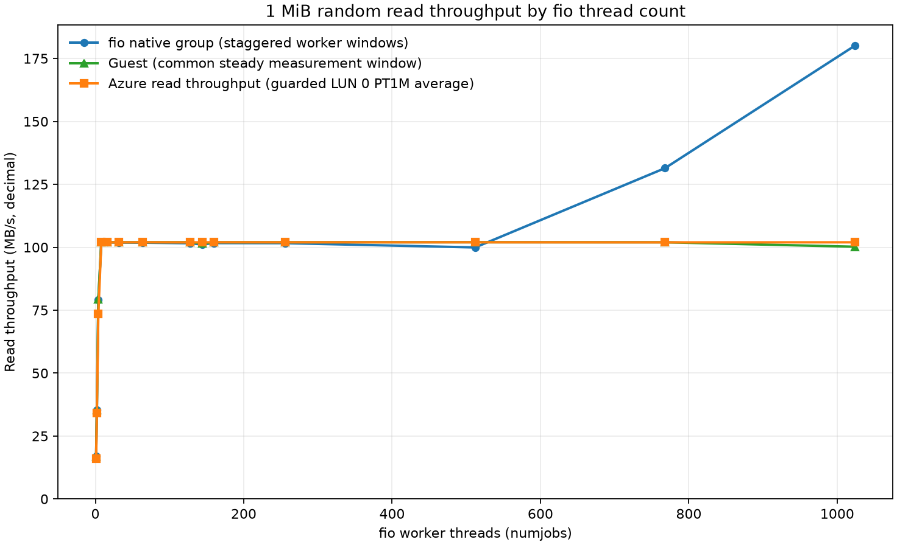
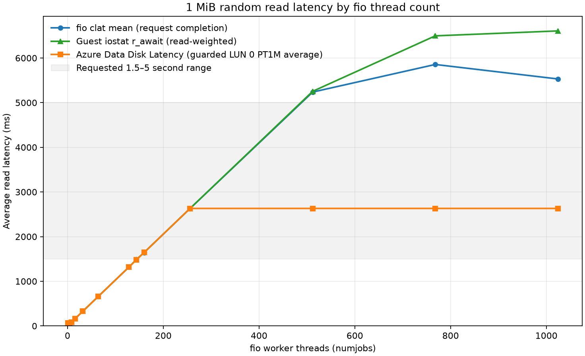

# West US 2 1 MiB Standard HDD read sweep

One thread sustained **16.96 MB/s initially and 39.83 MB/s in the repeat**. Eight threads reached the roughly **102 MB/s** plateau. The first tested mean guest await in the 1.5–5 second band was **160 threads, 1.645 seconds**. The requested 768- and 1,024-thread points both completed.

Measured on 2026-10-09 using Standard_E2bs_v5 and a 512 GiB Standard_LRS HDD, SCSI LUN 0, caching None. Each worker used direct, read-only random reads with psync and one outstanding request. Guest rates use the common UTC measurement window; fio native group statistics and Azure guarded PT1M averages have different clocks and sampling boundaries. Throughput uses decimal MB/s; 1 MiB reads are 1,048,576 bytes.

## Initial point and separate repeat

| Measure | Initial 1-thread point | Separate single-thread repeat | Unit |
|---|---:|---:|---|
| Guest rate, primary | 16.964 | 39.832 | MB/s |
| fio native rate, supporting | 16.985 | 39.821 | MB/s |
| Guest read await | 0.062 | 0.026 | s |
| fio mean completion latency | 0.062 | 0.026 | s |
| Azure guarded read rate | 15.969 (1 min) | 39.289 (1 min) | MB/s |
| Azure guarded disk latency | 0.066 (1 min) | 0.026 (1 min) | s |

The initial point raw files are in [artifacts/run-1](artifacts/run-1/); the separate repeat is in [artifacts/single-validation/run-1](artifacts/single-validation/run-1/) with its [repeat analysis](artifacts/single-validation/analysis/report.md).

The repeat is a separate validation run. These two one-thread measurements describe an observed range, not a cause.

## Threshold and saturation

The first tested main point at or above 1.5 s guest read await was 160 threads at 1.645 s; no interpolation is used.

The saturation knee is the first tested point at the sustained guest-rate plateau: **8 threads** (102.005 MB/s). Measurement criterion: First tested count reaching about 102 guest MB/s; four threads reached 79.25 MB/s.

### First measured points in the 1.5–5.0 second latency band

Each series is searched independently through actual primary-sweep points in ascending thread count. The interval is inclusive; no interpolation is used.

| Series (searched in ascending tested thread count) | First observed point in 1.5–5.0 s |
|---|---|
| Guest `r_await` | 160 threads; 1.645 s; 179 one-second samples |
| fio mean completion latency | 160 threads; 1.645 s |
| Azure Data Disk Latency | 160 threads; 1.645 s; 1 guarded min |

## All tested points

Guest MB/s are the headline rate. fio-native rates remain supporting measurements, not the headline; Azure rate and latency cells include the number of guarded complete PT1M buckets used. Raw point links open each `artifacts/run-<threads>/` folder. The [complete CSV](artifacts/analysis/summary.csv) and [all returned Azure minute points](artifacts/analysis/azure-minute-points.csv) retain exact values and timestamps.

| Threads | Guest rate | fio native rate | Azure guarded rate | fio mean / p95 | Guest await | Azure disk latency | Raw point |
|---:|---:|---:|---:|---:|---:|---:|---|
| 1 | 16.964 | 16.985 | 15.969 (1 min) | 0.062 / 0.148 s | 0.062 s | 0.066 (1 min) | [raw](artifacts/run-1/) |
| 2 | 35.280 | 35.264 | 34.095 (1 min) | 0.059 / 0.142 s | 0.059 s | 0.061 (1 min) | [raw](artifacts/run-2/) |
| 4 | 79.253 | 79.147 | 73.605 (1 min) | 0.053 / 0.124 s | 0.053 s | 0.057 (1 min) | [raw](artifacts/run-4/) |
| 8 | 102.005 | 101.981 | 102.028 (1 min) | 0.082 / 0.160 s | 0.082 s | 0.082 (1 min) | [raw](artifacts/run-8/) |
| 16 | 101.993 | 101.965 | 101.951 (1 min) | 0.164 / 0.240 s | 0.164 s | 0.164 (1 min) | [raw](artifacts/run-16/) |
| 32 | 101.993 | 101.879 | 101.958 (1 min) | 0.329 / 0.396 s | 0.329 s | 0.329 (1 min) | [raw](artifacts/run-32/) |
| 64 | 101.999 | 101.834 | 101.987 (1 min) | 0.658 / 0.726 s | 0.658 s | 0.658 (1 min) | [raw](artifacts/run-64/) |
| 128 | 102.005 | 101.597 | 101.951 (1 min) | 1.315 / 1.384 s | 1.316 s | 1.316 (1 min) | [raw](artifacts/run-128/) |
| 144 | 101.531 | 101.117 | 101.976 (1 min) | 1.487 / 1.535 s | 1.487 s | 1.480 (1 min) | [raw](artifacts/run-144/) |
| 160 | 101.999 | 101.668 | 101.986 (1 min) | 1.645 / 1.686 s | 1.645 s | 1.645 (1 min) | [raw](artifacts/run-160/) |
| 256 | 101.999 | 101.630 | 101.976 (1 min) | 2.632 / 2.668 s | 2.632 s | 2.631 (1 min) | [raw](artifacts/run-256/) |
| 512 | 102.016 | 99.935 | 101.979 (1 min) | 5.237 / 9.328 s | 5.254 s | 2.632 (1 min) | [raw](artifacts/run-512/) |
| 768 | 101.993 | 131.450 | 101.950 (1 min) | 5.855 / 13.892 s | 6.496 s | 2.632 (1 min) | [raw](artifacts/run-768/) |
| 1024 | 100.212 | 180.125 | 101.977 (1 min) | 5.531 / 11.476 s | 6.607 s | 2.632 (1 min) | [raw](artifacts/run-1024/) |

## 768- and 1,024-thread detail

Both configured high-thread points run their complete 30-second ramp and 180-second measurement regardless of mean latency; the 1 MiB sweep has no five-second stop rule. Azure cells show guarded PT1M bucket counts. Missing values are shown as `— (0 min)` and are not filled or interpolated.

| Threads | Guest MB/s | fio native MB/s | Azure MB/s (guarded min) | Guest await (s) | fio mean / p95 (s) | Azure latency (s, guarded min) | Raw point |
|---:|---:|---:|---:|---:|---:|---:|---|
| 768 | 101.993 | 131.450 | 101.950 (1 min) | 6.496 | 5.855 / 13.892 | 2.632 (1 min) | [raw](artifacts/run-768/) |
| 1024 | 100.212 | 180.125 | 101.977 (1 min) | 6.607 | 5.531 / 11.476 | 2.632 (1 min) | [raw](artifacts/run-1024/) |

## Captured guest queue context

The captured VM has 2 Linux blk-mq queues, each with 316 tags (632 total); the active scheduler is `none` ([captured topology](artifacts/queue-topology.json)).

768 threads: guest rate 101.993 MB/s, guest await 6.496 s, fio mean completion 5.855 s, Azure Data Disk Latency 2631.628 ms (1 guarded min); 1024 threads: guest rate 100.212 MB/s, guest await 6.607 s, fio mean completion 5.531 s, Azure Data Disk Latency 2631.529 ms (1 guarded min).

Guest read IOPS multiplied by guest await estimates about 631.9, 631.4 reads in flight at 768 and 1,024 threads. Compare these guest-side estimates with the 632 captured queue tags; they are not direct observations of tag occupancy or proof of a causal queue limit.

## Measurement caveats

The 1 MiB run used `Standard_E2bs_v5`. West US 2 sweeps ran concurrently, while the East US primary sweeps ran sequentially, and VM sizes differ (`Standard_E2bs_v5` versus `Standard_D4s_v4`). This is a description of these tested stacks; it does not establish a causal regional difference. Azure latency is an average of guarded complete one-minute buckets, not a request percentile. Empty or zero-count Azure buckets remain missing.

All graph axes are linear. The run’s local analysis report and raw inputs remain under `artifacts/`.

## Validation and cleanup

All successful main points and the separate repeat had zero fio errors, zero write/trim bytes, and zero test-device write/discard rates. [Validation](artifacts/validation.json) and [regional measurement checks](artifacts/regional-validation.md) record the checks. The owned test group was deleted and all 45 snapshots preserved: [cleanup](artifacts/cleanup.json).
