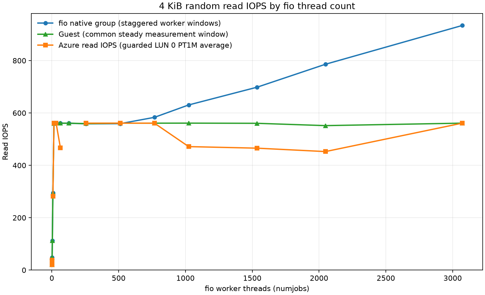
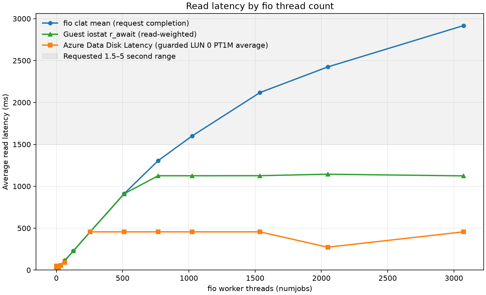

# West US 2 4 KiB Standard HDD read sweep

One thread sustained **20.84 IOPS initially and 60.58 IOPS in the repeat**. Sixteen threads reached the roughly **560 IOPS** plateau. Guest await stayed below 1.5 seconds through 3,072 threads; fio mean completion latency first entered the 1.5–5 second band at **1,024 threads, 1.600 seconds**.

Measured on 2026-10-09 using Standard_E2bs_v5 and a 512 GiB Standard_LRS HDD, SCSI LUN 0, caching None. Each worker used direct, read-only random reads with psync and one outstanding request. Guest rates use the common UTC measurement window; fio native group statistics and Azure guarded PT1M averages have different clocks and sampling boundaries. Throughput uses decimal MB/s; 1 MiB reads are 1,048,576 bytes.

## Initial point and separate repeat

| Measure | Initial 1-thread point | Separate single-thread repeat | Unit |
|---|---:|---:|---|
| Guest rate, primary | 20.837 | 60.583 | IOPS |
| fio native rate, supporting | 20.818 | 60.586 | IOPS |
| Guest read await | 0.048 | 0.016 | s |
| fio mean completion latency | 0.048 | 0.017 | s |
| Azure guarded read rate | 20.480 (1 min) | — (0 min) | IOPS |
| Azure guarded disk latency | 0.049 (1 min) | — (0 min) | s |

The initial point raw files are in [artifacts/run-1](artifacts/run-1/); the separate repeat is in [artifacts/single-validation/run-1](artifacts/single-validation/run-1/) with its [repeat analysis](artifacts/single-validation/analysis/report.md).

The repeat is a separate validation run. These two one-thread measurements describe an observed range, not a cause.

## Threshold and saturation

Guest common-window read await did not reach 1.5 s through 3072 tested threads.

The saturation knee is the first tested point at the sustained guest-rate plateau: **16 threads** (560.282 IOPS). Measurement criterion: First tested count reaching about 560 guest IOPS; eight threads reached 294.58 IOPS.

### First measured points in the 1.5–5.0 second latency band

Each series is searched independently through actual primary-sweep points in ascending thread count. The interval is inclusive; no interpolation is used.

| Series (searched in ascending tested thread count) | First observed point in 1.5–5.0 s |
|---|---|
| Guest `r_await` | not in band (15 sampled points; 2685 one-second samples total) |
| fio mean completion latency | 1024 threads; 1.600 s |
| Azure Data Disk Latency | not in band (13 sampled points; 13 guarded min total) |

## All tested points

Guest IOPS are the headline rate. fio-native rates remain supporting measurements, not the headline; Azure rate and latency cells include the number of guarded complete PT1M buckets used. Raw point links open each `artifacts/run-<threads>/` folder. The [complete CSV](artifacts/analysis/summary.csv) and [all returned Azure minute points](artifacts/analysis/azure-minute-points.csv) retain exact values and timestamps.

| Threads | Guest rate | fio native rate | Azure guarded rate | fio mean / p95 | Guest await | Azure disk latency | Raw point |
|---:|---:|---:|---:|---:|---:|---:|---|
| 1 | 20.837 | 20.818 | 20.480 (1 min) | 0.048 / 0.095 s | 0.048 s | 0.049 (1 min) | [raw](artifacts/run-1/) |
| 2 | 47.964 | 47.933 | 38.275 (1 min) | 0.042 / 0.084 s | 0.042 s | 0.046 (1 min) | [raw](artifacts/run-2/) |
| 4 | 112.921 | 112.879 | — (0 min) | 0.035 / 0.078 s | 0.035 s | — (0 min) | [raw](artifacts/run-4/) |
| 8 | 294.575 | 294.379 | 282.000 (1 min) | 0.027 / 0.068 s | 0.027 s | 0.030 (1 min) | [raw](artifacts/run-8/) |
| 16 | 560.282 | 560.160 | 560.650 (1 min) | 0.029 / 0.066 s | 0.029 s | 0.029 (1 min) | [raw](artifacts/run-16/) |
| 32 | 561.050 | 560.849 | 561.250 (1 min) | 0.057 / 0.093 s | 0.057 s | 0.057 (1 min) | [raw](artifacts/run-32/) |
| 64 | 561.000 | 560.771 | 467.345 (1 min) | 0.114 / 0.154 s | 0.114 s | 0.090 (1 min) | [raw](artifacts/run-64/) |
| 128 | 560.979 | 560.632 | — (0 min) | 0.228 / 0.263 s | 0.228 s | — (0 min) | [raw](artifacts/run-128/) |
| 256 | 559.291 | 558.586 | 561.010 (1 min) | 0.458 / 0.493 s | 0.458 s | 0.456 (1 min) | [raw](artifacts/run-256/) |
| 512 | 561.028 | 559.170 | 561.110 (1 min) | 0.912 / 1.485 s | 0.911 s | 0.456 (1 min) | [raw](artifacts/run-512/) |
| 768 | 560.978 | 583.278 | 560.910 (1 min) | 1.306 / 2.433 s | 1.126 s | 0.456 (1 min) | [raw](artifacts/run-768/) |
| 1024 | 561.140 | 630.567 | 471.510 (1 min) | 1.600 / 5.335 s | 1.126 s | 0.456 (1 min) | [raw](artifacts/run-1024/) |
| 1536 | 560.469 | 698.359 | 465.550 (1 min) | 2.118 / 9.865 s | 1.126 s | 0.456 (1 min) | [raw](artifacts/run-1536/) |
| 2048 | 551.654 | 785.989 | 452.550 (1 min) | 2.424 / 11.341 s | 1.144 s | 0.273 (1 min) | [raw](artifacts/run-2048/) |
| 3072 | 561.086 | 934.109 | 561.080 (1 min) | 2.917 / 16.844 s | 1.124 s | 0.456 (1 min) | [raw](artifacts/run-3072/) |

## Captured guest queue context

The captured VM has 2 Linux blk-mq queues, each with 316 tags (632 total); the active scheduler is `none` ([captured topology](artifacts/queue-topology.json)).

768 threads: guest rate 560.978 IOPS, guest await 1.126 s, fio mean completion 1.306 s, Azure Data Disk Latency 456.270 ms (1 guarded min); 1024 threads: guest rate 561.140 IOPS, guest await 1.126 s, fio mean completion 1.600 s, Azure Data Disk Latency 456.306 ms (1 guarded min).

Guest read IOPS multiplied by guest await estimates about 631.5, 631.6 reads in flight at 768 and 1,024 threads. That is close to the 632 captured queue tags and offers a possible queue-depth interpretation of the plateau. The guest averages do not directly measure tag occupancy or establish causality.

## Measurement caveats

The 4 KiB run used `Standard_E2bs_v5`. West US 2 sweeps ran concurrently, while the East US primary sweeps ran sequentially, and VM sizes differ (`Standard_E2bs_v5` versus `Standard_D4s_v4`). This is a description of these tested stacks; it does not establish a causal regional difference. Azure latency is an average of guarded complete one-minute buckets, not a request percentile. Empty or zero-count Azure buckets remain missing.

All graph axes are linear. The run’s local analysis report and raw inputs remain under `artifacts/`.

## Validation and cleanup

All successful main points and the separate repeat had zero fio errors, zero write/trim bytes, and zero test-device write/discard rates. [Validation](artifacts/validation.json) and [regional measurement checks](artifacts/regional-validation.md) record the checks. The owned test group was deleted and all 45 snapshots preserved: [cleanup](artifacts/cleanup.json).

The final artifact copy was retried after a transient SSH connection closure; the IO sweep and repeat were already complete and were not rerun. [Successful collection retry](artifacts/final-collection-retry.log). Guarded Azure latency was unavailable at 4 and 128 main threads and in the single-thread repeat; full-window values and raw responses remain in the analysis artifacts.
