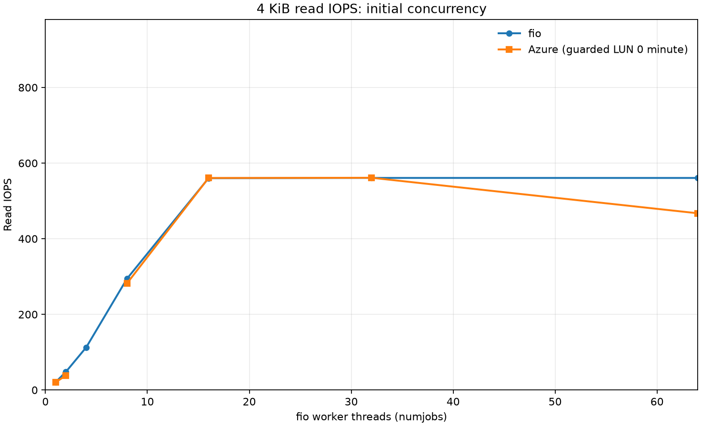
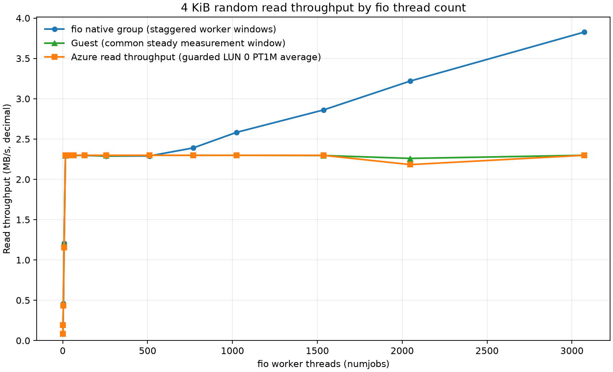

# fio Standard HDD read scaling results

Analyzed **15** run(s). The analyzer uses only captured measurements; missing samples remain blank.

## Results

See [`summary.csv`](summary.csv) for fio IOPS, decimal MB/s, fio total and completion latency, guest `r_await` and queue depth, and Azure read IOPS/throughput/latency/queue depth. [`azure-minute-points.csv`](azure-minute-points.csv) preserves every returned Azure metric minute point from the VM, disk, and host metric queries.

The thread counts shown are fio `numjobs`; each worker uses a synchronous engine with one outstanding request. The displayed Azure values are averages of complete PT1M LUN 0 buckets whose returned timestamp is at least 60 seconds after `measurement_start` and whose full PT1M interval fits before `measurement_end`. The extra leading guard is a conservative response to the first run's low Azure IOPS bucket despite steady guest I/O; it mitigates that observed mismatch but is not a proven timestamp correction. The CSV also retains the original full-window averages as `azure_full_window_*`; per-metric bucket counts show how many points contributed. Guest `r_await` is weighted by completed reads over complete iostat intervals. Azure averages are not fio percentiles and may differ because of sampling and aggregation windows.

All graph axes are linear. Throughput uses decimal MB/s; the CSV also records Azure-minus-fio differences.

| IO threads | Guest IOPS | Guest MB/s | Guest await (ms) | Azure latency (ms) | Native fio IOPS | Native fio mean (ms) |
|---:|---:|---:|---:|---:|---:|---:|
| 1 | 20.8 | 0.085 | 47.9 | 49.2 | 20.8 | 48.0 |
| 2 | 48.0 | 0.196 | 41.7 | 45.5 | 47.9 | 41.7 |
| 4 | 112.9 | 0.463 | 35.4 | — | 112.9 | 35.4 |
| 8 | 294.6 | 1.207 | 27.1 | 29.9 | 294.4 | 27.2 |
| 16 | 560.3 | 2.295 | 28.5 | 28.7 | 560.2 | 28.6 |
| 32 | 561.1 | 2.298 | 57.0 | 57.0 | 560.8 | 57.0 |
| 64 | 561.0 | 2.298 | 114.1 | 90.3 | 560.8 | 114.1 |
| 128 | 561.0 | 2.298 | 228.1 | — | 560.6 | 228.1 |
| 256 | 559.3 | 2.291 | 457.7 | 456.2 | 558.6 | 457.6 |
| 512 | 561.0 | 2.298 | 910.7 | 456.3 | 559.2 | 911.9 |
| 768 | 561.0 | 2.298 | 1125.6 | 456.3 | 583.3 | 1306.1 |
| 1024 | 561.1 | 2.298 | 1125.6 | 456.3 | 630.6 | 1599.9 |
| 1536 | 560.5 | 2.296 | 1126.3 | 456.3 | 698.4 | 2118.0 |
| 2048 | 551.7 | 2.260 | 1144.0 | 273.1 | 786.0 | 2424.1 |
| 3072 | 561.1 | 2.298 | 1124.3 | 456.3 | 934.1 | 2917.1 |

## Observed 1.5–5 second latency points

Mean and tail latency are listed separately. These are measured points in the inclusive 1,500–5,000 ms band; no interpolation is applied.

| Latency source | Last measured below 1.5 s | First measured at/above 1.5 s | Runs in band (threads: ms) |
|---|---:|---:|---|
| fio clat mean | 768: 1306.081 ms | 1024: 1599.934 ms | 1024: 1599.934, 1536: 2117.959, 2048: 2424.069, 3072: 2917.119 |
| fio clat p95 | 512: 1484.784 ms | 768: 2432.696 ms | 768: 2432.696 |
| fio clat p99 | 256: 517.997 ms | 512: 1518.338 ms | 512: 1518.338 |
| Guest iostat r_await | 3072: 1124.273 ms | — | No complete observed point |
| Azure Data Disk Latency | 3072: 456.300 ms | — | No complete observed point |

Guest iostat device: `sdb`.

## Method and interpretation

Native fio group statistics use staggered per-worker clocks. At high thread counts, summed worker IO counts divided by the maximum worker runtime overstate throughput over a shared wall-clock window. Use guest/Azure counters for steady disk throughput. The fio latency distribution summarizes its own collected worker samples, not exactly the guest's UTC window. See [fio 3.28 aggregation code](https://github.com/axboe/fio/blob/fio-3.28/stat.c). Failed attempts are excluded and their raw artifacts are retained.

This report compares three layers: fio request completion, Linux block-device `r_await`, and Azure's one-minute VM metric. Azure's API timestamp anchoring is not used to shift points; the fixed leading guard is applied directly to the returned timestamp, and the unfiltered minute rows remain available for inspection. The guarded Azure-minus-fio differences are descriptive and should not be read as a calibration offset. The per-thread test is closed-loop: increasing threads increases concurrent synchronous reads, while each worker holds at most one outstanding request.
