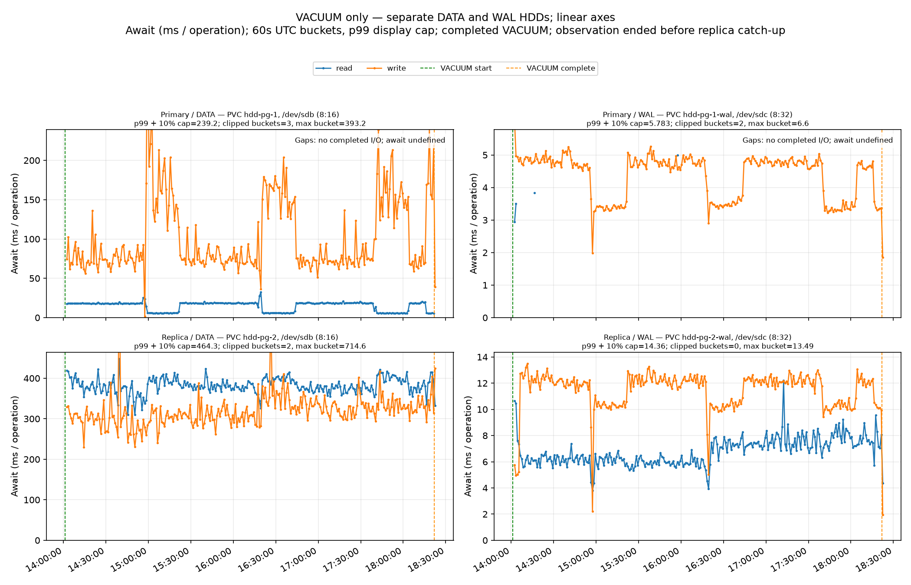
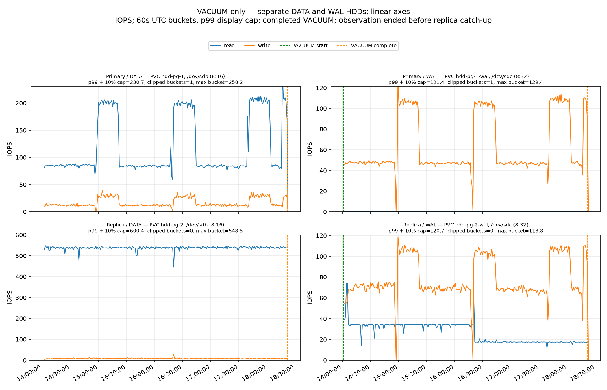
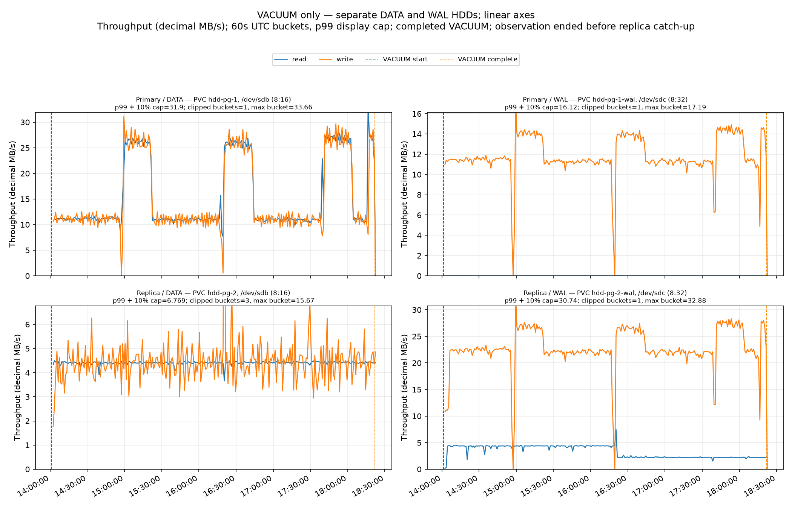

<!-- Latest retention policy: preserve every snapshot until explicit user deletion instruction. -->
# PostgreSQL VACUUM disk I/O comparison

**23-GiB follow-up complete:** primary VACUUM completed with exit 0 in **35 min 8.6 s** (2026-10-04 22:45:38.773760 → 23:20:47.346381 UTC). The replica caught up to primary flush LSN at **2026-10-05 01:50:13 UTC**, after another **2 h 29 min 26 s**. The complete timeline spans **3 h 4 min 34 s** with valid counter coverage above 99.9996%, 2,217 samples and no rejected intervals. Both final PostgreSQL logs and continuous log capture contained **zero WAL sender timeouts or receiver disconnect/reconnect events**. Over VACUUM plus replay, replica DATA averaged **537.1 read IOPS / 4.40 MB/s / 342.8 ms read await**, with **310.9 ms write await**. All snapshots and infrastructure remain preserved; automatic cleanup was deliberately deferred under the user's retention hold, independently of test success.

Full follow-up timeline graphs: [await](results/20261004T205730Z/await.png), [IOPS](results/20261004T205730Z/iops.png), [throughput](results/20261004T205730Z/throughput.png). [Timing](results/20261004T205730Z/timing.json) and [summary](results/20261004T205730Z/summary.json). The following detailed tables describe the historical 110-GiB run.

This records the historical 110-GiB run. The scripts now default to a configurable 23-GiB fixture and require replica catch-up before reporting test completion; the projected ~55-minute primary VACUUM duration has not been measured yet. The rebuilt fixture uses explicit `VACUUM (VERBOSE, FREEZE)` because fresh tuples otherwise skip the freezing performed by the historical ordinary VACUUM; the four requested GUCs remain at their defaults. Both historical runs used Standard HDDs; SCSI/NVMe identifies the VM interface.

Replica DATA reads averaged **538 IOPS / 4.41 MB/s**, with **383 ms mean await**. DATA write await averaged **319 ms**. Brief read/write interval peaks reached **2.48/1.50 seconds**. The complete and phase-specific measurements below describe all four devices.

**VACUUM status:** completed successfully (remote exit 0); server markers 2026-10-04T14:01:13.330015Z → 2026-10-04T18:21:48.027600Z (4h 20m 34.7s).
**VACUUM-window observation coverage:** 100.000–100.000% across four device series; valid; rejected interval counts 0.
**Replay:** not caught up at observation end; observation ended 2026-10-04T18:23:52.515886081Z; backlog 124077661280 bytes (target 60/E102C000, replay 43/FD682058).

## Setup and provenance

Measurement profile: D2s_v4 / SCSI rerun (eastus); PostgreSQL 16.15 / CNPG 1.30.1; four separate 512-GiB Standard_LRS DATA/WAL disks; `wal_level=logical`, `full_page_writes=on`, `recovery_prefetch=try`, `vacuum_cost_delay=0`. VACUUM used no application workload; preflight app sessions: 0.
Guest device mapping: primary DATA `sdb` (8:16); primary WAL `sdc` (8:32); replica DATA `sdb` (8:16); replica WAL `sdc` (8:32).
Prepared source: regional copy of the original keeper; heap 110.0 GiB. The measured replica was seeded from a native CNPG paired DATA/WAL snapshot Backup. [Preparation provenance](results/20261004T140103Z/prepare.json) records that source; `snapshot.json` now pins its independently verified replacement for future runs.
Cleanup verified: all experiment stacks, worker nodes, disks, temporary snapshots and archive storage are removed. Exactly one independently restored prepared snapshot remains; [cleanup proof](results/20261004T140103Z/cleanup.json).

## VACUUM-window rates and await

Values are mean guest block-device IOPS / decimal MB/s / operation-weighted await (ms), from counter deltas within the server-marked VACUUM window.

| Device and operation | SCSI run IOPS / MB/s / await ms |
|---|---:|
| Primary DATA read | 118.6 / 15.48 / 12.2 |
| Primary DATA write | 16.8 / 15.21 / 119.5 |
| Primary WAL read | 0.0 / 0.00 / 3.9 |
| Primary WAL write | 63.3 / 11.86 / 4.1 |
| Replica DATA read | 537.8 / 4.41 / 382.6 |
| Replica DATA write | 8.3 / 4.44 / 318.6 |
| Replica WAL read | 26.6 / 3.31 / 6.6 |
| Replica WAL write | 77.9 / 22.77 / 11.3 |

## Same-phase interval comparison

Triplets are time-weighted IOPS / decimal MB/s / operation-weighted await ms. Each phase pools all same-phase intervals across passes. Only intervals whose adjacent primary progress samples have the same non-null phase and whose counters are valid on all four device series are included.

| Observed phase | Valid / phase-matched observed seconds | Primary DATA read | Primary DATA write | Replica DATA read | Replica DATA write |
|---|---:|---:|---:|---:|---:|
| Scanning heap | 10663s / 10706s; 99.6% (2141 intervals) | 84.3 / 11.01 / 18.4 | 12.1 / 11.04 / 75.4 | 537.8 / 4.41 / 377.4 | 8.3 / 4.37 / 312.5 |
| Vacuuming indexes | 423s / 425s; 99.6% (85 intervals) | 112.0 / 14.60 / 15.7 | 4.6 / 4.26 / 95.2 | 539.1 / 4.42 / 338.7 | 8.9 / 4.27 / 278.4 |
| Vacuuming heap | 4427s / 4445s; 99.6% (889 intervals) | 201.7 / 26.33 / 5.8 | 29.2 / 26.40 / 163.9 | 538.1 / 4.41 / 399.3 | 8.1 / 4.56 / 336.5 |

The duration ratio is valid sampled counter time divided by time in adjacent samples with the same phase label; it is not coverage of the complete wall-clock phase or VACUUM.

Earlier NVMe comparison: [completed-run summary](results/20261004T065423Z/summary.json). [await](results/20261004T065423Z/await.png), [IOPS](results/20261004T065423Z/iops.png), and [throughput](results/20261004T065423Z/throughput.png). That run completed VACUUM but did not observe replay catch-up; it had multi-second sample-interval await tails, so its lower means do not establish that long stalls were absent.

## Highest observed sample-interval awaits

Raw valid sample intervals overlapping the VACUUM window; each row gives the full interval's operation count, rate, and await. A boundary-overlapping interval can include time outside the SQL markers.

| Device / operation | Interval UTC | Operations | IOPS | MB/s | Await ms |
|---|---|---:|---:|---:|---:|
| Primary DATA write (5.0s) | 2026-10-04T15:02:39.154Z–2026-10-04T15:02:44.106Z | 215 | 43.4 | 43.99 | 970.2 |
| Replica DATA read (5.0s) | 2026-10-04T15:40:09.106Z–2026-10-04T15:40:14.103Z | 678 | 135.7 | 1.11 | 2,483.5 |
| Replica DATA write (5.0s) | 2026-10-04T14:39:29.128Z–2026-10-04T14:39:34.166Z | 20 | 4.0 | 2.27 | 1,499.3 |
| Replica WAL write (5.0s) | 2026-10-04T14:02:14.101Z–2026-10-04T14:02:19.133Z | 140 | 27.8 | 5.68 | 24.6 |

## Replication and Azure disk saturation

The final PostgreSQL log collection found **zero WAL sender timeout messages** and no parsed replication disconnect/reconnect events. See the [primary log](results/20261004T140103Z/proof/primary-postgres.log), [replica log](results/20261004T140103Z/proof/replica-postgres.log), and event JSON. The replica received/flushed WAL promptly while replay fell behind: observation ended with **115.6 GiB (124.1 GB)** still unreplayed. VACUUM does not wait for synchronous replication while scanning and cleaning pages; the replica replays its WAL rather than running a separate VACUUM. PostgreSQL's synchronous replication wait is in the [transaction commit path](https://github.com/postgres/postgres/blob/REL_16_STABLE/src/backend/access/transam/xact.c).

Azure's 14:01–18:21 minute metrics corroborate the IOPS imbalance: replica DATA averaged about **96%** of its reported target, versus **23.5%** on primary DATA. Each disk's reported runtime target was 550 IOPS / 100 MB/s; replica DATA used about 8.1 MB/s of total read+write bandwidth. Those consumed-target estimates are separate from the guest counters and do not establish a hard cap or per-I/O latency. [Azure metrics and disk mapping](results/20261004T140103Z/proof/vmss-disk-target-consumption-1401-1821.md).

## Graphs

The figures show 60-second buckets. The p99 display limit is based on plotted bucket values, not per-operation latency p99; it changes axes only. Numeric summaries and peak intervals are uncapped.

## Run artifacts

[summary.json](results/20261004T140103Z/summary.json) · [timing.json](results/20261004T140103Z/timing.json) · [preflight.json](results/20261004T140103Z/preflight.json) · [snapshot metadata](snapshot.json) · [raw counters](results/20261004T140103Z/samples.jsonl.gz) · [VACUUM verbose log and markers](results/20261004T140103Z/vacuum.log) · [replication-events.json](results/20261004T140103Z/replication-events.json)

**Limitations:** Guest block-device rates and await are not application latency or cloud-service metrics. The SCSI D2s_v4 and prior NVMe D2as_v6 stacks have different request geometry and VM throughput envelopes; this comparison does not isolate a controller or disk-interface cause. Means do not rule out sparse stalls.

## Snapshot reuse and final verification

The replacement keeper is a full 512-GiB snapshot in East US, in the separately owned keeper resource group. Its Azure ID and preparation metadata are pinned in [snapshot.json](snapshot.json). An independent stack restored its primary and successfully seeded a replica from a native CNPG paired DATA/WAL snapshot Backup: [validation evidence](results/keeper-validation/validation-notes.md). That validation stack was deleted before keeper promotion. The old keeper was removed only after the replacement was verified and every experiment stack was gone: [promotion proof](results/20261004T140103Z/proof/promotion.json).

The four action scripts are described in [README.md](README.md). Required defaults and zero application sessions were verified on both instances; the full VACUUM counter window had 100% valid coverage and no rejected intervals (maximum sample gap 6.37 seconds). Plot/collector tests and shell checks passed. The fresh-fixture fallback is implemented but was not live-tested because the retained source was reusable.
