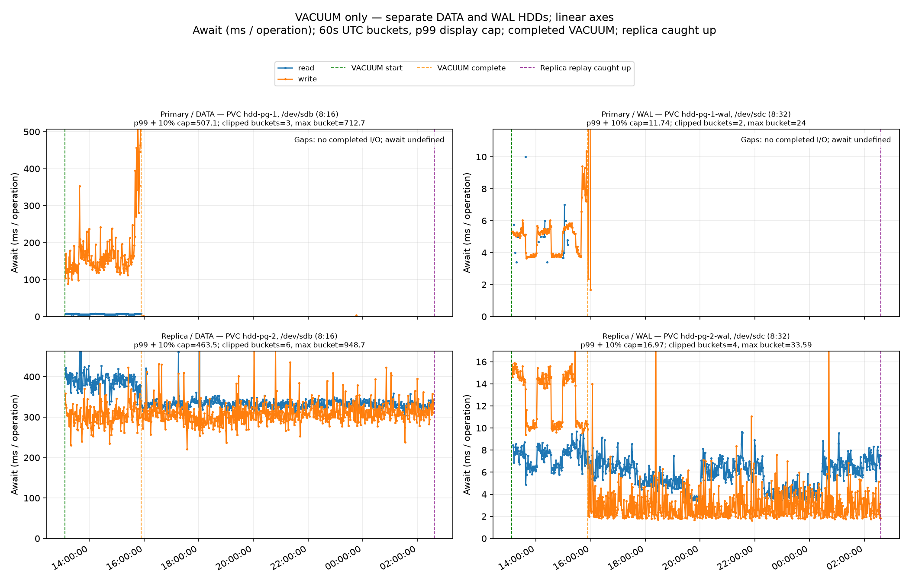
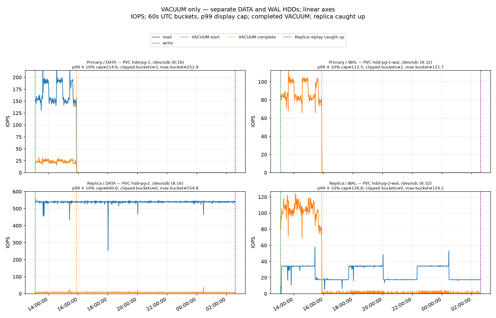
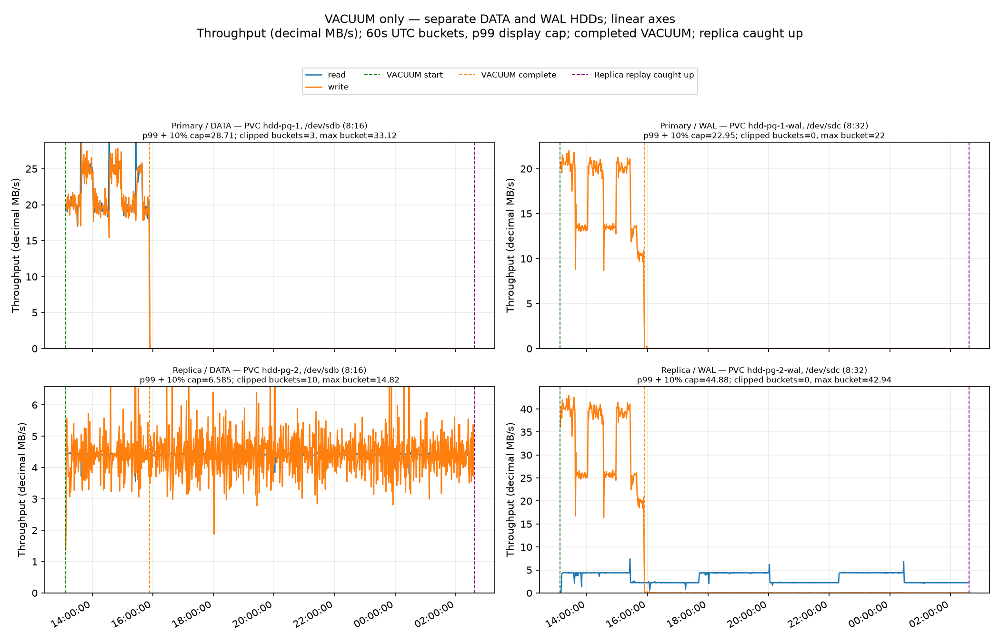

# 100-GiB repro

Primary VACUUM took **2h 46m 54s**. Replica catch-up required **10h 43m 01s more after VACUUM finished**, or **13h 29m 55s from VACUUM start**. Replay overlapped VACUUM; the additional time is the post-VACUUM replay tail, not the entire replay-processing duration.

Estimated total DATA read-operation amplification (replica ÷ primary) was **15.621×**: primary **~1,674,122 reads** (167.173 IOPS × 10,014.33s VACUUM), replica **~26,150,759 reads** (538.138 IOPS × 48,594.90s from VACUUM start through full replica catch-up). The replica interval includes replay while VACUUM was running and the later replay tail.

Run `100gib-20261005T130618Z`, UTC. Primary VACUUM completed in **2.78 h (166.9 min)**. Replica replay tail: **10.72 h (643.0 min)**. Test complete: **True**.

Replica DATA reads during VACUUM averaged **536.99 IOPS / 4.40 MB/s / 389.88 ms await**.

## Configuration

Fresh half-dead heap: 107,374,182,400 bytes (100.000 GiB), estimated 32,768,000 live and 32,768,000 dead tuples. The retained source keeper was restored, the bounded interleaved fixture was rebuilt, and CNPG seeded the replica from paired DATA/WAL snapshots. Both roles ran on separate AKS workers with separate 512-GiB Standard_LRS HDD DATA/WAL disks and host caching disabled.

```sql
VACUUM (VERBOSE, FREEZE) public.vacuum_target;
```

| Setting | Primary | Replica |
|---|---|---|
| wal_level | logical | logical |
| full_page_writes | on | on |
| recovery_prefetch | try | try |
| vacuum_cost_delay | 0 | 0 |
| maintenance_io_concurrency | 10 | 10 |
| maintenance_work_mem | 64MB | 64MB |
| shared_buffers | 256MB | 256MB |
| max_wal_size | 1GB | 1GB |
| checkpoint_timeout | 5min | 5min |
| synchronous_commit | on | on |
| wal_sender_timeout | 5s | 5s |
| wal_receiver_timeout | 5s | 5s |

No application workload was started. Every instrumented PostgreSQL application-session check was recorded with raw samples. Globally enabled autovacuum is disabled only for the fixture table. Explicit FREEZE is the original rebuilt-fixture workload option.

## Cold prepared snapshot

Before VACUUM, CNPG completed offline primary backup `vacuum-cold-e92bdc27` (2026-10-05 12:51:23–12:52:03 UTC). Its retained DATA and WAL snapshots are `snapshot-bf28fdba-ac33-4a6d-82ff-03f66821489f` and `snapshot-90446491-f3b1-4bbe-a527-93ee6066d102` in `rg-vacuum-retained-e92bdc2762775aa5ecbb33bf383e563d`; both are 512-GiB `Standard_ZRS` snapshots with `Retain` policy. Fixture evidence recorded a 100-GiB heap, 32,768,000 live/dead tuple estimates, indexed even-ID bounds, absent adjacent deleted odd IDs, and the required GUC defaults. The offline checkpoint restarted the PostgreSQL postmaster and reset `shared_buffers`; a few small indexed sentinel checks ran between the snapshot and measurement, which is a cache-state confound.

Cold-pair restoration evidence: [cold-snapshot-validation.json](../../evidence/cold-snapshot-validation.json). A separate one-instance CNPG Cluster restored the saved DATA/WAL pair, matched the 100-GiB heap and system identifier, and passed indexed live-even/deleted-adjacent-odd sentinels and the four requested GUC defaults. No Blob credentials, Barman ObjectStore, or external-cluster archive source was present. PostgreSQL reported `archive_mode=on` and CNPG's internal `restore_command` (`/controller/manager wal-restore --log-destination /controller/log/postgres.json %f %p`); those defaults remained, while the retained cold pair restored successfully without an external archive source. The CNPG recovery Job used the pinned system image, and the validation pod was then checked on the measurement image. The validation Cluster and its PVCs were removed; both source snapshots remain ready.

## Timeline

| Event | UTC |
|---|---|
| VACUUM starts | 2026-10-05T13:06:29.794989Z |
| Heap-work completion observed | not observed |
| Primary VACUUM completes | 2026-10-05T15:53:24.121515Z |
| Replica catch-up verified | 2026-10-06T02:36:24.697250138Z |

Remote VACUUM exit: `0`. Replica catch-up: `True`. Completion LSN: `C0/140EA9A0`. Final replica replay / primary flush LSN: `C0/15000000` / `C0/15000000`. Final backlog: `0` bytes. Catch-up requires three consecutive healthy samples through both the exact VACUUM completion LSN and current primary flush LSN.

The primary `pg_stat_wal` counters increased by 160,575,263,332 bytes, 26,397,193 full-page images, and 65,719,441 records between the pre-VACUUM checkpoint baseline and VACUUM completion. These cluster-level counters include background WAL and are not physical disk-write totals; disk I/O is reported from the DATA/WAL device counters below.

## Disk measurements

Each cell is IOPS / decimal MB/s / operation-weighted await in ms.

| Device / operation | Primary VACUUM | Replica replay tail | Whole timeline |
|---|---:|---:|---:|
| Primary Data read | 167.17 / 21.83 / 6.45 | 0.01 / 0.00 / 3.77 | 34.46 / 4.50 / 6.45 |
| Primary Data write | 23.52 / 21.59 / 173.18 | 0.00 / 0.00 / 223.53 | 4.85 / 4.45 / 173.22 |
| Primary Wal read | 0.01 / 0.00 / 4.53 | 0.00 / 0.00 / — | 0.00 / 0.00 / 4.53 |
| Primary Wal write | 88.72 / 16.83 / 4.94 | 0.01 / 0.00 / 6.27 | 18.29 / 3.47 / 4.95 |
| Replica Data read | 536.99 / 4.40 / 389.88 | 538.43 / 4.41 / 333.09 | 538.14 / 4.41 / 344.77 |
| Replica Data write | 8.58 / 4.42 / 305.39 | 8.42 / 4.46 / 312.01 | 8.45 / 4.45 / 310.63 |
| Replica Wal read | 30.71 / 3.91 / 7.47 | 24.38 / 3.12 / 5.31 | 25.68 / 3.28 / 5.84 |
| Replica Wal write | 102.92 / 32.48 / 12.75 | 0.86 / 0.02 / 3.74 | 21.89 / 6.71 / 12.47 |

Replica DATA read IOPS stayed near **537** in both workload windows: 536.99 during VACUUM and 538.43 during the replay tail. Primary DATA reads fell from 167.17 IOPS during VACUUM to 0.007 IOPS during the tail, so the combined-window IOPS ratio is dominated by the near-idle primary denominator and is not a useful amplification headline. Across the complete timeline, replica/primary DATA read bytes were **0.980×**; effective mean DATA read sizes were 127.54 KiB on primary and 8.00 KiB on replica.

## Graphs

All y-axes are linear. Figures contain four primary/replica DATA/WAL panels and separate read/write traces. Sixty-second UTC buckets use operation-weighted await and time-weighted IOPS/throughput. The p99 axis ceiling is a display choice; raw data and reported statistics retain all values, and off-scale buckets are marked. Five-second interval await averages are distinct from individual operation latency.







## Measurement quality

Collected 9,721 samples; maximum gap 6.91 seconds. Counter-window coverage valid: True. The original offline analysis marked two replica DATA read-time intervals invalid because the Linux 32-bit millisecond counter wrapped. A validated modulo-2^32 correction was applied only to those two read-time deltas; operation/sector counters, timestamps, raw samples, and experiment execution were unchanged. The corrected analysis has valid coverage for every window and zero rejected intervals. Raw `samples.jsonl.gz` SHA-256: `acf37b109194529e8c68b66555eaf60aed5404e8e0d71d1b39c7d72a4852875d`. See [correction record](counter-rollover-correction.json), [independent rollover audit](counter-rollover-audit.json), and [preserved original analysis](original-analysis-before-counter-rollover-correction/summary.json) with its original graphs. Guest await is completed block-operation time including queueing; it is not an Azure service-latency metric. Post-VACUUM error: `None`. Continuous PostgreSQL logs and final capture are saved alongside the counters.

## Evidence

- [preflight.json](preflight.json)
- [vacuum.log](vacuum.log)
- [timing.json](timing.json)
- [summary.json](summary.json)
- [events.jsonl](events.jsonl)
- [samples.jsonl.gz](samples.jsonl.gz)
- [monitoring/monitor-summary.json](monitoring/monitor-summary.json)
- [Independent root measurement audit](root-measurement-audit.json)

## Infrastructure and repeat comparison

Azure region: `eastus`. Stack owner token: `e92bdc2762775aa5ecbb33bf383e563d`. This is the **100-GiB size variation**: fixture heap size is the intended changed workload dimension, compared with the 23-GiB unchanged repeat. It uses the same East US region, two `Standard_D2s_v4` workers, PostgreSQL image, disk layout, fixture construction and VACUUM/replay framework, and measured GUC settings. Separate 512-GiB `Standard_LRS` HDD DATA/WAL disks had host caching disabled.

| Metric | Original 23 GiB | 23-GiB unchanged repeat | 100-GiB size variation |
|---|---:|---:|---:|
| VACUUM duration, minutes | 35.14 | 32.37 | 166.91 |
| Replica replay tail, minutes | 149.43 | 152.12 | 643.01 |
| Replica DATA read IOPS during VACUUM | 537.39 | 537.81 | 536.99 |
| Replica DATA read MB/s during VACUUM | 4.40 | 4.41 | 4.40 |
| Replica DATA read await ms during VACUUM | 391.31 | 403.04 | 389.88 |
| Estimated total DATA read-operation amplification | 15.778× | 15.789× | 15.621× |

Stack cleanup completed at 03:14:54 UTC on October 6. All five snapshots remain preserved and locked in the separate retained resource group. A fresh Azure audit confirms the main and node resource groups are absent, with no remaining non-snapshot resources. [Cleanup result](../../cleanup/result.json) · [fresh Azure verification](../../cleanup/root-fresh-azure-audit.json).

[Estimated total DATA read operations and amplification](estimated-data-read-operations.json).
