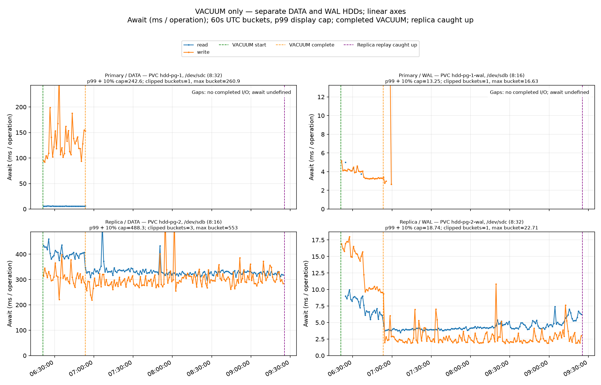
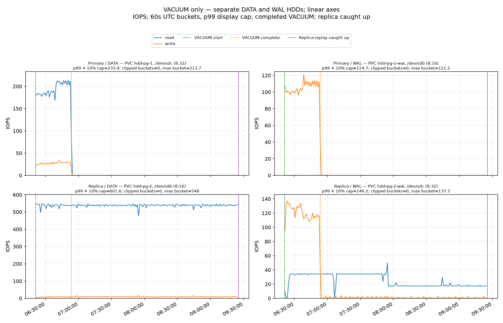
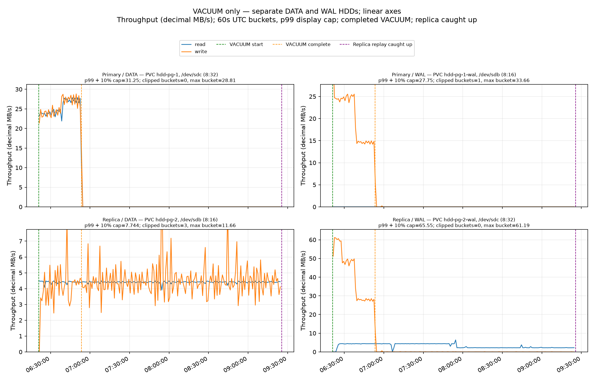

# 23-GiB unchanged repeat

Estimated total DATA read-operation amplification (replica ÷ primary) was **15.789×**: primary **~376,881 reads** (194.067 IOPS × 1,942.02s VACUUM), replica **~5,950,398 reads** (537.554 IOPS × 11,069.39s from VACUUM start through full replica catch-up). The replica interval includes replay while VACUUM was running and the later replay tail.

Primary VACUUM took **32m 22s**. The replica needed a further **2h 32m 07s after VACUUM finished** to replay through the final primary flush; full catch-up took **3h 04m 29s from VACUUM start**. Replica replay ran concurrently with VACUUM, so the additional time is the replay tail rather than the entire replay-processing duration.

Run `20261005T062051Z`, UTC. Primary VACUUM completed in **0.54 h (32.4 min)**. Replica replay tail: **2.54 h (152.1 min)**. Test complete: **True**.

Replica DATA reads during VACUUM averaged **537.81 IOPS / 4.41 MB/s / 403.04 ms await**.

## Configuration

Fresh half-dead heap: 24,696,061,952 bytes (23.000 GiB), estimated 7,536,640 live and 7,536,640 dead tuples. The retained source keeper was restored, the bounded interleaved fixture was rebuilt, and CNPG seeded the replica from paired DATA/WAL snapshots. Both roles ran on separate AKS workers with separate 512-GiB Standard_LRS HDD DATA/WAL disks and host caching disabled.

```sql
VACUUM (VERBOSE, FREEZE) public.vacuum_target;
```

| Setting | Primary | Replica |
|---|---|---|
| wal_level | logical | logical |
| full_page_writes | on | on |
| recovery_prefetch | try | try |
| vacuum_cost_delay | 0 | 0 |
| maintenance_io_concurrency | 10 | 10 |
| maintenance_work_mem | 64MB | 64MB |
| shared_buffers | 256MB | 256MB |
| max_wal_size | 1GB | 1GB |
| checkpoint_timeout | 5min | 5min |
| synchronous_commit | on | on |
| wal_sender_timeout | 5s | 5s |
| wal_receiver_timeout | 5s | 5s |

No application workload was started. Every instrumented PostgreSQL application-session check was recorded with raw samples. Globally enabled autovacuum is disabled only for the fixture table. Explicit FREEZE is the original rebuilt-fixture workload option.

## Timeline

| Event | UTC |
|---|---|
| VACUUM starts | 2026-10-05T06:21:02.062624Z |
| Heap-work completion observed | not observed |
| Primary VACUUM completes | 2026-10-05T06:53:24.079983Z |
| Replica catch-up verified | 2026-10-05T09:25:31.449889982Z |

Remote VACUUM exit: `0`. Replica catch-up: `True`. Completion LSN: `56/F43BA628`. Final replica replay / primary flush LSN: `56/F5000000` / `56/F5000000`. Final backlog: `0` bytes. Catch-up requires three consecutive healthy samples through both the exact VACUUM completion LSN and current primary flush LSN.

## Disk measurements

Each cell is IOPS / decimal MB/s / operation-weighted await in ms.

| Device / operation | Primary VACUUM | Replica replay tail | Whole timeline |
|---|---:|---:|---:|
| Primary Data read | 194.07 / 25.34 / 5.69 | 0.02 / 0.00 / 3.27 | 34.06 / 4.45 / 5.69 |
| Primary Data write | 27.53 / 25.57 / 131.81 | 0.02 / 0.01 / 233.00 | 4.84 / 4.50 / 132.10 |
| Primary Wal read | 0.01 / 0.00 / 4.20 | 0.00 / 0.00 / — | 0.00 / 0.00 / 4.20 |
| Primary Wal write | 105.59 / 20.23 / 3.75 | 0.02 / 0.00 / 4.40 | 18.54 / 3.55 / 3.75 |
| Replica Data read | 537.81 / 4.41 / 403.04 | 537.50 / 4.40 / 329.78 | 537.55 / 4.40 / 342.64 |
| Replica Data write | 7.74 / 4.09 / 309.73 | 8.86 / 4.56 / 305.47 | 8.66 / 4.48 / 306.14 |
| Replica Wal read | 30.67 / 3.89 / 7.63 | 24.03 / 3.08 / 4.29 | 25.20 / 3.22 / 5.00 |
| Replica Wal write | 120.27 / 41.06 / 13.34 | 0.76 / 0.02 / 2.99 | 21.73 / 7.22 / 13.04 |

Across the complete timeline, the replica/primary DATA read-byte ratio is **0.990×**. Effective mean DATA read sizes are 127.50 KiB on primary and 8.00 KiB on replica. These derive from valid counter-window totals; request size and the observation window affect IOPS ratios.

## Graphs

All y-axes are linear. Figures contain four primary/replica DATA/WAL panels and separate read/write traces. Sixty-second UTC buckets use operation-weighted await and time-weighted IOPS/throughput. The p99 axis ceiling is a display choice; raw data and reported statistics retain all values, and off-scale buckets are marked. Five-second interval await averages are distinct from individual operation latency.







## Measurement quality

Collected 2,216 samples; maximum gap 6.20 seconds. Counter-window coverage valid: True. Guest await is completed block-operation time including queueing; it is not an Azure service-latency metric. Post-VACUUM error: `None`. Continuous PostgreSQL logs and final capture are saved alongside the counters.

## Evidence

- [preflight.json](results/20261005T062051Z/preflight.json)
- [vacuum.log](results/20261005T062051Z/vacuum.log)
- [timing.json](results/20261005T062051Z/timing.json)
- [summary.json](results/20261005T062051Z/summary.json)
- [events.jsonl](results/20261005T062051Z/events.jsonl)
- [samples.jsonl.gz](results/20261005T062051Z/samples.jsonl.gz)
- [monitoring/monitor-summary.json](results/20261005T062051Z/monitoring/monitor-summary.json)
- [Independent raw-data audit](root-audit.json)
- [Framework hashes saved before launch](../framework-sha256.json)

## Infrastructure and repeat comparison

Azure region: `eastus`. Stack owner token: `0aaf271768f70a4fd06a9cb05e75a4ea`. This baseline uses the same East US region, worker SKU, fixture size, and unmodified experiment scripts as the original run.

| Metric | Original 23 GiB | Unchanged repeat |
|---|---:|---:|
| VACUUM duration, minutes | 35.14 | 32.37 |
| Replica replay tail, minutes | 149.43 | 152.12 |
| Replica DATA read IOPS during VACUUM | 537.39 | 537.81 |
| Replica DATA read MB/s during VACUUM | 4.40 | 4.41 |
| Replica DATA read await ms during VACUUM | 391.31 | 403.04 |
| Estimated total DATA read-operation amplification | 15.778× | 15.789× |

Cleanup preserves all snapshots. The separately recorded cleanup result identifies any stopped AKS control plane whose incremental snapshots prevent deletion of its node resource group.

## Resource cleanup

Cleanup completed at 09:30 UTC with all three snapshots preserved and protected. A fresh Azure inventory confirms that workers, managed disks, temporary Blob storage and networking are gone. The owned AKS control plane is stopped and remains because its node resource group contains protected incremental snapshots; Azure cannot move those snapshots, and deleting AKS would delete that group. The control plane and snapshot-containing groups are the reported residual resources. See the [cleanup result](cleanup/result.json) and [retained snapshot inventory](cleanup/snapshots-after.json). Shared Network Watcher cleanup is deferred until all four experiment stacks finish.

[Estimated total DATA read operations and amplification](results/20261005T062051Z/estimated-data-read-operations.json).
