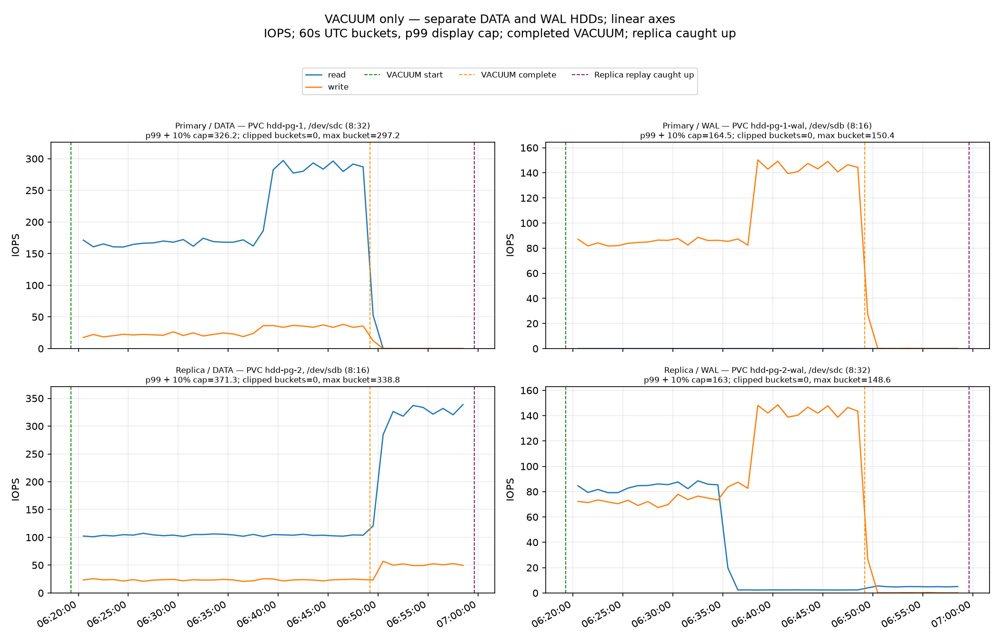
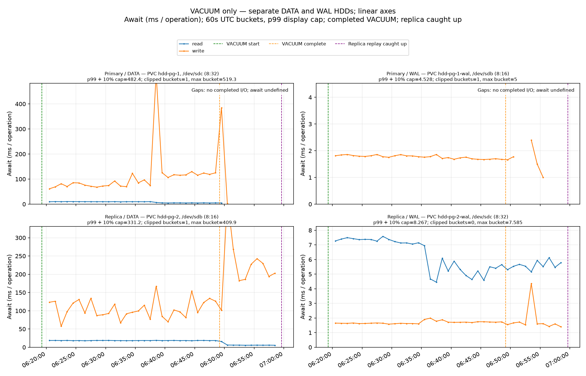
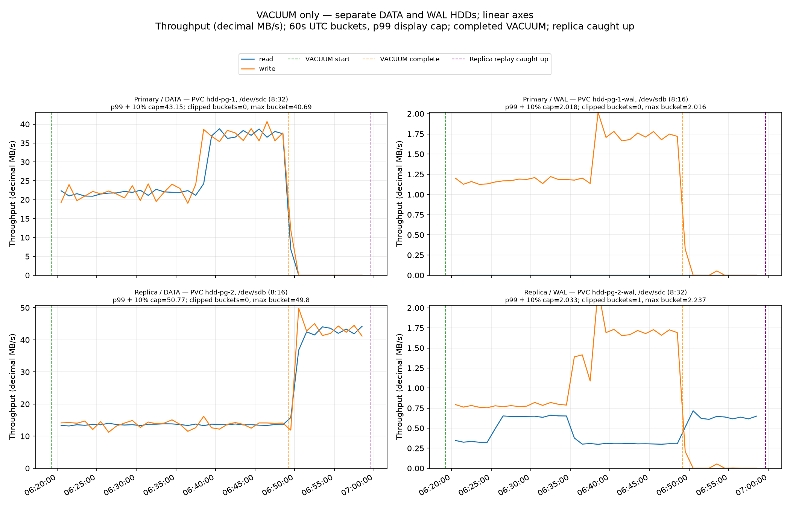

# 23-GiB VACUUM with primary `full_page_writes=off` and standby `recovery_prefetch=off`

Estimated total DATA read-operation amplification (standby ÷ primary) was **1.002896×**: the primary recorded an estimated **373,886 reads** (208.270 IOPS × 1,795.196s of VACUUM), while the standby recorded **374,969 reads** (154.762 IOPS × 2,422.880s from VACUUM start through full replay catch-up). The standby interval includes replay while VACUUM ran and the later replay tail.

VACUUM took **29.92 minutes**. Catch-up followed **10.46 additional minutes after VACUUM completed**; total elapsed time from VACUUM start through verified catch-up was **40.38 minutes**. Replay overlapped the VACUUM, so the tail is only the additional post-VACUUM time.

## Result

`VACUUM (VERBOSE, FREEZE) public.vacuum_target;` completed with remote exit code 0. Three consecutive healthy samples reached and held the current primary flush LSN, with zero observed replica lag at the end. The 23-GiB heap was restored from the preserved prepared DATA/WAL snapshot pair; no application sessions were present. This run used West US 3 `Standard_D2s_v4` nodes and separate primary/standby DATA and WAL disks.

During the VACUUM window, primary DATA read IOPS averaged **208.270** and standby DATA averaged **104.153**. Across the full primary-VACUUM-to-standby-catch-up duration, the estimated operation counts were nearly equal (**1.002896×** standby/primary). The directly measured whole-window DATA read bytes were 48.841 GB on the primary and 48.937 GB on the standby; that byte measure uses the full timeline on both devices and is reported separately from the requested estimated-operation formula.

The run held standby `recovery_prefetch=off` and changed primary `full_page_writes` to `off`; `full_page_writes` stayed `on` on the standby. Compared with the earlier West US 3 prefetch-off-only run, this run observed far more standby DATA reads. That is an observational comparison between separate stacks, not proof that the primary setting alone caused the difference. Both runs share the same region, VM size, prepared source pair and fixture layout, but cache residency and other run-to-run effects were not controlled.

With primary `full_page_writes=off`, `pg_stat_wal` reported a **0** FPI-counter delta during VACUUM (counter remained 2 before and after), alongside **879,363,200 WAL bytes** and **15,115,315 WAL records** between the command markers. `wal_log_hints` remained `on` and the data checksum version was 0. These counters describe this run's WAL generation; they do not measure physical disk writes or isolate a general mechanism.

## Timing, coverage, and effective GUCs

VACUUM ran from `2026-10-06T06:19:15.770198Z` to `2026-10-06T06:49:10.965711Z`. Catch-up was verified at `2026-10-06T06:59:38.649981943Z`. The collector recorded **487 samples** at a nominal five-second interval; the maximum sample gap was **7.209s** against a 12.5-second limit. An independent recount of all **72 device/window read/write metrics** from the raw counters passed; device identities stayed stable, no counter reset was detected, there were zero application sessions, and the final three samples reached the then-current primary flush LSN.

| GUC | Primary | Standby | Restart pending |
|---|---|---|---|
| `wal_level` | `logical` | `logical` | no |
| `full_page_writes` | `off` (local `postgresql.auto.conf`) | `on` (local `postgresql.auto.conf`, default value preserved) | no |
| `recovery_prefetch` | `try` (default) | `off` (local `postgresql.auto.conf`) | no |
| `vacuum_cost_delay` | `0` (default) | `0` (default) | no |
| `wal_log_hints` | `on` | `on` | no |
| data checksum version | `0` | `0` | — |

The pinned user-applied CNPG configuration omitted both treatment settings. CNPG's live Cluster spec showed its generated/default `full_page_writes=on`; the role-local effective values and their source files were read before and after measurement, with no pending restart. No shared `recovery_prefetch` override was present. `pg_stat_recovery_prefetch` was available and its listed cumulative-counter deltas were zero during the observation interval.

Counter coverage was valid in all three windows with no rejected intervals. For VACUUM, all four role/device series had 100% valid coverage. During replay drain, the minimum coverage was 99.99988% for standby DATA/WAL; across the full interval it was 99.99997% for standby DATA/WAL.

## Per-device measurements

These are guest block-device counters. Await values are operation-weighted milliseconds per completed operation; throughput uses decimal MB/s. `—` means the window had no completed read operation for that series.

### VACUUM (1795.196s)

| Device | Read IOPS | Read await (ms/op) | Read MB/s | Write IOPS | Write await (ms/op) | Write MB/s |
|---|---:|---:|---:|---:|---:|---:|
| Primary DATA | 208.270 | 7.47 | 27.195156 | 26.819 | 117.73 | 27.525279 |
| Primary WAL | 0.000557042 | 5.00 | 2.28165e-06 | 107.359 | 1.76 | 1.386654 |
| Standby DATA | 104.153 | 18.40 | 13.598866 | 22.986 | 104.21 | 13.344563 |
| Standby WAL | 45.808 | 7.26 | 0.422594 | 100.332 | 1.71 | 1.189321 |

### Replay drain (627.684s after VACUUM)

| Device | Read IOPS | Read await (ms/op) | Read MB/s | Write IOPS | Write await (ms/op) | Write MB/s |
|---|---:|---:|---:|---:|---:|---:|
| Primary DATA | 0.246 | 2.93 | 0.032190 | 0.555 | 670.45 | 0.520379 |
| Primary WAL | 0 | — | 0 | 0.200 | 1.67 | 0.007400 |
| Standby DATA | 299.503 | 6.13 | 39.071591 | 48.668 | 230.95 | 40.600635 |
| Standby WAL | 4.811 | 5.60 | 0.615822 | 0.270 | 1.81 | 0.006994 |

### VACUUM start through catch-up (2422.880s)

| Device | Read IOPS | Read await (ms/op) | Read MB/s | Write IOPS | Write await (ms/op) | Write MB/s |
|---|---:|---:|---:|---:|---:|---:|
| Primary DATA | 154.378 | 7.47 | 20.158172 | 20.015 | 121.70 | 20.529244 |
| Primary WAL | 0.000412732 | 5.00 | 1.69055e-06 | 79.598 | 1.76 | 1.029337 |
| Standby DATA | 154.762 | 12.25 | 20.197962 | 29.639 | 158.12 | 20.405661 |
| Standby WAL | 35.187 | 7.20 | 0.472653 | 74.409 | 1.71 | 0.883021 |

The DATA/WAL device mapping was separate and stable: primary DATA `/dev/sdc` (`8:32`, LUN 0), primary WAL `/dev/sdb` (`8:16`, LUN 1); standby DATA `/dev/sdb` (`8:16`, LUN 1), standby WAL `/dev/sdc` (`8:32`, LUN 0). The per-role mappings belong to distinct VM nodes. The whole-window metrics above combine observed replay overlap with the primary VACUUM and the post-VACUUM tail; idle primary tail activity is included in the explicitly requested whole-window replica/primary estimate only as designed by its formula.

## Logs, artifacts, and graphs

Retained PostgreSQL container logs were captured at completion using the collector's `kubectl logs --since-time=<VACUUM start>` path; there was no independent continuous follower. The capture contains 12 primary and 19 standby log lines, and its parser found 0 WAL sender/receiver disconnect or timeout events. The independent audit explicitly does not treat this as proof that no earlier lines were rotated or lost.

- [Machine-readable summary](summary.json), [timing](timing.json), [estimated total DATA read operations](estimated-data-read-operations.json), [raw samples](samples.jsonl.gz)
- [Independent raw-counter audit](root-independent-counter-audit.json), [measurement completion audit](measurement-completion-audit.json), [completion-time log-capture audit](root-completion-log-capture-audit.json), [log-capture manifest](monitoring/monitor-summary.json)
- [Preflight](preflight.json), [postflight](postflight.json), [recovery-prefetch stats](recovery-prefetch-stats.json), [VACUUM log](vacuum.log)
- [Preparation/source-pair proof](../../evidence/source-pair-restore-proof.json), [preparation recovery audit](../../evidence/prepare-recovery-audit.json), [measurement launch receipt](../../evidence/measurement-launch.json)

All y-axes are linear. The figures show read and write measurements for primary/standby DATA/WAL devices.

## Cleanup and snapshot retention

Cleanup completed at **2026-10-06 07:09:35 UTC**. The owner-scoped cleanup removed the main and node resource groups and left no non-snapshot resources; a fresh Azure audit confirmed only retained snapshot resources remain. Both snapshots created for this stack are preserved and deletion-locked. The reused source DATA/WAL snapshot pair is also unchanged and locked, with the exact source grants absent. See the [cleanup result](../../cleanup/result.json), [fresh Azure snapshot/lock audit](../../cleanup/root-fresh-azure-audit.json), [retained snapshot inventory](../../cleanup/snapshots-after.json), and [source-pair preservation audit](../../evidence/root-source-pair-grant-lock-fresh-audit.json).
