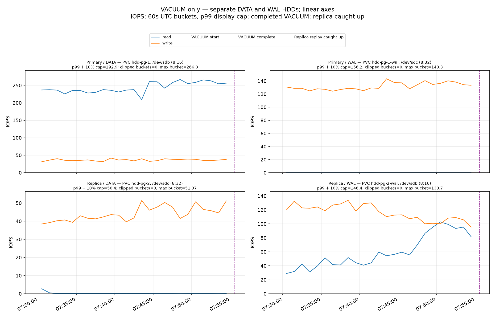
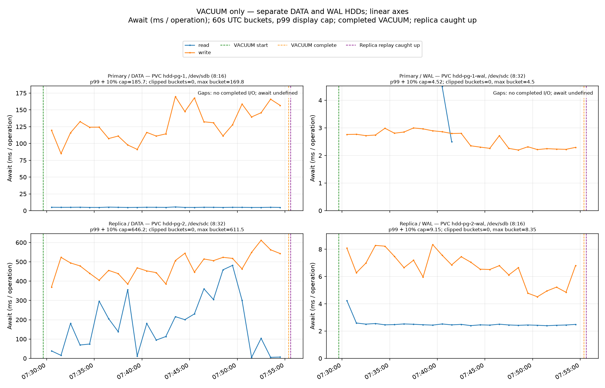
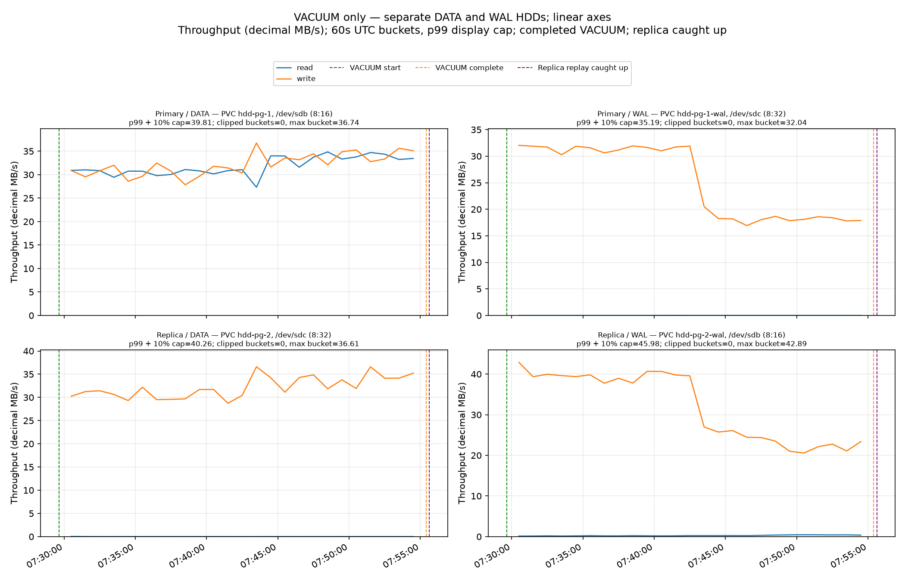

# 23-GiB VACUUM with standby `recovery_prefetch=off`

Estimated total DATA read-operation amplification (replica ÷ primary) was **0.000892×**: primary **~376,772 reads** (243.812 IOPS × 1,545.34s VACUUM), replica **~336 reads** (0.216 IOPS × 1,558.17s from VACUUM start through full replica catch-up). The replica interval includes replay while VACUUM was running and the later replay tail.

Primary VACUUM took **25m 45s**. The replica needed a further **12.8s after VACUUM finished** to replay through the final primary flush; full catch-up took **25m 58s from VACUUM start**. Replica replay ran concurrently with VACUUM, so the additional time is the replay tail rather than the entire replay-processing duration.

## Result

The 23-GiB `VACUUM (VERBOSE, FREEZE)` finished successfully and the replica caught up to the completion LSN. During the VACUUM window, standby DATA read IOPS were **0.217** versus **243.812** on the primary, a replica/primary ratio of **0.000892×**. Across VACUUM plus replay catch-up, measured DATA reads were about **14.4 MB** on the standby and **49.2 GB** on the primary. Counter coverage rounded to 100% for all four DATA/WAL devices in every window; the minimum was 99.9942% for replica counters during replay drain, with no rejected intervals.

An independent recount of the raw counters confirms the standby read count and disk identity. Across the full sample capture, `hdd-pg-2` DATA rose from **4,721 to 5,060 completed reads** (339 reads, 14.475 MB); prorating sample intervals to the exact VACUUM-start-to-catch-up window gives **335.986 reads** (14.434 MB), versus **376,771.915 reads** on primary DATA during VACUUM, or **0.000892×**. The DATA PVC stayed mounted at `/var/lib/postgresql/data` on LUN 0 (`/dev/sdc`, `8:32`); its separate WAL PVC was mounted at `/var/lib/postgresql/wal` on LUN 1 (`/dev/sdb`, `8:16`) and recorded 93,734 raw reads across capture. Device identities were stable and no counters reset. These are completed guest block-device I/Os, not logical PostgreSQL page-read calls; guest cache residency was not measured or cleared. See the [independent raw-counter recount](independent-prefetch-read-count-audit.json) and [root read-count recheck](root-prefetch-read-count-recheck.json).

The primary used the default `recovery_prefetch=try`. The standby used `recovery_prefetch=off`, sourced from its local `postgresql.auto.conf`; `pending_restart=false`. The CNPG Cluster had no shared `recovery_prefetch` override, and both role settings were verified again after measurement. `pg_stat_recovery_prefetch` was available on both instances; all listed cumulative-counter deltas were zero over the measured interval.

## Measurements

| DATA read metric | Prefetch off, West US 3 | Original default-prefetch run, East US |
|---|---:|---:|
| VACUUM-window primary read IOPS | 243.812 | 178.768 |
| VACUUM-window standby read IOPS | 0.217 | 537.391 |
| Standby/primary VACUUM-window read IOPS ratio | 0.000892× | 3.006× |
| VACUUM-window standby read throughput | 0.00934 MB/s | 4.404 MB/s |
| VACUUM-window standby DATA write await | 482.8 ms | 303.7 ms |
| VACUUM + replay primary DATA read IOPS | 241.890 | 34.067 |
| VACUUM + replay standby DATA read IOPS | 0.216 | 537.054 |
| Estimated total DATA read-operation amplification (primary VACUUM vs full replica replay) | 0.000892× | 15.778× |
| Estimated DATA reads, primary / standby | 49.216 GB / 14.4 MB | 49.267 GB / 48.734 GB |
| Effective bytes per DATA read, primary / standby | 130,580 B / 42,961 B | 130,589 B / 8,194 B |

The comparison with the original run is observational: this prefetch-off stack ran in West US 3 on `Standard_D2s_v4`, because East US capacity/quota was unavailable. The original ran in East US. Region is therefore a confounding difference; the result does not isolate recovery prefetch as a causal effect. A repeated East US baseline is being tracked separately by the parent experiment.

The standby completed only about **336 DATA read operations** during the 25.8-minute VACUUM window. Its 92.0-ms operation-weighted read await and 1.26-s maximum sampled interval therefore describe sparse incidental reads, not a sustained replay-read stream. DATA write await remained high at **482.8 ms** while the replica still caught up. The graph and summary preserve these measurements without inferring why the read requests changed.

## PostgreSQL settings and measurement windows

The measured cluster had two PostgreSQL 16.15 instances on separate nodes, four distinct 512-GiB Standard_LRS DATA/WAL disks, and a 23-GiB heap fixture. The collector observed **314 samples** at a nominal 5-second cadence; the maximum interval was **5.680s** (allowed maximum 12.5s). All four device-counter series had valid coverage and no rejected intervals in each reported window.

VACUUM ran from `2026-10-05T07:29:38.716537Z` to `2026-10-05T07:55:24.056614Z` (**25m 45.340s**). Three consecutive healthy samples confirmed catch-up at `2026-10-05T07:55:36.885110617Z`, **0m 12.828s** after the VACUUM completion marker; the recorded replay-drain sampling window was 12.828s. Total VACUUM-to-catch-up observation time was **25m 58.169s**. Window coverage was 1545.340s for VACUUM, 12.828s for replay drain, and 1558.169s for VACUUM plus replay.

| GUC | Primary value / source | Standby value / source | Restart pending |
|---|---|---|---|
| `wal_level` | `logical` / configuration file (custom.conf) | `logical` / configuration file (custom.conf) | no |
| `full_page_writes` | `on` / configuration file (custom.conf) | `on` / configuration file (custom.conf) | no |
| `recovery_prefetch` | `try` / default | `off` / configuration file (postgresql.auto.conf) | no |
| `vacuum_cost_delay` | `0` / default | `0` / default | no |

`wal_level=logical` and `full_page_writes=on` came from CNPG's generated configuration; `vacuum_cost_delay=0` was the PostgreSQL default. `recovery_prefetch=try` remained the primary default, while `off` was the experiment-only standby setting in its local `postgresql.auto.conf`. No restart was pending on either role.

The tables report time-weighted device IOPS/throughput and operation-weighted await. `—` means no completed operations were observed for that direction in the window.

### VACUUM command

| Device | Read IOPS | Read await (ms/op) | Read MB/s | Write IOPS | Write await (ms/op) | Write MB/s |
|---|---:|---:|---:|---:|---:|---:|
| primary / data | 243.812 | 4.96 | 31.8370 | 36.019 | 128.89 | 32.0777 |
| primary / wal | 0.00388 | 3.17 | 0.00042 | 131.961 | 2.60 | 25.2162 |
| replica / data | 0.217 | 92.00 | 0.00934 | 43.691 | 482.78 | 31.9142 |
| replica / wal | 60.604 | 2.55 | 0.2736 | 114.758 | 6.72 | 31.8413 |

### Replay drain

| Device | Read IOPS | Read await (ms/op) | Read MB/s | Write IOPS | Write await (ms/op) | Write MB/s |
|---|---:|---:|---:|---:|---:|---:|
| primary / data | 10.355 | 3.45 | 1.3523 | 15.130 | 498.18 | 15.0819 |
| primary / wal | 0.000 | — | 0.0000 | 10.122 | 2.05 | 0.8179 |
| replica / data | 0.000 | — | 0.0000 | 20.585 | 316.34 | 16.6042 |
| replica / wal | 3.253 | 2.45 | 0.0143 | 4.793 | 6.60 | 1.0784 |

### VACUUM + replay

| Device | Read IOPS | Read await (ms/op) | Read MB/s | Write IOPS | Write await (ms/op) | Write MB/s |
|---|---:|---:|---:|---:|---:|---:|
| primary / data | 241.890 | 4.96 | 31.5860 | 35.848 | 130.17 | 31.9378 |
| primary / wal | 0.00385 | 3.17 | 0.00041 | 130.958 | 2.60 | 25.0153 |
| replica / data | 0.216 | 92.00 | 0.00926 | 43.501 | 482.13 | 31.7882 |
| replica / wal | 60.132 | 2.55 | 0.2715 | 113.852 | 6.72 | 31.5880 |
## WAL deltas

VACUUM start/completion markers showed **36,932,318,738 WAL bytes**, **15,115,437 records**, and **6,071,356 full-page images**. The cluster `pg_stat_wal` delta from immediately before the VACUUM command reported the same deltas; it includes background WAL and is not a measurement of physical DATA/WAL disk writes. WAL disk reads and writes are reported separately in the device tables above.

For PostgreSQL 16.15 source-level context on recovery prefetch and full-page images, including limits on what these observations establish, see [recovery-prefetch-context.md](recovery-prefetch-context.md).

## Run evidence

- Measurement interval: `2026-10-05T07:29:38.716537Z` to `2026-10-05T07:55:36.885110617Z`; VACUUM completed at `07:55:24.056614Z` and replica catch-up was observed with three consecutive qualifying samples.
- Workload: no application clients; separate 512-GiB Standard_LRS DATA and WAL disks on primary and replica; 23-GiB heap fixture.
- The project Python environment was used to regenerate only the report and graphs after the controller's system-Python renderer lacked `matplotlib`. Original failed controller state/timing and follower summary remain preserved alongside the recovered artifacts; no workload was rerun.
- Machine-readable measurements and validation evidence: [summary.json](summary.json), [preflight.json](preflight.json), [postflight.json](postflight.json), [timing.json](timing.json), [recovery-prefetch-stats.json](recovery-prefetch-stats.json), [artifact-recovery.json](artifact-recovery.json), [preparation-recovery-audit.json](../../evidence/preparation-recovery-audit.json).

## Graphs

All y-axes are linear. Each graph shows read and write measurements for primary/replica DATA and WAL devices.

## Resource cleanup

Teardown completed at 08:10 UTC. All five stack snapshots were preserved and protected against deletion. A fresh Azure inventory contains only those snapshots in this stack's main and retention groups; its AKS cluster, workers, managed disks, temporary Blob account and node resource group are gone. The shared West US 3 Network Watcher remains in use by the read-pressure stack and is scheduled for removal after all experiments finish. See the [cleanup result](../../cleanup/result.json) and [retained snapshot inventory](../../cleanup/snapshots-after.json).

Independent [raw-counter audit](root-audit.json) matched all device/window metrics, verified successful VACUUM and three final caught-up samples, and checked WAL/FPI comparability.

[Estimated total DATA read operations and amplification](estimated-data-read-operations.json).
