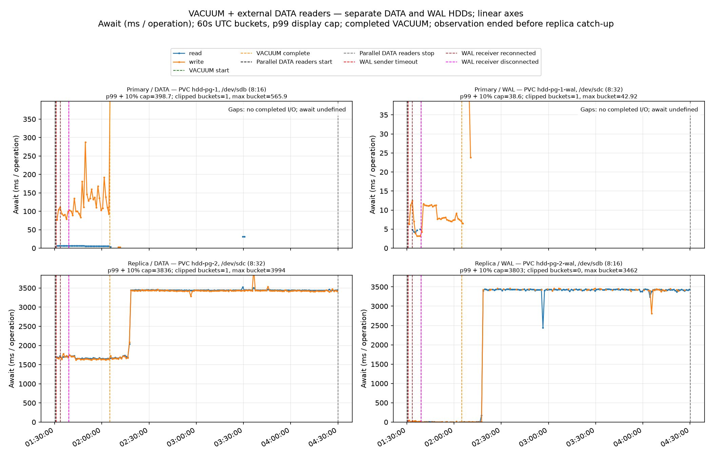
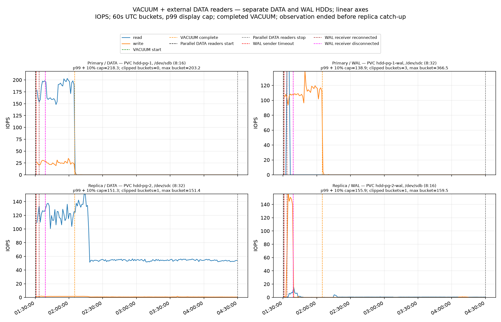
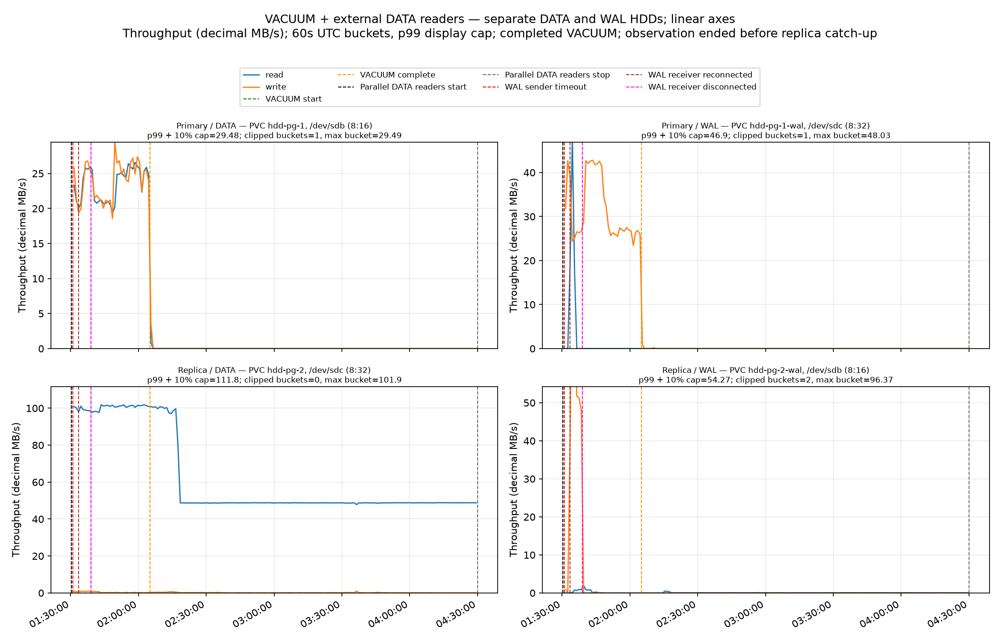

# Read-pressure experiment 2 — three-hour partial observation

**Status: the user-directed three-hour stop ended this experiment before replica catch-up.** Primary `VACUUM (VERBOSE, FREEZE)` completed in **34 min 40.019 s**. Replay continued for **2 h 24 min 58.6 s** after VACUUM completion but did not reach the VACUUM completion LSN. Total observed time from VACUUM start was **2 h 59 min 38.6 s**. VACUUM and replay overlap, so the post-VACUUM tail is not the full duration of replay processing.

The operation-weighted guest replica DATA read-await over this partial interval was **2,651.9 ms**. The report also counts intervals above a 1.5-second analysis threshold. During observed replay, at-least-1.5-s device read-await was sustained for **8,697.7 s** over 1740 intervals. 2 individual valid intervals exceeded 4 s. This device metric includes PostgreSQL/replay and the five external O_DIRECT readers, so it is not replay-only latency.

Primary DATA completed reads during VACUUM are estimated at **374,600 operations** (180.09 average IOPS × 2,080.0 elapsed seconds). Replica DATA reads through the last sample are estimated at **785,111 operations** (72.84 average IOPS × 10,778.6 elapsed seconds), giving a **partial observed total-operation ratio of 2.10×**. Replica operations include the external readers and stop before catch-up; this is not completed-replay amplification. The same-window average-rate ratio was 0.669× (replica 120.57 vs primary 180.09 IOPS), and that replica count also includes the external readers.

## Setup and treatment

The stack used the prepared 23-GiB heap (24696061952 bytes) in West US 3 on two `Standard_D2s_v4` workers. PostgreSQL 16.15 used separate 512-GiB `Standard_LRS` DATA and WAL disks with host caching disabled. The prepared source snapshot was `/subscriptions/${AZURE_SUBSCRIPTION_ID}/resourceGroups/rg-az-hdd-repro-snapshot-keeper/providers/Microsoft.Compute/snapshots/azhr-keep-scsi-prepared-7a297601434285b1`. A completed paired CNPG snapshot backup seeded the standby from fresh retained DATA/WAL snapshots `/subscriptions/${AZURE_SUBSCRIPTION_ID}/resourceGroups/rg-vacuum-snapshots-16244c2c1353a0fc1b108ec455fd70c8/providers/Microsoft.Compute/snapshots/snapshot-4d712e3d-bc99-42ab-8874-3bc99089aa5a` and `/subscriptions/${AZURE_SUBSCRIPTION_ID}/resourceGroups/rg-vacuum-snapshots-16244c2c1353a0fc1b108ec455fd70c8/providers/Microsoft.Compute/snapshots/snapshot-d370b592-1c96-438d-a161-4a6557e656ae`.

The only database workload was `VACUUM (VERBOSE, FREEZE) public.vacuum_target;`. Relevant settings retained framework defaults: `wal_level=logical`, `full_page_writes=on`, `recovery_prefetch=try`, `vacuum_cost_delay=0`, and `synchronous_commit=on`; collected samples recorded zero application sessions. Five reader processes on the standby worker issued 1-MiB O_DIRECT random reads at depth 32 through a read-only mount of a token-owned 4-GiB auxiliary directory outside PGDATA, on the standby DATA filesystem. The files were generated from `/dev/urandom`, not copied from a relation and never used as database data.

Only standby DATA (`sdc`, `8:32`, LUN 0, PV `pvc-89d9e769-5b8e-40b2-a2a3-9af8172f18a7`) used `mq-deadline`, `nr_requests=1024`, and `async_depth=512`. Device/SCSI depth remained 316; `max_sectors_kb=1280` and `max_hw_sectors_kb=2048`. Standby WAL (`sdb`, `8:16`, LUN 1) was not tuned. Queue treatment is evidenced for every raw replica sample. All five workers exited with zero errors and positive reads. Cleanup restored async depth 256 under mq-deadline, then DATA defaults `none`/316; final readback passed and reader pod/ConfigMap were absent.

The generated files were followed by a 302-second no-reader cooldown. `dropCaches=false`; cooldown does not prove page-cache eviction. O_DIRECT bypassed page cache for reader I/O, but preparation/cache history remains a caveat.

## Five-reader latency calibration

Before the fresh full run, a separate 91.11-second calibration ran during actual replay tail with five 1-MiB O_DIRECT readers at depth 32 on the same DATA device. The operation-weighted guest DATA await was **1,675.9 ms** across 15 intervals; all 15 were at least 1,500 ms and none reached 2,000 ms. The device recorded 120.05 read IOPS and 100.67 MB/s while replay advanced 34.55 MB and backlog remained positive at both ends. All five workers exited cleanly. These are aggregate DATA-device counters including the external reads, not replay-only latency. Reader completion latency averaged 1,667.8 ms and is a separate metric. Calibration used the selected DATA-only `mq-deadline`, `nr_requests=1024`, `async_depth=512` treatment; cleanup restored async depth 256 under the scheduler and then `none`/316 defaults. See the [selected method](../../evidence/selected-read-pressure-method.json), [independent raw audit](../../evidence/calibration/root-calibration-audit.json), [peer audit](../../evidence/calibration/peer-audit.json), and [calibration queue readback](../../evidence/calibration/queue-final-readback.json). This bounded calibration is separate from the three-hour measurement above.

## Disk measurements

Cells report **read IOPS / read MB/s / read await ms; write IOPS / write MB/s / write await ms**. Await is operation-weighted.

| Window | Role/device | Read IOPS | Read MB/s | Read await ms | Write IOPS | Write MB/s | Write await ms |
|---|---|---:|---:|---:|---:|---:|---:|
| VACUUM | Primary DATA | 180.09 | 23.51 | 5.95 | 25.38 | 23.82 | 121.10 |
| VACUUM | Primary WAL | 18.62 | 2.44 | 4.39 | 110.62 | 31.53 | 8.08 |
| VACUUM | Replica DATA | 120.57 | 100.43 | 1,687.66 | 1.47 | 0.40 | 1,668.60 |
| VACUUM | Replica WAL | 2.51 | 0.24 | 5.84 | 24.09 | 11.44 | 20.71 |
| Observed replay tail | Primary DATA | 0.02 | 0.00 | 3.86 | 0.03 | 0.02 | 540.47 |
| Observed replay tail | Primary WAL | 0.00 | 0.00 | — | 0.02 | 0.00 | 8.80 |
| Observed replay tail | Replica DATA | 61.43 | 53.19 | 3,104.39 | 0.71 | 0.15 | 3,114.26 |
| Observed replay tail | Replica WAL | 0.55 | 0.07 | 2,993.33 | 0.06 | 0.00 | 3,011.10 |
| Whole partial observation | Primary DATA | 34.77 | 4.54 | 5.95 | 4.92 | 4.62 | 122.97 |
| Whole partial observation | Primary WAL | 3.59 | 0.47 | 4.39 | 21.36 | 6.09 | 8.08 |
| Whole partial observation | Replica DATA | 72.84 | 62.30 | 2,651.85 | 0.85 | 0.20 | 2,635.31 |
| Whole partial observation | Replica WAL | 0.93 | 0.10 | 1,433.30 | 4.69 | 2.21 | 49.03 |

Whole-observation replica DATA await averaged 2,651.853 ms; the post-VACUUM observed tail averaged 3,104.394 ms. Caller-side reader completion latency averaged 2,701.8 ms over 638,674 operations, a separate metric. Linux block counters report guest completed-I/O time including guest-visible queue wait, not Azure service-side latency.

## Replay progress and early stop

Replay advanced from `4E/57000000` to `4E/E7D88508` by the last sample. VACUUM target was `56/FA3B98F8`; primary flush at stop was `56/FB000000`. Replay advanced **2,430,108,936 WAL address bytes**, with **34,668,221,424 bytes (32.287 GiB)** remaining to the target. This is a WAL LSN address-byte span, not a fraction of WAL records or database pages; 6.550% of that address-byte span was traversed.

The user-requested SIGINT was sent to verified controller PID 978222 at **2026-10-06T04:30:00.114632+00:00**, exactly three hours after launch. Its `finally` path stopped readers and restored the queue; then `KeyboardInterrupt` propagated, leaving the original controller test state failed with “controller exited before terminal test state.” That incomplete state is preserved rather than represented as success. VACUUM exited 0; no PostgreSQL process was signalled.

Rate-conditioned estimates from recent replay windows (projections, not observed completion times):

| Recent window | Rate (WAL address bytes/s) | Additional time at same rate | Total from VACUUM start |
|---|---:|---:|---:|
| 5 min | 62,453 | 154.2 h | 157.2 h |
| 15 min | 61,452 | 156.7 h | 159.7 h |
| 30 min | 63,757 | 151.0 h | 154.0 h |
| 60 min | 67,770 | 142.1 h | 145.1 h |

Assumes unchanged recent rate through remaining WAL. Rate can vary with WAL records, disk behavior, restartpoints and reconnect; these are projections, not measured finish times.

## Replication connection events

| UTC | Role | Event | Log message |
|---|---|---|---|
| 2026-10-06T01:30:59.633759839Z | primary | sender_timeout | terminating walsender process due to replication timeout |
| 2026-10-06T01:33:33.513672782Z | replica | receiver_connected | started streaming WAL from primary at 4E/8A000000 on timeline 1 |
| 2026-10-06T01:38:59.30177602Z | primary | sender_timeout | terminating walsender process due to replication timeout |
| 2026-10-06T01:39:00.681811512Z | replica | receiver_disconnect | could not receive data from WAL stream: SSL error: unexpected eof while reading |

No follower restarts were recorded. At the last sample, sender/receiver fields were absent while local replay had advanced. These facts are separate; the captures do not establish causation or identify every source of replayed WAL during receiver-absent intervals. A read-only primary audit found the inactive replication slot retained WAL with `max_slot_wal_keep_size=-1`.

## Supplementary Azure Monitor context

Azure Monitor showed VM uncached bandwidth at 99.7% mean and 100% median over the observed replay tail, while VM uncached IOPS consumption averaged 1.3%. DATA LUN 0 read throughput averaged 53.6 MB/s (48.8 MB/s median) and used 51.7% of the reported per-disk bandwidth on average. WAL LUN 1 had near-zero reported bandwidth/IOPS consumption but Azure disk latency averaged 3.09 seconds (3.43-second median). These platform counters are separate from, and do not replace or subtract, the guest DATA-device counters above; guest counters still include all PostgreSQL and five external-reader operations on that device.

The pattern is consistent with a shared VM uncached-bandwidth constraint contributing to the slow replay, but it does not prove causation or identify which process issued the I/O. Microsoft lists 48 MB/s base and 200 MB/s burst uncached throughput for Standard_D2s_v4; those Dsv4 figures are specified for Premium SSD and do not directly describe this Standard_LRS HDD configuration. Azure's one-minute aggregates also lack process attribution. See the [full Azure Monitor diagnostic](azure-monitor-diagnostic/README.md), [raw metric analysis](azure-monitor-diagnostic/vmss-metrics-analysis.json), [VM monitoring reference](https://learn.microsoft.com/en-us/azure/virtual-machines/monitor-vm-reference), [disk metrics](https://learn.microsoft.com/en-us/azure/virtual-machines/disks-metrics), and [Dsv4 specifications](https://learn.microsoft.com/en-us/azure/virtual-machines/sizes/general-purpose/dsv4-series).

## Coverage and artifacts

The raw capture contains **2,158 samples**, from 2026-10-06T01:30:20.344122894Z through 2026-10-06T04:29:59.557093725Z. Maximum sample gap was **9.637 s** against the 12.5-s validity limit. VACUUM, replay-tail and whole partial windows had valid coverage with zero rejected intervals. No unsigned 32-bit `rm`/`wm` counter rollover was detected for the stable DATA/WAL device identities. Read-await above 1.5 seconds was observed during replay for more than 60 seconds. **Full catch-up was not observed.**

The continuous primary/replica log follower flushed at 2026-10-06T04:30:07.927415+00:00; it recorded two walsender timeouts, a receiver EOF and one subsequent reconnect; no follower restarts occurred. Stack cleanup completed at 2026-10-06T05:06:52Z. All 13 retained snapshots remained Succeeded and locked; the fresh Azure audit verified the experiment resource groups were removed and the retained snapshot inventory unchanged. See the [cleanup result](../../cleanup/result.json), [fresh Azure audit](../../cleanup/root-fresh-azure-audit.json), and [partial outcome receipt](../../root-outcome-audit.json). The original controller's failed terminal state is preserved to distinguish the user-requested stop from a completed replay measurement.

All figures use **linear y-axes**, four panels for primary/replica DATA/WAL, read/write traces, 60-second UTC buckets, and replication-event markers. Display uses a p99 axis ceiling to keep most values visible; numeric values are not clipped.

## Evidence

- Raw counters: [`samples.jsonl.gz`](samples.jsonl.gz), SHA-256 `72bbca6f1825deab40c6e482b244d20137c7d0de7e2af93bbf104c664caa462a`.
- Timing and derived metrics: [`partial-timing.json`](partial-timing.json), [`partial-summary.json`](partial-summary.json).
- Replay progress and projections: [`replay-progress.json`](replay-progress.json), [`replay-extrapolation.json`](replay-extrapolation.json).
- Queue treatment/restoration: [`replica-data-queue-sysfs.jsonl`](../../evidence/replica-data-queue-sysfs.jsonl), [`cleanup-summary.json`](../../evidence/pressure-cleanup-summary.json).
- Reader counters: [`reader log`](../../evidence/read-pressure-workers.jsonl), [`placement`](reader-resource-placement.json).
- Log monitoring: [`monitor summary`](monitoring/monitor-summary.json), [primary](monitoring/primary-postgres-live.log), [replica](monitoring/replica-postgres-live.log).
- Snapshot/preparation metadata: [`selected method`](../../evidence/selected-read-pressure-method.json), [`preparation audit`](../../evidence/root-latencycap5-preparation-audit.json).
- Stop request: [`user-three-hour-termination-request.json`](user-three-hour-termination-request.json); original [test state](../../evidence/pressure-controller-terminal-state.json).
