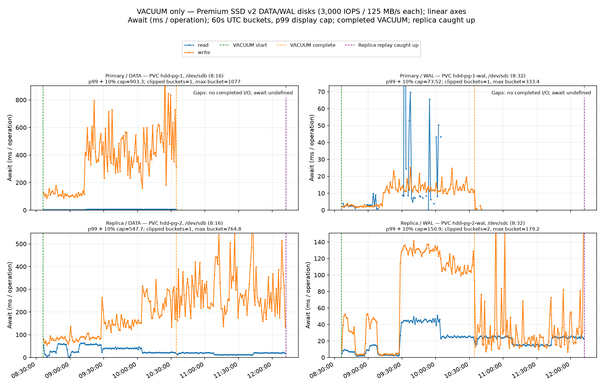
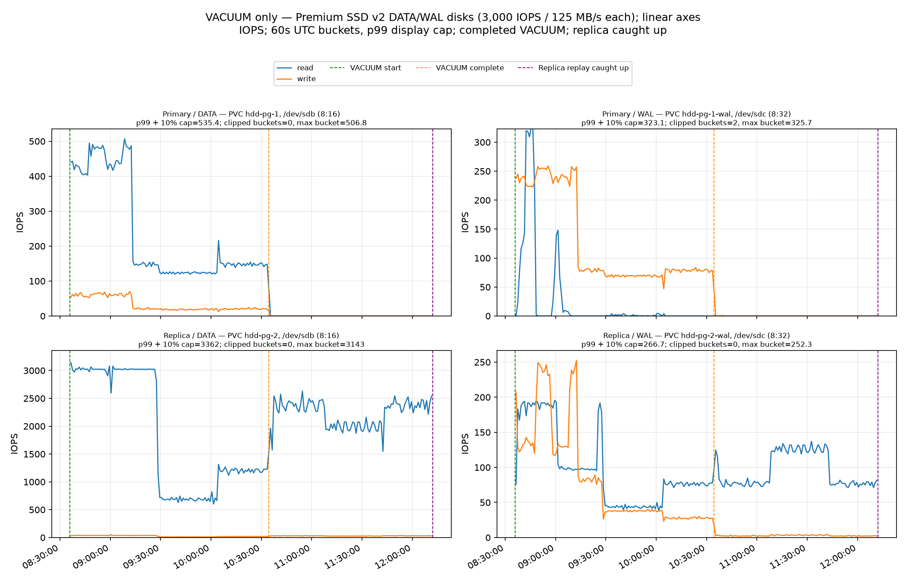
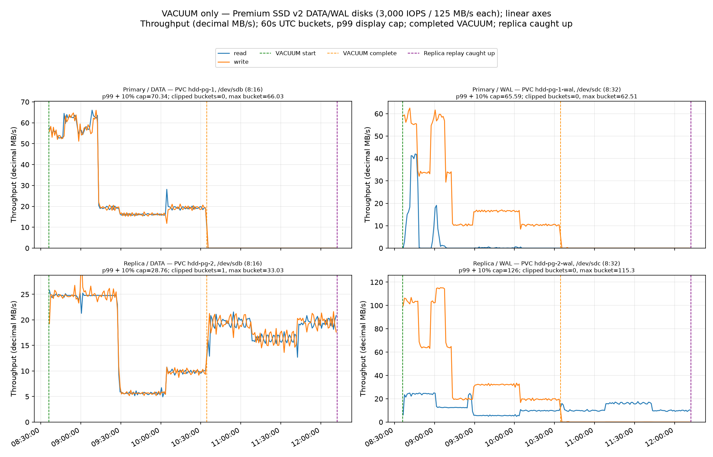

<!-- AUTOGENERATED-EXPERIMENT-SUMMARY:START -->
# 100gib VACUUM experiment report

**Status: complete with valid coverage.**

Completion requires test-process status `complete`, process exit 0, `timing.testComplete=true`, `summary.status.testComplete=true`, and `summary.coverage.valid=true`.

| Completion check | Result |
|---|---|
| `processExitZero` | pass |
| `processStatusComplete` | pass |
| `timingTestComplete` | pass |
| `summaryTestComplete` | pass |
| `coverageValid` | pass |

## Fixture and configuration

The prepared fixture targets a 100 GiB heap; the recorded heap is 100.00 GiB and table size is 101.40 GiB. Prepared live/dead tuple values are estimates (32,768,000 / 32,768,000).

The run uses 512 GiB `PremiumV2_LRS` disks for separate DATA and WAL on primary and replica, provisioned at 3000 IOPS / 125 MB/s; the verified StorageClass caching mode is `None` and logical sectors are 512 bytes. Region/zone: eastus / 1.

| PostgreSQL setting | Primary | Primary source | Replica | Replica source |
|---|---|---|---|---|
| `wal_level` | logical | configuration file | logical | configuration file |
| `full_page_writes` | on | configuration file | on | configuration file |
| `recovery_prefetch` | try | default | try | default |
| `vacuum_cost_delay` | 0 | default | 0 | default |
| `maintenance_work_mem` | 64MB | default | 64MB | default |
| `shared_buffers` | 256MB | configuration file | 256MB | configuration file |
| `maintenance_io_concurrency` | 10 | default | 10 | default |
| `synchronous_commit` | on | default | on | default |
| `synchronous_standby_names` | ANY 1 ("hdd-pg-2") | configuration file | ANY 1 ("hdd-pg-2") | configuration file |
| `wal_log_hints` | on | configuration file | on | configuration file |
| `max_wal_size` | 1GB | configuration file | 1GB | configuration file |
| `checkpoint_timeout` | 5min | default | 5min | default |

No application client workload was created. The original prepared source snapshot consistency is described as online primary disk snapshot after checkpoint; crash-consistent. Tuple counts in preparation metadata are estimates; where original SQL output is unavailable, the timeline distinguishes bounded/control-flow evidence from raw command output.

Measurement image: `ghcr.io/cloudnative-pg/postgresql:16.15-202609281634-standard-trixie@sha256:1dd42563007500b94b943f2a1620f724efedfc9eea2d07a50c6db4582c2431fd`. PostgreSQL system identifier: `7692518806614212629`. Observed VM size: `Standard_D2s_v4`; live VMSS verification: [vmss-metrics-20261007T121548Z.json](../../recovery/vm-burst-review/collected-retry-2/vmss-metrics-20261007T121548Z.json).
VACUUM command: `VACUUM (VERBOSE, FREEZE) public.vacuum_target;`.

## Timing

| Milestone | UTC |
|---|---|
| Counter observation began | 2026-10-07T08:36:00.121405889Z (first primary counter sample) |
| VACUUM started | 2026-10-07T08:36:00.983779Z |
| VACUUM command start (heap-work lower bound) | 2026-10-07T08:36:00.983779Z |
| First VACUUM progress observed (scanning heap) | 2026-10-07T08:36:02.066850270Z |
| VACUUM heap work complete (if recorded) | not separately observed |
| VACUUM completed | 2026-10-07T10:34:28.321130Z |
| Replica catch-up complete | 2026-10-07T12:12:15.664417135Z |
| Counter observation ended | 2026-10-07T12:12:15.673044477Z |

VACUUM duration: 1h 58m 27s. Start through replica catch-up: 3h 36m 15s.
Replay-drain duration after VACUUM: 1h 37m 47s (final timing receipt).
The final timing receipt did not record a heap-work completion timestamp, so no distinct interval from heap-work end through VACUUM finish is claimed.

Published summary status: testComplete=True; coverage.valid=True; windows: replayDrain=valid, vacuum=valid, vacuumAndReplay=valid.

### Phase-window DATA reads

| Window | Covered seconds (primary / replica) | DATA read IOPS (primary / replica) | Replica / primary IOPS rate | DATA read MB/s (primary / replica) | Replica / primary read-byte rate | DATA read await ms (primary / replica) |
|---|---:|---:|---:|---:|---:|---:|
| VACUUM only | 7,107.3 / 7,107.3 | 235.74 / 1,845.11 | 7.83× | 30.76 / 15.12 | 0.49× | 3.485 ms / 37.766 ms |
| Post-VACUUM replay drain | 5,867.3 / 5,867.3 | 0.04 / 2,221.80 | 57,316.09× | 0.01 / 18.21 | 3,628.43× | 1.534 ms / 17.395 ms |
| VACUUM through catch-up (whole observed window) | 12,974.7 / 12,974.7 | 129.15 / 2,015.46 | 15.61× | 16.85 / 16.52 | 0.98× | 3.484 ms / 27.610 ms |
Replay-drain share of replica DATA reads in the VACUUM-through-catch-up window: 49.85% of operations and 49.84% of bytes, calculated from the prorated stored window rates and covered seconds.

Stored summary windows use the frozen plot's boundary method: valid counter deltas are prorated by overlap duration. The whole-observation row is explicitly VACUUM start through replay catch-up; it is not a VACUUM-only ratio. DATA reads aggregate table, index, and other device traffic and do not reveal per-page read history.

## Guest block-device totals

Totals span the first through last persisted samples. Await is the operation-weighted guest block-device time, including queueing.

| Role / device | Read ops | Read GiB | Read await | Write ops | Write GiB | Write await | Combined op-weighted await |
|---|---:|---:|---:|---:|---:|---:|---:|
| Primary / Data | 1,675,975 | 203.65 GiB | 3.484 ms | 231,443 | 201.50 GiB | 256.863 ms | 34.229 ms |
| Primary / Wal | 172,486 | 20.72 GiB | 2.982 ms | 900,229 | 158.33 GiB | 6.890 ms | 6.261 ms |
| Replica / Data | 26,152,406 | 199.60 GiB | 27.609 ms | 345,897 | 201.34 GiB | 206.049 ms | 29.939 ms |
| Replica / Wal | 1,246,537 | 148.47 GiB | 17.100 ms | 604,994 | 301.82 GiB | 41.048 ms | 24.925 ms |

### DATA-read comparison

| Measure | Primary DATA | Replica DATA | Replica / primary |
|---|---:|---:|---:|
| Read operations | 1,675,975 | 26,152,406 | 15.60× |
| Read bytes | 203.65 GiB | 199.60 GiB | 0.98× |
| Mean request size | 127.41 KiB | 8.00 KiB | — |
| Read bytes / prepared heap | 2.04× | 2.00× | — |

These are aggregate device/index read histories, not per-page histories. Operation ratios can rise when request sizes shrink while total bytes stay similar; they do not prove cache thrashing or repeated reads of specific pages.

## Figures and source artifacts

All three figures use linear axes. Clipped peaks, if any, are marked in the plot captions; raw samples retain numeric values.

| Artifact | Link |
|---|---|
| Await graph | [await.png](await.png) |
| IOPS graph | [iops.png](iops.png) |
| Throughput graph | [throughput.png](throughput.png) |
| Raw samples | [samples.jsonl](samples.jsonl) |
| Preflight and live SQL/settings evidence | [preflight.json](preflight.json) |
| Timing receipt | [timing.json](timing.json) |
| Coverage and summary | [summary.json](summary.json) |
| Test event stream | [events.jsonl](events.jsonl) |
| VACUUM output/log | [vacuum.log](vacuum.log) |
| Detached VACUUM process receipt | [vacuum-process.json](vacuum-process.json) |
| Continuous primary PostgreSQL log | [primary-postgres-live.log](monitoring/primary-postgres-live.log) |
| Continuous replica PostgreSQL log | [replica-postgres-live.log](monitoring/replica-postgres-live.log) |
| Primary follower diagnostics | [primary-follower.err](monitoring/primary-follower.err) |
| Replica follower diagnostics | [replica-follower.err](monitoring/replica-follower.err) |
| Replication events | [replication-events.json](replication-events.json) |

### Await

### IOPS

### Throughput

## Interpretation and limits

The counters are guest block-device statistics, not Azure service or application latency metrics. The test has no client workload and does not measure client latency. The experiment does not isolate a single causal mechanism or include a matched `recovery_prefetch=off` control.

OS page caches were not explicitly dropped. The pre-observation checkpoint and setup can leave cached pages. Comparisons between 50 GiB and the East US runs also differ by region (West US 3 for 50 GiB). Only one measured run per size is available; conclusions should remain descriptive.

Azure copy progress for Standard sources is not reliably observable. The preparation barrier verifies the four measured PremiumV2 copies and retired the two owned Standard staging disks; it does not claim global cloud backend quiescence. Owned compute and test-resource cleanup completed at 2026-10-07T12:41:35.564847+00:00; the cleanup receipt records 42 retained snapshots. Snapshot identities and protection flags were compared before/after staging retirement (unchanged=True, all protected=True); all snapshots remain retained. 1 verified local online-Backup WAL/history export receipt(s) exist for this run. No global cloud-quiescence claim is made.
<!-- AUTOGENERATED-EXPERIMENT-SUMMARY:END -->

<!-- COMPLETE-END-TO-END-TIMELINE:START -->
## Complete end-to-end timeline

The timeline below embeds preparation, recovery/retries, Backup snapshot creation/readiness, replica seeding, disk hydration observations, measurement events, and outstanding evidence. Each evidence link is relative to this report.

| UTC / interval | Precision | Event | Evidence and qualification |
|---|---|---|---|
| 2026-10-04T14:10:10.0747777+00:00 | inherited-source-metadata-timestamp | Historical fixture creation timestamp inherited from source metadata | The inherited createdAtUtc field accompanies originalKeeperSnapshotId=azhr-keep-amplification-prepared-05d212886d and snapshotId=azhr-keep-scsi-prepared-7a297601434285b1. It is not an independently verified ARM creation time for the selected later keeper/copy. The historical source topology is combined PGDATA/pg_wal; prepared live/dead tuple counts are inherited estimates. The allowlisted source manifest and saved source-snapshot provenance record the intermediate copy lineage used by this run. Evidence: [preflight.json](preflight.json) · SHA-256 `5a329897a8ce2bfb9bd2e83006f99463c2189655a29d5e7b1eb5376e2e9499aa`; [source-snapshot.json](../.state/source-snapshot.json) · SHA-256 `04f2efb7bf0aa2a04a5b5c6297a3e4c3d6e534d25415b0990cf8c13379454afd`; [source-manifest.json](../source-manifest.json) · SHA-256 `939861f7eae1ec48978ff21cd31b9aaab07045302832aae53a3b24afa4c07560` |
| 2026-10-05T05:34:50.754499+00:00 | ARM-resource-creation-time | Allowlisted prepared source snapshot created | Existing source snapshot keeper-base-16244c2c; its identity is selected by the pinned source manifest. The local source metadata records a keeper → staging disk → regional incremental snapshot lineage; historical fixture properties are inherited from that chain, not direct measurements of this stack. Evidence: [source-snapshot.json](../.state/source-snapshot.json) · SHA-256 `04f2efb7bf0aa2a04a5b5c6297a3e4c3d6e534d25415b0990cf8c13379454afd`; [source-manifest.json](../source-manifest.json) · SHA-256 `939861f7eae1ec48978ff21cd31b9aaab07045302832aae53a3b24afa4c07560` |
| 2026-10-06T15:36:09.011879+00:00 | start-time-only-terminal-time-unavailable | Provision launch reported AKS inspection failure; owned snapshots were preserved | The retained stdout records `Cannot inspect AKS provisioning` and deferred cleanup because snapshot deletion was not authorized. No exact failure or cleanup timestamp was retained; the cluster and PVC creation records below document later resource state. Evidence: [provision-launch.json](../.state/provision-launch.json) · SHA-256 `cc5ecf3d84f0f0adda6a44ead874d182d79eb3650857c73c8782041369ffe406`; [provision.log](../provision.log) · SHA-256 `5a4d0c2c51b6a84dc2d2f7c154a444b59a5677b6d7a44d0a3770c03d32409eb4`; [01-provision.sh](../01-provision.sh) · SHA-256 `dd031ccccb37512fbd5353287b9fa843a7e0d794fe4716b1fd881534873106b4` |
| 2026-10-06T15:36:09.011879+00:00 | exact-process-receipt | Provisioning process launched | This is the local provisioning-launch timestamp. See the captured provision log for its terminal result; resource creation timestamps below are independent Kubernetes evidence. Evidence: [provision-launch.json](../.state/provision-launch.json) · SHA-256 `cc5ecf3d84f0f0adda6a44ead874d182d79eb3650857c73c8782041369ffe406`; [01-provision.sh](../01-provision.sh) · SHA-256 `dd031ccccb37512fbd5353287b9fa843a7e0d794fe4716b1fd881534873106b4`; [provision.log](../provision.log) · SHA-256 `5a4d0c2c51b6a84dc2d2f7c154a444b59a5677b6d7a44d0a3770c03d32409eb4` |
| 2026-10-06T15:56:39.763126+00:00 → 2026-10-06T15:56:47.473755+00:00 | process-receipt-interval | Preparation attempt 1: failed (exit 1); ERROR: Cannot submit owned incremental source copy. | Supervisor receipt gives the exact process start/finish bounds; internal SQL statement times are not logged. Evidence: [prepare-process.json](../.state/attempts/prepare-1/prepare-process.json) · SHA-256 `6b369006b709bf3950b0197e89cd4cfc292d914cc6e0554a630ee73a6a701271`; [prepare.log](../.state/attempts/prepare-1/prepare.log) · SHA-256 `8d7df58632ad3d69d566824032971d22e4d03785705f65f6d3483385c6a7ef34`; [02-prepare.sh](../.state/attempts/prepare-1/02-prepare.sh) · SHA-256 `1d07e1b2020677465621df54ca122e61d2b2473b0beb4ba8f9ade4adb4bc7c00` |
| 2026-10-06T16:00:51.822547+00:00 → 2026-10-06T20:29:32.653796+00:00 | process-receipt-interval | Preparation attempt 2: failed (exit 1); ERROR: Owned incremental source copy timed out. | Supervisor receipt gives the exact process start/finish bounds; internal SQL statement times are not logged. Evidence: [prepare-process.json](../.state/attempts/prepare-2/prepare-process.json) · SHA-256 `9365074edbf6bd050d0e4cbecbaa539824d2761cec5a412b6ddab4461114c333`; [prepare.log](../.state/attempts/prepare-2/prepare.log) · SHA-256 `58315e109595e7e88483aaf6a05d71884a3f00ec36b2fc6452159c00a00b17c0`; [02-prepare.sh](../.state/attempts/prepare-2/02-prepare.sh) · SHA-256 `7bbb216825214b9febfd9bcc80be781f72c411ad71ff9fce78bcd64bf63dac5b` |
| 2026-10-06T20:48:40.100229+00:00 → 2026-10-06T20:51:57.724429+00:00 | process-receipt-interval | Preparation attempt 3: failed (exit -15); ERROR: Owned incremental source copy timed out. | Supervisor receipt gives the exact process start/finish bounds; internal SQL statement times are not logged. Evidence: [prepare-process.json](../.state/attempts/prepare-3/prepare-process.json) · SHA-256 `fdc63f80771b929f19fcd85dfb7ff406b44ee3f2c5aa03752295022242c7fba5`; [prepare.log](../.state/attempts/prepare-3/prepare.log) · SHA-256 `a463f8a62061a83b978ea660d31065ac121269a0e0687e397116c45f23d919a9`; [02-prepare.sh](../.state/attempts/prepare-3/02-prepare.sh) · SHA-256 `7b24d869c7ef362653f38201402f5e4f297c874f66253658f884ced15055b20f` |
| 2026-10-06T20:49:04.8796799+00:00 | ARM-resource-creation-time | Owned Standard staging disk created | Temporary source restore disk restore-stage-f1b90aec-ef6f2376; copy completion for Standard sources is not exposed reliably. Evidence: [receipt-ef6f2376.json](../.state/source-stage/receipt-ef6f2376.json) · SHA-256 `eaed6a8aa16c64c56c331024344bfdc2bfa0cec61c87bed947072aebe2a4d3cd`; [plan-ef6f2376.json](../.state/source-stage/plan-ef6f2376.json) · SHA-256 `a1e58a5309acd0777ea341cbb46fecaac659eb6233f2f87a2bde69dafde0cd0a` |
| 2026-10-06T20:52:16.315154+00:00 → 2026-10-06T20:52:44.146820+00:00 | process-receipt-interval | Preparation attempt 4: failed (exit 1); ERROR: Cannot revalidate the previous owned source-stage receipt. | Supervisor receipt gives the exact process start/finish bounds; internal SQL statement times are not logged. Evidence: [prepare-process.json](../.state/attempts/prepare-4/prepare-process.json) · SHA-256 `22b0fef497691f18d54c3b159c6140d2a61128e3c3ca3240759bd5b54ef93aed`; [prepare.log](../.state/attempts/prepare-4/prepare.log) · SHA-256 `f9281f5c3d870ade262768727aa85ecafc84546eede5895d5127a4019b2b5211`; [02-prepare.sh](../.state/attempts/prepare-4/02-prepare.sh) · SHA-256 `7b24d869c7ef362653f38201402f5e4f297c874f66253658f884ced15055b20f` |
| 2026-10-06T20:52:39.32511+00:00 | ARM-resource-creation-time | Owned incremental restore snapshot created | Restore copy keeper-pv2-f1b90aec-ef6f2376; preserved under CanNotDelete snapshot retention. Evidence: [receipt-ef6f2376.json](../.state/source-stage/receipt-ef6f2376.json) · SHA-256 `eaed6a8aa16c64c56c331024344bfdc2bfa0cec61c87bed947072aebe2a4d3cd` |
| 2026-10-06T20:53:32.307852+00:00 → 2026-10-07T06:11:36Z | bounded-by-process-and-backup | Fixture INSERT/index/DELETE/CHECKPOINT phase | Frozen 02 control flow places INSERT, index build, DELETE, and CHECKPOINT before Backup creation. Exact SQL statement timestamps/output are absent from this stack's raw capture. The initial remote capture at 05:11:36 contained CREATE INDEX output only; by 05:15:07 the captured output contained DELETE 32768000 and CHECKPOINT with status 0. The INSERT transcript remains unavailable. Evidence: [prepare-process.json](../.state/attempts/prepare-5/prepare-process.json) · SHA-256 `8996c771a22b946b2d37a5f5590b730937a841de41d503b4fdb702c9a358b568`; [02-prepare.sh](../.state/attempts/prepare-5/02-prepare.sh) · SHA-256 `7b24d869c7ef362653f38201402f5e4f297c874f66253658f884ced15055b20f`; [capture-manifest.json](../../recovery/fixture-watch/100-dml-output/initial-20261007T051136Z/capture-manifest.json) · SHA-256 `143259e3b9900e3ce6e2a19b5d19700a44098997a9b124f78d9412a05c7567d0`; [capture-manifest.json](../../recovery/fixture-watch/100-dml-output/final-20261007T051507Z/capture-manifest.json) · SHA-256 `5aa531c946803b3936b068fc2a48fac5f83a3828291487997b6c27e9a24448b4` |
| 2026-10-06T20:53:32.307852+00:00 → 2026-10-07T07:11:40.678470+00:00 | process-receipt-interval | Preparation attempt 5: failed (exit 1); ERROR: Backup lacks paired snapshots. | Supervisor receipt gives the exact process start/finish bounds; internal SQL statement times are not logged. Evidence: [prepare-process.json](../.state/attempts/prepare-5/prepare-process.json) · SHA-256 `8996c771a22b946b2d37a5f5590b730937a841de41d503b4fdb702c9a358b568`; [prepare.log](../.state/attempts/prepare-5/prepare.log) · SHA-256 `bae47e00d1ac6ad340a74b16abb759334b95e531e37a6103190f6c0c16d9a17e`; [original-prepare-terminal.log](../../recovery/backup-wait-resume/original-100gib/original-prepare-terminal.log) · SHA-256 `bae47e00d1ac6ad340a74b16abb759334b95e531e37a6103190f6c0c16d9a17e`; [02-prepare.sh](../.state/attempts/prepare-5/02-prepare.sh) · SHA-256 `7b24d869c7ef362653f38201402f5e4f297c874f66253658f884ced15055b20f` |
| 2026-10-06T20:54:11Z | exact-kubernetes-creation-timestamp | Initial primary DATA PVC resource created | Resource hdd-pg-1 creation timestamp from the preserved Kubernetes object capture. Evidence: [pvcs.json](../../recovery/fixture-watch/100-wal-move-20261007T055516Z/pvcs.json) · SHA-256 `8bb1ed2d4c5829b265e6c5526dde9531ef91d9b5611a7ca8421c7fa1d2b77405` |
| 2026-10-07T05:11:36.534300Z | capture-time-upper-bound | CREATE INDEX output observed in active remote psql capture | Read-only capture saw CREATE INDEX in the active command output; the actual statement completion instant is not recorded. Evidence: [capture-manifest.json](../../recovery/fixture-watch/100-dml-output/initial-20261007T051136Z/capture-manifest.json) · SHA-256 `143259e3b9900e3ce6e2a19b5d19700a44098997a9b124f78d9412a05c7567d0` |
| 2026-10-07T05:15:07.274796Z | capture-time-upper-bound | DELETE count, CHECKPOINT, and status 0 captured | Remote output was exactly CREATE INDEX / DELETE 32768000 / CHECKPOINT; status file was 0. Capture time bounds observation, not SQL completion. INSERT output was not captured. Evidence: [capture-manifest.json](../../recovery/fixture-watch/100-dml-output/final-20261007T051507Z/capture-manifest.json) · SHA-256 `5aa531c946803b3936b068fc2a48fac5f83a3828291487997b6c27e9a24448b4` |
| 2026-10-07T05:15:33Z | exact-kubernetes-creation-timestamp | Separate primary WAL PVC created | The WAL claim has its own creation time and is separate from the prepared DATA claim. Evidence: [pvcs.json](../../recovery/fixture-watch/100-wal-move-20261007T055516Z/pvcs.json) · SHA-256 `8bb1ed2d4c5829b265e6c5526dde9531ef91d9b5611a7ca8421c7fa1d2b77405` |
| 2026-10-07T05:15:34Z | exact-kubernetes-event-timestamp | Primary restarted onto the separate WAL claim | The preserved K8s event capture records the prior primary container being stopped for the WAL-storage transition; later captures show the primary running with both DATA and WAL claims attached. Evidence: [events.json](../../recovery/fixture-watch/100-wal-move-20261007T054847Z/events.json) · SHA-256 `91fd5dc8384c46754d5e449482f700e07a4465d28047cceb0b20e86c701a3390`; [pods.json](../../recovery/fixture-watch/100-wal-move-20261007T054847Z/pods.json) · SHA-256 `537e9fee5fef6c3a73c5b797372a45de5bccb463c4216c1332f5fb04d47914c0`; [pvcs.json](../../recovery/fixture-watch/100-wal-move-20261007T055516Z/pvcs.json) · SHA-256 `8bb1ed2d4c5829b265e6c5526dde9531ef91d9b5611a7ca8421c7fa1d2b77405` |
| 2026-10-07T05:44:18Z | exact-kubernetes-creation-timestamp | Primary PostgreSQL pod created | Primary pod UID 4a4793aa-f940-4255-80d4-775dda9efbc6 in the preserved K8s capture. Later WAL-migration restarts are listed separately where captured. Evidence: [pods.json](../../recovery/fixture-watch/100-wal-move-20261007T054847Z/pods.json) · SHA-256 `537e9fee5fef6c3a73c5b797372a45de5bccb463c4216c1332f5fb04d47914c0` |
| 2026-10-07T05:44:30Z | exact-kubernetes-event-timestamp | Separate WAL PVC provisioned and attached | The storage provisioner reported success for the new hdd-pg-1-wal claim; subsequent pod events record the claims attached and PostgreSQL container started. Evidence: [events.json](../../recovery/fixture-watch/100-wal-move-20261007T054847Z/events.json) · SHA-256 `91fd5dc8384c46754d5e449482f700e07a4465d28047cceb0b20e86c701a3390`; [pods.json](../../recovery/fixture-watch/100-wal-move-20261007T054847Z/pods.json) · SHA-256 `537e9fee5fef6c3a73c5b797372a45de5bccb463c4216c1332f5fb04d47914c0`; [pvcs.json](../../recovery/fixture-watch/100-wal-move-20261007T055516Z/pvcs.json) · SHA-256 `8bb1ed2d4c5829b265e6c5526dde9531ef91d9b5611a7ca8421c7fa1d2b77405` |
| 2026-10-07T05:44:57Z | exact-kubernetes-event-timestamp | Primary PostgreSQL running with separate DATA/WAL claims | Kubernetes event capture records PostgreSQL container start after the new WAL PVC was provisioned and attached. This is evidence of the transition; the data-migration command's per-file completion transcript was not retained. Evidence: [pvcs.json](../../recovery/fixture-watch/100-wal-move-20261007T055516Z/pvcs.json) · SHA-256 `8bb1ed2d4c5829b265e6c5526dde9531ef91d9b5611a7ca8421c7fa1d2b77405`; [events.json](../../recovery/fixture-watch/100-wal-move-20261007T055516Z/events.json) · SHA-256 `f976b7211a08c1f339a49b117c7d9d0bb587a2c1b4a48d8d07a4aa95d68df7c4`; [pods.json](../../recovery/fixture-watch/100-wal-move-20261007T055516Z/pods.json) · SHA-256 `537e9fee5fef6c3a73c5b797372a45de5bccb463c4216c1332f5fb04d47914c0`; [primary.log](../../recovery/fixture-watch/100-wal-move-20261007T055516Z/primary.log) · SHA-256 `eb92c56c2d25da9ac4fd0cd1454d3c88f492cf9ab9f3d225144a8e7d17b5758d` |
| 2026-10-07T06:11:35.140726641Z | exact-postgresql-archive-log-timestamp | WAL segment archived before paired Backup | Barman logged successful archive of WAL segment pg_wal/000000010000009A0000007F; this supports the configured `waitForArchive` Backup boundary. No credentials or object contents are included. Evidence: [primary.log](../../recovery/fixture-watch/100-post-wal-20261007T061139Z/primary.log) · SHA-256 `a5c1e41fdd1dc9b93f851e0d215ee987f70c9cd05db9c73ee01d5a08f704e1d5` |
| 2026-10-07T06:11:36Z → 2026-10-07T07:13:20Z | exact-CNPG-status-time | CNPG online paired DATA/WAL Backup started and completed | Backup vacuum-backup-f1b90aec; started 2026-10-07T06:11:36Z; completed 2026-10-07T07:13:20Z. Backup WAL range 9A/80000028–9A/80000138 (segments 000000010000009A00000080–000000010000009A00000080). Evidence: [backup.json](../../recovery/fixture-watch/100-backup-watch-20261007T071457Z/backup.json) · SHA-256 `50f3eb67f62f34bab1dc0cd95b77bcc11328e3ed3791c36263b121d3554ee20c`; [volumesnapshots.json](../../recovery/fixture-watch/100-backup-watch-20261007T071457Z/volumesnapshots.json) · SHA-256 `20ef8c46e8033cf760525bbc7db5c8ba30547917d8fbc58cd2564009eece5b14`; [prepare-process.json](../.state/attempts/prepare-5/prepare-process.json) · SHA-256 `8996c771a22b946b2d37a5f5590b730937a841de41d503b4fdb702c9a358b568` |
| 2026-10-07T06:11:46Z | exact-kubernetes-resource-timestamp | Paired Backup VolumeSnapshot created: vacuum-backup-f1b90aec | VSS UID 604b8cee-1a94-4df6-b846-be245038a795; this timestamp is creation evidence. Later readiness is reported separately only where a SnapshotReady event was retained. Evidence: [volumesnapshots.json](../../recovery/fixture-watch/100-backup-watch-20261007T071457Z/volumesnapshots.json) · SHA-256 `20ef8c46e8033cf760525bbc7db5c8ba30547917d8fbc58cd2564009eece5b14` |
| 2026-10-07T06:11:46Z | exact-kubernetes-resource-timestamp | Paired Backup VolumeSnapshot created: vacuum-backup-f1b90aec-wal | VSS UID ebeff553-ca6f-487c-8517-e803b02337ca; this timestamp is creation evidence. Later readiness is reported separately only where a SnapshotReady event was retained. Evidence: [volumesnapshots.json](../../recovery/fixture-watch/100-backup-watch-20261007T071457Z/volumesnapshots.json) · SHA-256 `20ef8c46e8033cf760525bbc7db5c8ba30547917d8fbc58cd2564009eece5b14` |
| 2026-10-07T06:11:47.4131489+00:00 | exact-ARM-resource-creation-time | Azure paired Backup DATA snapshot resource created: snapshot-604b8cee-1a94-4df6-b846-be245038a795 | ARM snapshot uniqueId b530378c-e2ce-43e0-a464-209842f00958; linked through the prepared DATA Backup snapshot name and VSS UID 604b8cee-1a94-4df6-b846-be245038a795. This is the Azure resource creation timestamp, not copy completion or CSI SnapshotReady time. Evidence: [backup.json](../../recovery/fixture-watch/100-backup-watch-20261007T071457Z/backup.json) · SHA-256 `50f3eb67f62f34bab1dc0cd95b77bcc11328e3ed3791c36263b121d3554ee20c`; [audit.json](../../recovery/backup-wait-resume/final-audit/100gib-v2/audit.json) · SHA-256 `bebea09da9f9bd6694b4e7c6ca33a4ad00e56f974f98269717c249c6daebcb68`; [prepare.json](../.state/prepare.json) · SHA-256 `4c9089e078eb4ba5e99105c433de8403d658c12a299bb601bc64512aa4025236`; [volumesnapshots.json](../../recovery/fixture-watch/100-backup-watch-20261007T071457Z/volumesnapshots.json) · SHA-256 `20ef8c46e8033cf760525bbc7db5c8ba30547917d8fbc58cd2564009eece5b14`; [azure-snapshot-data.json](../../recovery/backup-retention-review/evidence/100gib/vacuum-backup-f1b90aec/azure-snapshot-data.json) · SHA-256 `e3e4b5f7aff82dbe308fdd58dc71730d155c58a49e427c1fbe19819617c2fd1f`; [volumesnapshotcontent-data.json](../../recovery/backup-retention-review/evidence/100gib/vacuum-backup-f1b90aec/volumesnapshotcontent-data.json) · SHA-256 `2ccf239fef3bd2e7671df9515eff3857569808855fb06fb3c4d4d28aa65ea42f` |
| 2026-10-07T06:11:47.4172433+00:00 | exact-ARM-resource-creation-time | Azure paired Backup WAL snapshot resource created: snapshot-ebeff553-ca6f-487c-8517-e803b02337ca | ARM snapshot uniqueId 5d6164bd-68b6-455a-ada8-cfb4c9f95022; linked through the prepared WAL Backup snapshot name and VSS UID ebeff553-ca6f-487c-8517-e803b02337ca. This is the Azure resource creation timestamp, not copy completion or CSI SnapshotReady time. Evidence: [backup.json](../../recovery/fixture-watch/100-backup-watch-20261007T071457Z/backup.json) · SHA-256 `50f3eb67f62f34bab1dc0cd95b77bcc11328e3ed3791c36263b121d3554ee20c`; [audit.json](../../recovery/backup-wait-resume/final-audit/100gib-v2/audit.json) · SHA-256 `bebea09da9f9bd6694b4e7c6ca33a4ad00e56f974f98269717c249c6daebcb68`; [prepare.json](../.state/prepare.json) · SHA-256 `4c9089e078eb4ba5e99105c433de8403d658c12a299bb601bc64512aa4025236`; [volumesnapshots.json](../../recovery/fixture-watch/100-backup-watch-20261007T071457Z/volumesnapshots.json) · SHA-256 `20ef8c46e8033cf760525bbc7db5c8ba30547917d8fbc58cd2564009eece5b14`; [azure-snapshot-wal.json](../../recovery/backup-retention-review/evidence/100gib/vacuum-backup-f1b90aec/azure-snapshot-wal.json) · SHA-256 `10dfdfb5c74fb4031fae1c6cb19e4828dc5b25821d6a67257d0e6c4f5848e079`; [volumesnapshotcontent-wal.json](../../recovery/backup-retention-review/evidence/100gib/vacuum-backup-f1b90aec/volumesnapshotcontent-wal.json) · SHA-256 `a427a1dbeedb844f2d3faf2826727f035e5aff789b5357b613b732b24a2f4e6f` |
| 2026-10-07T06:20:19.468970+00:00 | first-observed-copy-progress | Paired Backup snapshot copy progress observed | DATA=0.0%/Pending; WAL=51.0%/Pending. A captured 100% value is the first preserved observation, not the actual Azure transition time. Evidence: [snapshots.json](../../recovery/fixture-watch/100-arm-snapshots-20261007T062019Z/snapshots.json) · SHA-256 `ecda7a868df251429a7c8d95edbbda60ab12d05f2cbd949b72eea0ecab400b9e` |
| 2026-10-07T06:28:19Z | exact-kubernetes-event-timestamp | Paired Backup snapshot ready to use: vacuum-backup-f1b90aec-wal | SnapshotReady event for VSS UID ebeff553-ca6f-487c-8517-e803b02337ca; readiness is later than snapshot object creation. Evidence: [events.json](../../recovery/fixture-watch/100-backup-watch-20261007T071457Z/events.json) · SHA-256 `b843929fe5dbdfbcd45b9a88c55091024f4f5e578531fa4c217e7942ba10dfa0` |
| 2026-10-07T06:29:58.559509+00:00 | first-observed-copy-progress | Paired Backup snapshot copy progress observed | DATA=2.0%/Pending; WAL=100.0%/Available. A captured 100% value is the first preserved observation, not the actual Azure transition time. Evidence: [snapshots.json](../../recovery/fixture-watch/100-arm-snapshots-20261007T062958Z/snapshots.json) · SHA-256 `f20f50e0bc6a2c2250b7e8fd6a4b2303fc280ff4cb04c38e79e6d17f690dc40e` |
| 2026-10-07T06:39:35.851414+00:00 | first-observed-copy-progress | Paired Backup snapshot copy progress observed | DATA=20.0%/Pending; WAL=100.0%/Available. A captured 100% value is the first preserved observation, not the actual Azure transition time. Evidence: [snapshots.json](../../recovery/fixture-watch/100-arm-snapshots-20261007T063935Z/snapshots.json) · SHA-256 `0c78bf224cd1c3ef20bce3f43e7c6cced72dbaff8a295d9659b018c3f139bac8` |
| 2026-10-07T06:46:47.748041+00:00 | first-observed-copy-progress | Paired Backup snapshot copy progress observed | DATA=27.0%/Pending; WAL=100.0%/Available. A captured 100% value is the first preserved observation, not the actual Azure transition time. Evidence: [snapshots.json](../../recovery/fixture-watch/100-arm-snapshots-20261007T064647Z/snapshots.json) · SHA-256 `8eab71025590b6fe274d8bf2e37ff1a93e22e6e1db406e43b00b37268a437e3e` |
| 2026-10-07T06:56:30.916031+00:00 | first-observed-copy-progress | Paired Backup snapshot copy progress observed | DATA=63.0%/Pending; WAL=100.0%/Available. A captured 100% value is the first preserved observation, not the actual Azure transition time. Evidence: [snapshots.json](../../recovery/fixture-watch/100-arm-snapshots-20261007T065630Z/snapshots.json) · SHA-256 `617b8bede01d35fa15d0796baa8eab2ae84f61b6a00cf4e2a1f5c830a760353f` |
| 2026-10-07T07:06:44.871038+00:00 | first-observed-copy-progress | Paired Backup snapshot copy progress observed | DATA=100.0%/Available; WAL=100.0%/Available. A captured 100% value is the first preserved observation, not the actual Azure transition time. Evidence: [snapshots.json](../../recovery/fixture-watch/100-arm-snapshots-20261007T070644Z/snapshots.json) · SHA-256 `eb0da71cfa07def0e51231230645100fcd26ca178fab747366ca7757fe81f27d` |
| 2026-10-07T07:11:40.678470+00:00 | exact-process-receipt | Original 100 GiB preparation stopped at its bounded Backup wait | Original 02 wait expired while its owned Backup was still finalizing; it did not enter the seed/image/final audit tail. Evidence: [original-process-terminal.json](../../recovery/backup-wait-resume/original-100gib/original-process-terminal.json) · SHA-256 `8996c771a22b946b2d37a5f5590b730937a841de41d503b4fdb702c9a358b568`; [original-02-prepare.sh](../../recovery/backup-wait-resume/original-100gib/original-02-prepare.sh) · SHA-256 `7b24d869c7ef362653f38201402f5e4f297c874f66253658f884ced15055b20f`; [prepare.log](../.state/attempts/prepare-5/prepare.log) · SHA-256 `bae47e00d1ac6ad340a74b16abb759334b95e531e37a6103190f6c0c16d9a17e` |
| 2026-10-07T07:13:20Z | exact-kubernetes-event-timestamp | Paired Backup snapshot ready to use: vacuum-backup-f1b90aec | SnapshotReady event for VSS UID 604b8cee-1a94-4df6-b846-be245038a795; readiness is later than snapshot object creation. Evidence: [events.json](../../recovery/fixture-watch/100-backup-watch-20261007T071457Z/events.json) · SHA-256 `b843929fe5dbdfbcd45b9a88c55091024f4f5e578531fa4c217e7942ba10dfa0` |
| 2026-10-07T07:13:20Z | exact-kubernetes-event/status-time | Existing paired Backup completed after original timeout | The continuation reused the existing Backup and snapshots; no second Backup or fixture DML was submitted. Evidence: [backup.json](../../recovery/fixture-watch/100-backup-watch-20261007T071457Z/backup.json) · SHA-256 `50f3eb67f62f34bab1dc0cd95b77bcc11328e3ed3791c36263b121d3554ee20c`; [events.json](../../recovery/fixture-watch/100-backup-watch-20261007T071457Z/events.json) · SHA-256 `b843929fe5dbdfbcd45b9a88c55091024f4f5e578531fa4c217e7942ba10dfa0`; [resume-progress.json](../../recovery/backup-wait-resume/results/100gib-v2/resume-progress.json) · SHA-256 `433ed84a1e4ff734be2f0380c2bc3cd9f936f162f384906ab2c9d81fcf34fc15` |
| 2026-10-07T07:14:21.115045+00:00 → 2026-10-07T07:14:42.020471+00:00 | process-receipt-interval | Preparation attempt 6: failed (exit 2); RECOVERY BLOCKED: Backup VolumeSnapshot vacuum-backup-f1b90aec owner/request/source mismatch | Supervisor receipt gives the exact process start/finish bounds; internal SQL statement times are not logged. Evidence: [prepare-process.json](../.state/attempts/prepare-6/prepare-process.json) · SHA-256 `3422e2fab9e197b14be619f0cec133957fdc5c366b29a9e9448495d9115a7b97`; [prepare.log](../.state/attempts/prepare-6/prepare.log) · SHA-256 `8700639b383b691c70f01c7b48f3b4be5941a7208ba0f8b01f11837702473682`; [02-prepare.sh](../.state/attempts/prepare-6/02-prepare.sh) · SHA-256 `4dbe252d0c48f17a3ba1086d2d351b6fcba2162f4ff3085f9708fe08d27abe98` |
| 2026-10-07T07:28:35.929126+00:00 → 2026-10-07T08:25:17.473893+00:00 | process-receipt-interval | Preparation continuation v2: complete (exit 0) | Supervisor receipt gives the exact process start/finish bounds; internal SQL statement times are not logged. Evidence: [prepare-process.json](../.state/prepare-process.json) · SHA-256 `a3efcd8ce208d1b00ec2fedfeee5ab5b331a59ac463d6324fdd4532b56cb04ad` |
| 2026-10-07T07:29:59Z | exact-kubernetes-creation-timestamp | Replica DATA and WAL PVCs created | Both replica PVC creation timestamps are pinned in the finalizer audit. Evidence: [audit.json](../../recovery/backup-wait-resume/final-audit/100gib-v2/audit.json) · SHA-256 `bebea09da9f9bd6694b4e7c6ca33a4ad00e56f974f98269717c249c6daebcb68`; [seed-events.json](../../recovery/backup-wait-resume/results/100gib-v2/seed-events.json) · SHA-256 `0cb3025d85df2c744fb562c12ba8e8fbfe726929c10da4b592cbfaf159bd98a9` |
| 2026-10-07T07:38:43Z | exact-kubernetes-event-timestamp | Snapshot recovery seed Job Completed event | Job UID aecfcd65-ba99-4667-9ef6-1bb75558bb26; completion is anchored to the Completed event rather than current-object existence after garbage collection. Evidence: [audit.json](../../recovery/backup-wait-resume/final-audit/100gib-v2/audit.json) · SHA-256 `bebea09da9f9bd6694b4e7c6ca33a4ad00e56f974f98269717c249c6daebcb68`; [seed-events.json](../../recovery/backup-wait-resume/results/100gib-v2/seed-events.json) · SHA-256 `0cb3025d85df2c744fb562c12ba8e8fbfe726929c10da4b592cbfaf159bd98a9` |
| 2026-10-07T07:39:15Z | exact-kubernetes-creation-timestamp | Replica PostgreSQL pod created | Replica pod creation follows the pinned Job completion event in the finalizer audit. Evidence: [audit.json](../../recovery/backup-wait-resume/final-audit/100gib-v2/audit.json) · SHA-256 `bebea09da9f9bd6694b4e7c6ca33a4ad00e56f974f98269717c249c6daebcb68`; [seed-events.json](../../recovery/backup-wait-resume/results/100gib-v2/seed-events.json) · SHA-256 `0cb3025d85df2c744fb562c12ba8e8fbfe726929c10da4b592cbfaf159bd98a9` |
| 2026-10-07T07:42:38.259625+00:00 | first-observed-copy-progress | Primary/replica DATA and WAL disk progress observed | hdd-pg-1=100.0% (Copy); hdd-pg-1-wal=None% (Empty); hdd-pg-2=0.0% (Copy); hdd-pg-2-wal=89.0% (Copy). Progress values are first captured observations, not exact background transition times. Evidence: [summary.json](../../recovery/fixture-watch/100-disks-20261007T074234Z/summary.json) · SHA-256 `a7fe0bff31ad70a080296b65cd053cee056672e5eb4a411b3252987a0095131e` |
| 2026-10-07T07:47:33.381077+00:00 | first-observed-copy-progress | Primary/replica DATA and WAL disk progress observed | hdd-pg-1=100.0% (Copy); hdd-pg-1-wal=None% (Empty); hdd-pg-2=0.0% (Copy); hdd-pg-2-wal=100.0% (Copy). Progress values are first captured observations, not exact background transition times. Evidence: [summary.json](../../recovery/fixture-watch/100-disks-20261007T074729Z/summary.json) · SHA-256 `d7bc125571b270521ee59ba545a2606f13cc920866e3998e39f9a1c0a65655c0` |
| 2026-10-07T07:52:13.922230+00:00 | first-observed-copy-progress | Primary/replica DATA and WAL disk progress observed | hdd-pg-1=100.0% (Copy); hdd-pg-1-wal=None% (Empty); hdd-pg-2=25.0% (Copy); hdd-pg-2-wal=100.0% (Copy). Progress values are first captured observations, not exact background transition times. Evidence: [summary.json](../../recovery/fixture-watch/100-disks-20261007T075210Z/summary.json) · SHA-256 `0f448f3a68b497e953a03e64c9fac58cbb7c5f4dc51b1560e661933cc54f01b8` |
| 2026-10-07T07:57:56.521584+00:00 | first-observed-copy-progress | Primary/replica DATA and WAL disk progress observed | hdd-pg-1=100.0% (Copy); hdd-pg-1-wal=None% (Empty); hdd-pg-2=25.0% (Copy); hdd-pg-2-wal=100.0% (Copy). Progress values are first captured observations, not exact background transition times. Evidence: [summary.json](../../recovery/fixture-watch/100-disks-20261007T075752Z/summary.json) · SHA-256 `b6750e84c49fea28c3ab878b26b5cf89b8ea09bd4940747d18205f7952cc4a6f` |
| 2026-10-07T08:03:41.289998+00:00 | first-observed-copy-progress | Primary/replica DATA and WAL disk progress observed | hdd-pg-1=100.0% (Copy); hdd-pg-1-wal=None% (Empty); hdd-pg-2=25.0% (Copy); hdd-pg-2-wal=100.0% (Copy). Progress values are first captured observations, not exact background transition times. Evidence: [summary.json](../../recovery/fixture-watch/100-disks-20261007T080335Z/summary.json) · SHA-256 `ccc29a3877a5838c70975d51f3a5f91c2a4220e4e7d09b1eb2b7e0a457172437` |
| 2026-10-07T08:09:35.875966+00:00 | first-observed-copy-progress | Primary/replica DATA and WAL disk progress observed | hdd-pg-1=100.0% (Copy); hdd-pg-1-wal=None% (Empty); hdd-pg-2=36.0% (Copy); hdd-pg-2-wal=100.0% (Copy). Progress values are first captured observations, not exact background transition times. Evidence: [summary.json](../../recovery/fixture-watch/100-disks-20261007T080931Z/summary.json) · SHA-256 `d7afb071ad9ad6d3cf9fef3f07aa043d85823394007b7c0dabf39bfc5c2ae749` |
| 2026-10-07T08:15:19.888499+00:00 | first-observed-copy-progress | Primary/replica DATA and WAL disk progress observed | hdd-pg-1=100.0% (Copy); hdd-pg-1-wal=None% (Empty); hdd-pg-2=69.0% (Copy); hdd-pg-2-wal=100.0% (Copy). Progress values are first captured observations, not exact background transition times. Evidence: [summary.json](../../recovery/fixture-watch/100-disks-20261007T081515Z/summary.json) · SHA-256 `43f33e21941c6aa41f81e40cb6f454c3fb1867c3ed3ef209827028149fd92a1f` |
| 2026-10-07T08:21:22.881942+00:00 | first-observed-copy-progress | Primary/replica DATA and WAL disk progress observed | hdd-pg-1=100.0% (Copy); hdd-pg-1-wal=None% (Empty); hdd-pg-2=87.0% (Copy); hdd-pg-2-wal=100.0% (Copy). Progress values are first captured observations, not exact background transition times. Evidence: [summary.json](../../recovery/fixture-watch/100-disks-20261007T082118Z/summary.json) · SHA-256 `5b924452f1daec4fa083f0e2dc422e8f1c28f2afe21357cf306fa99cccfc26e6` |
| 2026-10-07T08:25:17.413339+00:00 | first-complete-audit-observation | Finalizer's four-disk hydration inventory | Disk inventory at finalizer verification: pvc-a0e5e9a4-51b2-4b34-90e8-f1e79a7439c1 Copy 100.0%; pvc-316a1094-6e0e-4dd5-a32b-070319573632 Empty None%; pvc-33bde4d4-2c77-4dae-afe6-6e8895633723 Copy 100.0%; pvc-e5d5f186-de82-4348-9a5a-c6ab8c7439dc Copy 100.0%. Empty disks correctly have null copy progress. This records the first retained complete audit, not exact Azure hydration transition times. Evidence: [audit.json](../../recovery/backup-wait-resume/final-audit/100gib-v2/audit.json) · SHA-256 `bebea09da9f9bd6694b4e7c6ca33a4ad00e56f974f98269717c249c6daebcb68` |
| 2026-10-07T08:25:17.413339+00:00 | first-complete-audit-observation | Measured PremiumV2 disk copies verified at 100% | The audit confirms every measured DATA Copy disk at 100%, DATA Empty disk with null progress, and every WAL/replica disk at 100% where copied. Exact underlying transition time is not recorded. Evidence: [audit.json](../../recovery/backup-wait-resume/final-audit/100gib-v2/audit.json) · SHA-256 `bebea09da9f9bd6694b4e7c6ca33a4ad00e56f974f98269717c249c6daebcb68` |
| 2026-10-07T08:25:17.413339+00:00 | exact-finalizer-receipt-time | Preparation finalizer exit 0; four separate DATA/WAL disks gated | All four measured PremiumV2 disks passed numeric hydration checks and replica catch-up; audit verifiedAtUtc=2026-10-07T08:25:17.413339+00:00. Evidence: [audit.json](../../recovery/backup-wait-resume/final-audit/100gib-v2/audit.json) · SHA-256 `bebea09da9f9bd6694b4e7c6ca33a4ad00e56f974f98269717c249c6daebcb68`; [prepare.json](../../recovery/backup-wait-resume/final-audit/100gib-v2/prepare.json) · SHA-256 `4c9089e078eb4ba5e99105c433de8403d658c12a299bb601bc64512aa4025236` |
| 2026-10-07T08:27:08.507248+00:00 | first-observed-copy-progress | Primary/replica DATA and WAL disk progress observed | hdd-pg-1=100.0% (Copy); hdd-pg-1-wal=None% (Empty); hdd-pg-2=100.0% (Copy); hdd-pg-2-wal=100.0% (Copy). Progress values are first captured observations, not exact background transition times. Evidence: [summary.json](../../recovery/fixture-watch/100-disks-20261007T082704Z/summary.json) · SHA-256 `81763e16b034390410808cf716738071df408cdeab7657ab3d04e0a2995df032` |
| 2026-10-07T08:28:45.766885+00:00 | exact-retirement-receipt-time | Temporary Standard staging disks retired; snapshots preserved | Exactly the two owned unattached Standard staging disks were deleted. All before/after snapshot identities and lock protections were preserved. Evidence: [staging-retirement.json](../../preflight/staging-retirement.json) · SHA-256 `65c47e46a9d0d979e4c0cd6ce58d42886086804f4a19863663c8ccf0528bb1d4`; [snapshot-audit-staging-retirement-before-20261007T082828Z.json](../../preflight/snapshot-audit-staging-retirement-before-20261007T082828Z.json) · SHA-256 `909ba6962e368547d68d41d9af4c20d92de91388936f3935b84aa8aabf40d8a0`; [snapshot-audit-staging-retirement-after-20261007T082828Z.json](../../preflight/snapshot-audit-staging-retirement-after-20261007T082828Z.json) · SHA-256 `089a1fe07d85a3db7b2569981b5beb2b06e9f940cd3274c1874ffb4e402cb863` |
| 2026-10-07T08:29:00.702085+00:00 | exact-gate-receipt-time | Fresh all-stack hydration gate released measurement startup (first-startup) | The gate checked all preparation receipts, four measured PremiumV2 disks per stack, copy progress, replica readiness, and staging-retirement evidence before authorizing startup. Evidence: [measurement-gate.json](../../recovery/measurement-checksum-v2/first-startup/measurement-gate.json) · SHA-256 `584911701cbe201f87a24a3243c0f994c1147b0067b55a8951d56102846f72a9`; [staging-retirement.json](../../preflight/staging-retirement.json) · SHA-256 `65c47e46a9d0d979e4c0cd6ce58d42886086804f4a19863663c8ccf0528bb1d4` |
| 2026-10-07T08:29:00.738018+00:00 → 2026-10-07T08:29:11.520048+00:00 | exact-process-receipt-interval | Measurement process failed | Test process status=failed, exit=2. PostgreSQL startup query failed: pg_control column "data_checksum_version" does not exist (PG16 uses data_page_checksum_version). Evidence: [test-process.json](../.state/attempts/test-1/test-process.json) · SHA-256 `268c92ad532264a453fdb3b16dfb5b8b4552b1e17be31b4d7317c99f12746254`; [test.log](../.state/attempts/test-1/test.log) · SHA-256 `15181745a8258d50bdb3a26064d91c241bb1f04059700c469ad752a7a8c7bc4c`; [03-test.py](../.state/attempts/test-1/03-test.py) · SHA-256 `1b6b25fdd0c49f1ec9c1b116f28c72ddb5d63202c858ffa34ec12815756e004a` |
| 2026-10-07T08:35:43.085195+00:00 → 2026-10-07T12:12:20.645378+00:00 | exact-process-receipt-interval | Measurement process completed | Test process status=complete, exit=0. Evidence: [test-process.json](../.state/test-process.json) · SHA-256 `231127ff3e23be4364f5176e3886dd8704f2bea7965e7cff6a7bfc8862bd6083` |
| 2026-10-07T08:35:43.085195+00:00 | exact-process-receipt-time | Measurement restarted after preserving the pre-VACUUM startup failure | The first test attempt exited before submitting VACUUM because its PostgreSQL 16 checksum query used an unavailable column. The corrected query reads data_page_checksum_version; the new supervised process began this retry. Evidence: [test-process.json](../.state/attempts/test-1/test-process.json) · SHA-256 `268c92ad532264a453fdb3b16dfb5b8b4552b1e17be31b4d7317c99f12746254`; [test-process.json](../.state/test-process.json) · SHA-256 `231127ff3e23be4364f5176e3886dd8704f2bea7965e7cff6a7bfc8862bd6083`; [source-review.json](../../recovery/measurement-checksum-v2/source-review.json) · SHA-256 `1735bbdbc5ee7a8164a08292a9759bdf1354c2eadb3c3b3ba797b69f1ba52bc3`; [03-test-v2.py](../../recovery/measurement-checksum-v2/03-test-v2.py) · SHA-256 `59e3eb442dc2fa0d52df6eb97b8addd728f21b5742635d842afbf857f5c5a8a3` |
| 2026-10-07T08:35:55.408Z | exact-test-event-time | Measurement preflight complete | The persisted test event stream records this milestone. Evidence: [events.jsonl](events.jsonl) · SHA-256 `b08b7c1d30e62276b760e2532f3256f269a6d739727fdfdd084460ab9a69eaca` |
| 2026-10-07T08:35:57.765Z | exact-test-event-time | Primary checkpoint complete; target LSN established | The persisted test event stream records this milestone. Primary checkpoint target LSN 9A/860000D8 was established. The initial replica replay wait occurs after this event and before observation_started; its completion is bounded by observation_started, not separately timestamped here. Evidence: [events.jsonl](events.jsonl) · SHA-256 `b08b7c1d30e62276b760e2532f3256f269a6d739727fdfdd084460ab9a69eaca` |
| 2026-10-07T08:36:00.982Z | exact-test-event-time | Counter observation and VACUUM process launched | The persisted test event stream records this milestone. Evidence: [events.jsonl](events.jsonl) · SHA-256 `b08b7c1d30e62276b760e2532f3256f269a6d739727fdfdd084460ab9a69eaca` |
| 2026-10-07T08:36:00.983779Z | exact-test-timing-receipt | VACUUM started | Result status: True; coverage valid=True. Evidence: [timing.json](timing.json) · SHA-256 `6804642b6443d9f928093fae424a61e563d53f723e85e6db23e59bc02398205d`; [summary.json](summary.json) · SHA-256 `1282ddb8f4909fdad9b7f2fe4a1ec1c6dbbeab40b6e52165ba62db9dd79e70c0` |
| 2026-10-07T08:36:00.983779Z | exact-postgresql-log-time | VACUUM start marker observed | The persisted test event stream records this milestone. Marker time 2026-10-07T08:36:00.983779Z. Evidence: [events.jsonl](events.jsonl) · SHA-256 `b08b7c1d30e62276b760e2532f3256f269a6d739727fdfdd084460ab9a69eaca` |
| 2026-10-07T08:36:02.066850270Z | first-observed-vacuum-phase | VACUUM progress phase first observed | The persisted test event stream records this milestone. First sampled phase: scanning heap. Evidence: [events.jsonl](events.jsonl) · SHA-256 `b08b7c1d30e62276b760e2532f3256f269a6d739727fdfdd084460ab9a69eaca` |
| 2026-10-07T08:47:12.060683934Z | first-observed-vacuum-phase | VACUUM progress phase first observed | The persisted test event stream records this milestone. First sampled phase: vacuuming indexes. Evidence: [events.jsonl](events.jsonl) · SHA-256 `b08b7c1d30e62276b760e2532f3256f269a6d739727fdfdd084460ab9a69eaca` |
| 2026-10-07T08:47:27.120037190Z | first-observed-vacuum-phase | VACUUM progress phase first observed | The persisted test event stream records this milestone. First sampled phase: vacuuming heap. Evidence: [events.jsonl](events.jsonl) · SHA-256 `b08b7c1d30e62276b760e2532f3256f269a6d739727fdfdd084460ab9a69eaca` |
| 2026-10-07T08:57:12.121374808Z | first-observed-vacuum-phase | VACUUM progress phase first observed | The persisted test event stream records this milestone. First sampled phase: scanning heap. Evidence: [events.jsonl](events.jsonl) · SHA-256 `b08b7c1d30e62276b760e2532f3256f269a6d739727fdfdd084460ab9a69eaca` |
| 2026-10-07T09:07:57.179031296Z | first-observed-vacuum-phase | VACUUM progress phase first observed | The persisted test event stream records this milestone. First sampled phase: vacuuming indexes. Evidence: [events.jsonl](events.jsonl) · SHA-256 `b08b7c1d30e62276b760e2532f3256f269a6d739727fdfdd084460ab9a69eaca` |
| 2026-10-07T09:08:17.373190143Z | first-observed-vacuum-phase | VACUUM progress phase first observed | The persisted test event stream records this milestone. First sampled phase: vacuuming heap. Evidence: [events.jsonl](events.jsonl) · SHA-256 `b08b7c1d30e62276b760e2532f3256f269a6d739727fdfdd084460ab9a69eaca` |
| 2026-10-07T09:29:07.013716548Z | first-observed-vacuum-phase | VACUUM progress phase first observed | The persisted test event stream records this milestone. First sampled phase: scanning heap. Evidence: [events.jsonl](events.jsonl) · SHA-256 `b08b7c1d30e62276b760e2532f3256f269a6d739727fdfdd084460ab9a69eaca` |
| 2026-10-07T10:04:22.041560171Z | first-observed-vacuum-phase | VACUUM progress phase first observed | The persisted test event stream records this milestone. First sampled phase: vacuuming indexes. Evidence: [events.jsonl](events.jsonl) · SHA-256 `b08b7c1d30e62276b760e2532f3256f269a6d739727fdfdd084460ab9a69eaca` |
| 2026-10-07T10:05:07.082362173Z | first-observed-vacuum-phase | VACUUM progress phase first observed | The persisted test event stream records this milestone. First sampled phase: vacuuming heap. Evidence: [events.jsonl](events.jsonl) · SHA-256 `b08b7c1d30e62276b760e2532f3256f269a6d739727fdfdd084460ab9a69eaca` |
| 2026-10-07T10:19:25.042612+00:00 | exact-export-receipt-time | Required paired-Backup WAL/history archive exported and verified locally | Private local export receipt records selected object bytes and hashes; no credential values or WAL contents are included in this timeline. Evidence: [receipt.json](../../recovery/backup-retention-review/exports/100gib/vacuum-backup-f1b90aec/receipt.json) · SHA-256 `c87210057ce2979f0a874b63820423d9dcbfb38b3b804a4faffc32624d517100` |
| 2026-10-07T10:34:28.321130Z | exact-test-timing-receipt | VACUUM completed | Result status: True; coverage valid=True. Evidence: [timing.json](timing.json) · SHA-256 `6804642b6443d9f928093fae424a61e563d53f723e85e6db23e59bc02398205d`; [summary.json](summary.json) · SHA-256 `1282ddb8f4909fdad9b7f2fe4a1ec1c6dbbeab40b6e52165ba62db9dd79e70c0` |
| 2026-10-07T10:34:28.321130Z | exact-postgresql-log-time | VACUUM completion marker observed | The persisted test event stream records this milestone. Marker time 2026-10-07T10:34:28.321130Z. Evidence: [events.jsonl](events.jsonl) · SHA-256 `b08b7c1d30e62276b760e2532f3256f269a6d739727fdfdd084460ab9a69eaca` |
| 2026-10-07T10:34:34.606Z | exact-test-event-time | Replica replay drain started after VACUUM | The persisted test event stream records this milestone. Evidence: [events.jsonl](events.jsonl) · SHA-256 `b08b7c1d30e62276b760e2532f3256f269a6d739727fdfdd084460ab9a69eaca` |
| 2026-10-07T12:12:15.664417135Z | exact-test-timing-receipt | Replica replay catch-up complete | Result status: True; coverage valid=True. Evidence: [timing.json](timing.json) · SHA-256 `6804642b6443d9f928093fae424a61e563d53f723e85e6db23e59bc02398205d`; [summary.json](summary.json) · SHA-256 `1282ddb8f4909fdad9b7f2fe4a1ec1c6dbbeab40b6e52165ba62db9dd79e70c0` |
| 2026-10-07T12:12:15.664417135Z | exact-test-event-sample-time | Replica reached the VACUUM completion LSN | The persisted test event stream records this milestone. Stable catch-up target LSN C0/140EBE90; replay=C0/15000000; primary flush=C0/15000000. Evidence: [events.jsonl](events.jsonl) · SHA-256 `b08b7c1d30e62276b760e2532f3256f269a6d739727fdfdd084460ab9a69eaca` |
| 2026-10-07T12:12:19.838Z | exact-test-event-time | Counter observation finished | The persisted test event stream records this milestone. Evidence: [events.jsonl](events.jsonl) · SHA-256 `b08b7c1d30e62276b760e2532f3256f269a6d739727fdfdd084460ab9a69eaca` |
| 2026-10-07T12:17:44.020012+00:00 | exact-local-cleanup-journal-time | Cleanup attempt 20261007T121744.019044Z-550172: phase recorded: auditing-before-cleanup | Cleanup run 20261007T121744.019044Z-550172 journal records the phase after its local state receipt was saved; cloud completion requires separate resource audit evidence. Evidence: [phase-events.jsonl](../../recovery/cleanup-timeline/phase-events.jsonl) · SHA-256 `6cbe15696dd2f45369d40ed2274eb00713e378137b9724a6b866ea478d5b45d9`; [post-measurement-cleanup-v2.py](../../post-measurement-cleanup-v2.py) · SHA-256 `d11df6f5e0a57c0fdd42282ab8215cfb29e82ca6310af24297324bb235d13603` |
| 2026-10-07T12:17:45.581517+00:00 | exact-local-cleanup-journal-time | Cleanup attempt 20261007T121744.019044Z-550172: phase recorded: removing-owned-compute | Cleanup run 20261007T121744.019044Z-550172 journal records the phase after its local state receipt was saved; cloud completion requires separate resource audit evidence. Evidence: [phase-events.jsonl](../../recovery/cleanup-timeline/phase-events.jsonl) · SHA-256 `6cbe15696dd2f45369d40ed2274eb00713e378137b9724a6b866ea478d5b45d9`; [post-measurement-cleanup-v2.py](../../post-measurement-cleanup-v2.py) · SHA-256 `d11df6f5e0a57c0fdd42282ab8215cfb29e82ca6310af24297324bb235d13603` |
| 2026-10-07T12:17:45.586063+00:00 → 2026-10-07T12:17:45.586259+00:00 | exact-local-process-launch-bounds | Cleanup attempt 20261007T121744.019044Z-550172: 100gib teardown process launched | Run 20261007T121744.019044Z-550172 launched PID 550205 with command `bash 100gib/04-teardown.sh`; Popen returned at 2026-10-07T12:17:45.586259+00:00. Resource-removal completion is recorded separately. Evidence: [phase-events.jsonl](../../recovery/cleanup-timeline/phase-events.jsonl) · SHA-256 `6cbe15696dd2f45369d40ed2274eb00713e378137b9724a6b866ea478d5b45d9`; [100gib-20261007T121744.019044Z-550172.json](../../recovery/cleanup-timeline/teardown-observations/100gib-20261007T121744.019044Z-550172.json) · SHA-256 `2f48203fce304153a3b6aa05ba50571987634893cb52bdcd6b06d071a004193e` |
| 2026-10-07T12:18:39.331305+00:00 → 2026-10-07T12:18:39.331305+00:00 | exact-local-process-exit-observation-time | Cleanup attempt 20261007T121744.019044Z-550172: 100gib teardown process exit observed | Run 20261007T121744.019044Z-550172 PID 550205 exited 1; its per-run receipt status is None. No cleanup completion is inferred from this process exit. Evidence: [phase-events.jsonl](../../recovery/cleanup-timeline/phase-events.jsonl) · SHA-256 `6cbe15696dd2f45369d40ed2274eb00713e378137b9724a6b866ea478d5b45d9`; [100gib-20261007T121744.019044Z-550172.json](../../recovery/cleanup-timeline/teardown-observations/100gib-20261007T121744.019044Z-550172.json) · SHA-256 `2f48203fce304153a3b6aa05ba50571987634893cb52bdcd6b06d071a004193e`; [04-teardown-before.sh](../../recovery/cleanup-cli-correction/04-teardown-before.sh) · SHA-256 `c49fc87cf125b3dc85f2219c39fbc0d0838903bb9f03d96ffbec66f9376f02ca`; [README.md](../../recovery/cleanup-cli-correction/README.md) · SHA-256 `bcc91ac332adff69a1545e1014abb62622b15f734545dcb582b8b0ac23f9a0dd`; [manifest.json](../../recovery/cleanup-cli-correction/failed-attempt-evidence/manifest.json) · SHA-256 `5c04545a6d3156314cfbfc2cbb0b22de233007c3681459f3597918ff6c83e320`; [teardown.log](../../recovery/cleanup-cli-correction/failed-attempt-evidence/100gib/teardown.log) · SHA-256 `caaeb2bd4b8dfd796086415fba0bf3e2420cde6c11ba168d8e7292f409ed1f95`; [post-cleanup-v2.log](../../recovery/cleanup-cli-correction/failed-attempt-evidence/post-cleanup-v2.log) · SHA-256 `b889aa595e38d3b508bf7cafd8088f5cb2e07bd87990030162a3d2f6efd46591` |
| 2026-10-07T12:18:39.334676+00:00 | exact-local-cleanup-journal-time | Cleanup attempt 20261007T121744.019044Z-550172: phase recorded: failed | Cleanup run 20261007T121744.019044Z-550172 journal records the phase after its local state receipt was saved; cloud completion requires separate resource audit evidence. Evidence: [phase-events.jsonl](../../recovery/cleanup-timeline/phase-events.jsonl) · SHA-256 `6cbe15696dd2f45369d40ed2274eb00713e378137b9724a6b866ea478d5b45d9`; [post-measurement-cleanup-v2.py](../../post-measurement-cleanup-v2.py) · SHA-256 `d11df6f5e0a57c0fdd42282ab8215cfb29e82ca6310af24297324bb235d13603` |
| 2026-10-07T12:29:03.748011+00:00 | exact-local-cleanup-journal-time | Cleanup attempt 20261007T122903.746854Z-560008: phase recorded: auditing-before-cleanup | Cleanup run 20261007T122903.746854Z-560008 journal records the phase after its local state receipt was saved; cloud completion requires separate resource audit evidence. Evidence: [phase-events.jsonl](../../recovery/cleanup-timeline/phase-events.jsonl) · SHA-256 `6cbe15696dd2f45369d40ed2274eb00713e378137b9724a6b866ea478d5b45d9`; [post-measurement-cleanup-v2.py](../../post-measurement-cleanup-v2.py) · SHA-256 `d11df6f5e0a57c0fdd42282ab8215cfb29e82ca6310af24297324bb235d13603` |
| 2026-10-07T12:29:05.427140+00:00 | exact-local-cleanup-journal-time | Cleanup attempt 20261007T122903.746854Z-560008: phase recorded: removing-owned-compute | Cleanup run 20261007T122903.746854Z-560008 journal records the phase after its local state receipt was saved; cloud completion requires separate resource audit evidence. Evidence: [phase-events.jsonl](../../recovery/cleanup-timeline/phase-events.jsonl) · SHA-256 `6cbe15696dd2f45369d40ed2274eb00713e378137b9724a6b866ea478d5b45d9`; [post-measurement-cleanup-v2.py](../../post-measurement-cleanup-v2.py) · SHA-256 `d11df6f5e0a57c0fdd42282ab8215cfb29e82ca6310af24297324bb235d13603` |
| 2026-10-07T12:29:05.432761+00:00 → 2026-10-07T12:29:05.433013+00:00 | exact-local-process-launch-bounds | Cleanup attempt 20261007T122903.746854Z-560008: 100gib teardown process launched | Run 20261007T122903.746854Z-560008 launched PID 560041 with command `bash 100gib/04-teardown.sh`; Popen returned at 2026-10-07T12:29:05.433013+00:00. Resource-removal completion is recorded separately. Evidence: [phase-events.jsonl](../../recovery/cleanup-timeline/phase-events.jsonl) · SHA-256 `6cbe15696dd2f45369d40ed2274eb00713e378137b9724a6b866ea478d5b45d9`; [100gib-20261007T122903.746854Z-560008.json](../../recovery/cleanup-timeline/teardown-observations/100gib-20261007T122903.746854Z-560008.json) · SHA-256 `c4e188e673fa8995d662951f499ccd27a0cb7944d23a01ad8f3f8aa7f2e947b3` |
| 2026-10-07T12:37:30Z → 2026-10-07T12:37:30.626762+00:00 | exact-run-specific-teardown-receipt-time | Cleanup attempt 20261007T122903.746854Z-560008: per-run receipt recorded 100gib completion | Run 20261007T122903.746854Z-560008 PID 560041 exited 0; its immutable per-run receipt says complete at 2026-10-07T12:37:30Z. The current canonical receipt represents a different state, so no current resource state is inferred from this historical attempt. Evidence: [phase-events.jsonl](../../recovery/cleanup-timeline/phase-events.jsonl) · SHA-256 `6cbe15696dd2f45369d40ed2274eb00713e378137b9724a6b866ea478d5b45d9`; [100gib-20261007T122903.746854Z-560008.json](../../recovery/cleanup-timeline/teardown-observations/100gib-20261007T122903.746854Z-560008.json) · SHA-256 `c4e188e673fa8995d662951f499ccd27a0cb7944d23a01ad8f3f8aa7f2e947b3` |
| 2026-10-07T12:37:36.257080+00:00 | exact-local-cleanup-journal-time | Cleanup attempt 20261007T122903.746854Z-560008: phase recorded: removing-owned-shared-watchers | Cleanup run 20261007T122903.746854Z-560008 journal records the phase after its local state receipt was saved; cloud completion requires separate resource audit evidence. Evidence: [phase-events.jsonl](../../recovery/cleanup-timeline/phase-events.jsonl) · SHA-256 `6cbe15696dd2f45369d40ed2274eb00713e378137b9724a6b866ea478d5b45d9`; [post-measurement-cleanup-v2.py](../../post-measurement-cleanup-v2.py) · SHA-256 `d11df6f5e0a57c0fdd42282ab8215cfb29e82ca6310af24297324bb235d13603` |
| 2026-10-07T12:37:54.108809+00:00 | exact-local-cleanup-journal-time | Cleanup attempt 20261007T122903.746854Z-560008: phase recorded: failed | Cleanup run 20261007T122903.746854Z-560008 journal records the phase after its local state receipt was saved; cloud completion requires separate resource audit evidence. Evidence: [phase-events.jsonl](../../recovery/cleanup-timeline/phase-events.jsonl) · SHA-256 `6cbe15696dd2f45369d40ed2274eb00713e378137b9724a6b866ea478d5b45d9`; [post-measurement-cleanup-v2.py](../../post-measurement-cleanup-v2.py) · SHA-256 `d11df6f5e0a57c0fdd42282ab8215cfb29e82ca6310af24297324bb235d13603` |
| 2026-10-07T12:39:42.775668+00:00 | exact-local-cleanup-journal-time | Cleanup attempt 20261007T123942.774537Z-567745: phase recorded: auditing-before-cleanup | Cleanup run 20261007T123942.774537Z-567745 journal records the phase after its local state receipt was saved; cloud completion requires separate resource audit evidence. Evidence: [phase-events.jsonl](../../recovery/cleanup-timeline/phase-events.jsonl) · SHA-256 `6cbe15696dd2f45369d40ed2274eb00713e378137b9724a6b866ea478d5b45d9`; [post-measurement-cleanup-v2.py](../../post-measurement-cleanup-v2.py) · SHA-256 `d11df6f5e0a57c0fdd42282ab8215cfb29e82ca6310af24297324bb235d13603` |
| 2026-10-07T12:39:44.325137+00:00 | exact-local-cleanup-journal-time | Cleanup attempt 20261007T123942.774537Z-567745: phase recorded: removing-owned-compute | Cleanup run 20261007T123942.774537Z-567745 journal records the phase after its local state receipt was saved; cloud completion requires separate resource audit evidence. Evidence: [phase-events.jsonl](../../recovery/cleanup-timeline/phase-events.jsonl) · SHA-256 `6cbe15696dd2f45369d40ed2274eb00713e378137b9724a6b866ea478d5b45d9`; [post-measurement-cleanup-v2.py](../../post-measurement-cleanup-v2.py) · SHA-256 `d11df6f5e0a57c0fdd42282ab8215cfb29e82ca6310af24297324bb235d13603` |
| 2026-10-07T12:39:44.330607+00:00 → 2026-10-07T12:39:44.330832+00:00 | exact-local-process-launch-bounds | Cleanup attempt 20261007T123942.774537Z-567745: 100gib teardown process launched | Run 20261007T123942.774537Z-567745 launched PID 567794 with command `bash 100gib/04-teardown.sh`; Popen returned at 2026-10-07T12:39:44.330832+00:00. Resource-removal completion is recorded separately. Evidence: [phase-events.jsonl](../../recovery/cleanup-timeline/phase-events.jsonl) · SHA-256 `6cbe15696dd2f45369d40ed2274eb00713e378137b9724a6b866ea478d5b45d9`; [100gib-20261007T123942.774537Z-567745.json](../../recovery/cleanup-timeline/teardown-observations/100gib-20261007T123942.774537Z-567745.json) · SHA-256 `4fa41404de81a6f8d8aa511812cdb61191c70f26ce793c8127e0ecab875c19f8` |
| 2026-10-07T12:41:14Z → 2026-10-07T12:41:14.649783+00:00 | exact-canonical-teardown-receipt-time | Cleanup attempt 20261007T123942.774537Z-567745: 100gib teardown completed; retained snapshots verified | Run 20261007T123942.774537Z-567745 process PID 567794 exited 0 (observed 2026-10-07T12:41:14.649783+00:00); its receipt and current canonical teardown both say complete at 2026-10-07T12:41:14Z. Snapshot retention is verified in the linked receipts. Evidence: [phase-events.jsonl](../../recovery/cleanup-timeline/phase-events.jsonl) · SHA-256 `6cbe15696dd2f45369d40ed2274eb00713e378137b9724a6b866ea478d5b45d9`; [100gib-20261007T123942.774537Z-567745.json](../../recovery/cleanup-timeline/teardown-observations/100gib-20261007T123942.774537Z-567745.json) · SHA-256 `4fa41404de81a6f8d8aa511812cdb61191c70f26ce793c8127e0ecab875c19f8`; [teardown.json](../.state/teardown.json) · SHA-256 `62e6686e7f5fbbc8be715d922edab7b125548043e54963d1c2e46a72d3bf1ec6`; [snapshot-retention.json](../.state/snapshot-retention.json) · SHA-256 `0509b54079aa47f0eb5e735863024ff09fa44cc39632657844965ff43d156c73`; [snapshot-audit-before-compute-cleanup.json](../../preflight/snapshot-audit-before-compute-cleanup.json) · SHA-256 `9fe1292228a90353114c27cab218f20263f92006e3a560427686d2c550ca8b8b`; [snapshot-audit-after-compute-cleanup.json](../../preflight/snapshot-audit-after-compute-cleanup.json) · SHA-256 `9828c445ee66a138cf43978b41333d69b7f7197e55a20071d1b84fb3f2e3fbc4`; [snapshot-audit-after-shared-cleanup.json](../../preflight/snapshot-audit-after-shared-cleanup.json) · SHA-256 `300be77da98e29bdee0fedff936df529ca455f0e74f5a15a5e3766b4e345a335` |
| 2026-10-07T12:41:20.100124+00:00 | exact-local-cleanup-journal-time | Cleanup attempt 20261007T123942.774537Z-567745: phase recorded: removing-owned-shared-watchers | Cleanup run 20261007T123942.774537Z-567745 journal records the phase after its local state receipt was saved; cloud completion requires separate resource audit evidence. Evidence: [phase-events.jsonl](../../recovery/cleanup-timeline/phase-events.jsonl) · SHA-256 `6cbe15696dd2f45369d40ed2274eb00713e378137b9724a6b866ea478d5b45d9`; [post-measurement-cleanup-v2.py](../../post-measurement-cleanup-v2.py) · SHA-256 `d11df6f5e0a57c0fdd42282ab8215cfb29e82ca6310af24297324bb235d13603` |
| 2026-10-07T12:41:35.564847+00:00 | exact-cleanup-receipt-time | Authorized non-snapshot test resources cleaned up; snapshots retained | Cleanup receipt reports 42 retained snapshots; every snapshot remained protected. Evidence: [cleanup-state.json](../../cleanup-state.json) · SHA-256 `30a03d9eca34530ca792426c99f50db0bca8bea0c7ab64bb1fe9544b3f527ad2`; [snapshot-audit-before-compute-cleanup.json](../../preflight/snapshot-audit-before-compute-cleanup.json) · SHA-256 `9fe1292228a90353114c27cab218f20263f92006e3a560427686d2c550ca8b8b`; [snapshot-audit-after-compute-cleanup.json](../../preflight/snapshot-audit-after-compute-cleanup.json) · SHA-256 `9828c445ee66a138cf43978b41333d69b7f7197e55a20071d1b84fb3f2e3fbc4`; [snapshot-audit-after-shared-cleanup.json](../../preflight/snapshot-audit-after-shared-cleanup.json) · SHA-256 `300be77da98e29bdee0fedff936df529ca455f0e74f5a15a5e3766b4e345a335` |
| 2026-10-07T12:41:35.565094+00:00 | exact-local-cleanup-journal-time | Cleanup attempt 20261007T123942.774537Z-567745: phase recorded: complete | Cleanup run 20261007T123942.774537Z-567745 journal records the phase after its local state receipt was saved; cloud completion requires separate resource audit evidence. Evidence: [phase-events.jsonl](../../recovery/cleanup-timeline/phase-events.jsonl) · SHA-256 `6cbe15696dd2f45369d40ed2274eb00713e378137b9724a6b866ea478d5b45d9`; [post-measurement-cleanup-v2.py](../../post-measurement-cleanup-v2.py) · SHA-256 `d11df6f5e0a57c0fdd42282ab8215cfb29e82ca6310af24297324bb235d13603` |

### Outstanding timeline evidence

- The 100-GiB INSERT transcript is unavailable; only CREATE INDEX/DELETE/CHECKPOINT output and status 0 were preserved.

### Time semantics

Exact timestamps come from process, Kubernetes, or ARM receipts. First-observed copy/hydration values bound when the state was observed, not the hidden backend transition. SQL operations without captured raw output are described as bounded or corroborating control-flow evidence.
<!-- COMPLETE-END-TO-END-TIMELINE:END -->

<!-- ROOT-MEASURED-VACUUM-DETAILS:START -->
## Measured VACUUM output

The target-table [VACUUM log](vacuum.log) reports 3 index-cleanup cycle(s), 13,107,200 heap pages scanned, 32,767,995 tuples removed, 32,768,000 remaining and frozen, and 0 dead but not yet removable. It reports 32,768,000 dead item identifiers removed. These measured counts are distinct from the prepared live/dead estimates of 32,768,000 / 32,768,000.

The separately captured fixture command affected `DELETE 32768000` rows and completed `CHECKPOINT` with status 0. Its INSERT output was unavailable. That DELETE count is distinct from VACUUM's logged 32,767,995 tuple removals.

| WAL measurement scope | Records | Full-page images | Bytes |
|---|---:|---:|---:|
| Target-table VACUUM backend | 65,718,290 | 26,397,194 | 160,575,194,979 |
| Cluster start/end marker delta | 65,719,302 | 26,397,194 | 160,575,264,573 |

The cluster delta includes background WAL. Neither scope equals physical disk writes. With `maintenance_work_mem=64MB`, larger fixtures required more index/heap cleanup cycles; the cycles divide the heap work into sections rather than repeat a full heap scan every time. See [PostgreSQL 16 VACUUM progress phases](https://www.postgresql.org/docs/16/progress-reporting.html#VACUUM-PROGRESS-REPORTING).

[Structured log evidence and source hashes](../../recovery/measurement-review/vacuum-log-evidence.json) document the measured counts and their scope.
<!-- ROOT-MEASURED-VACUUM-DETAILS:END -->

For the separate VMSS host-level metrics and phase analysis, see [MEASUREMENT-SUPPLEMENT.md](../../recovery/vm-burst-review/MEASUREMENT-SUPPLEMENT.md).

Cleanup retry evidence and the pre-delete CLI guard correction are documented in [cleanup retry notes](../../recovery/cleanup-cli-correction/README.md).
