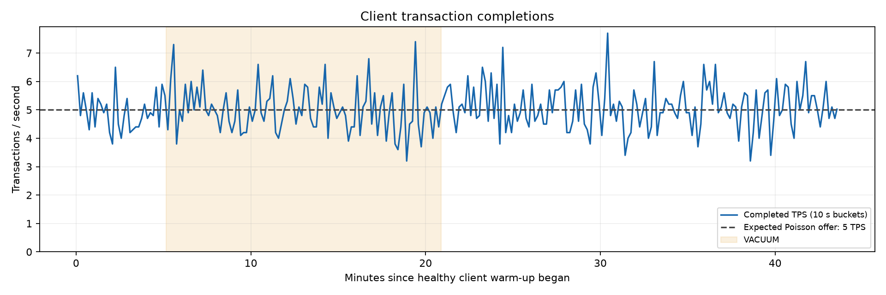
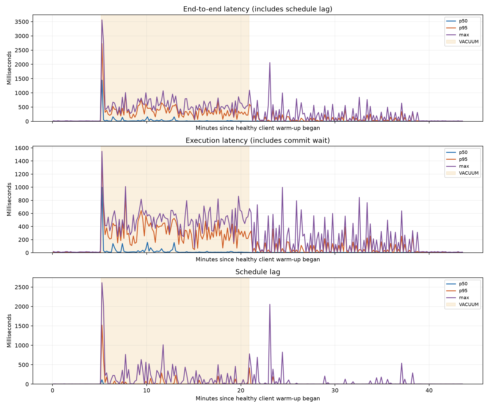
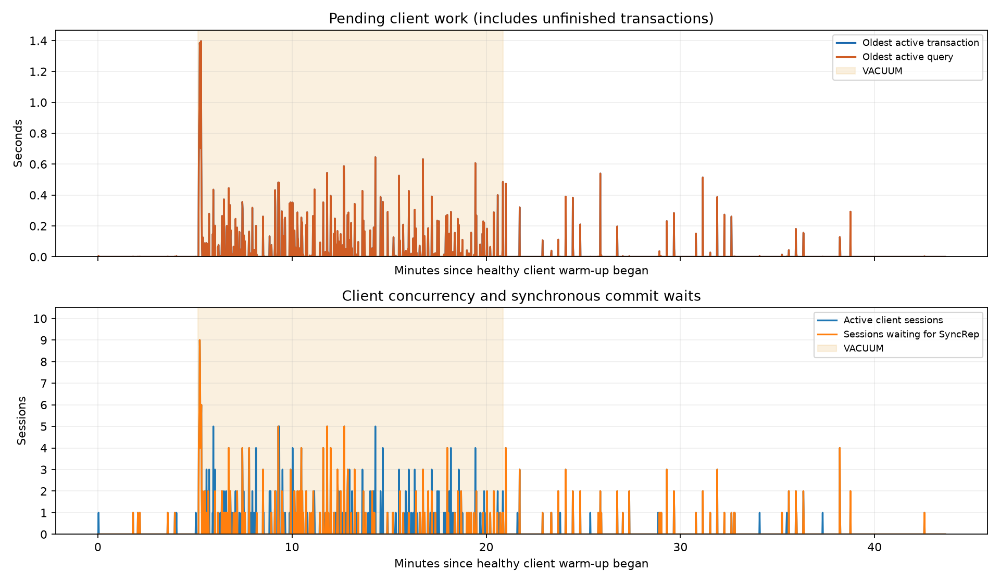
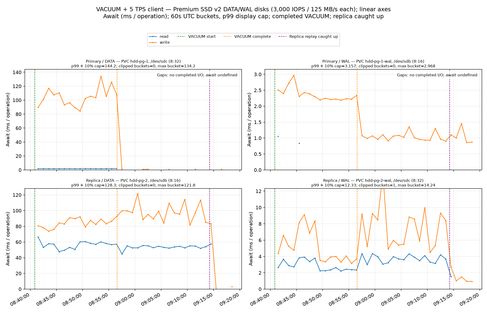
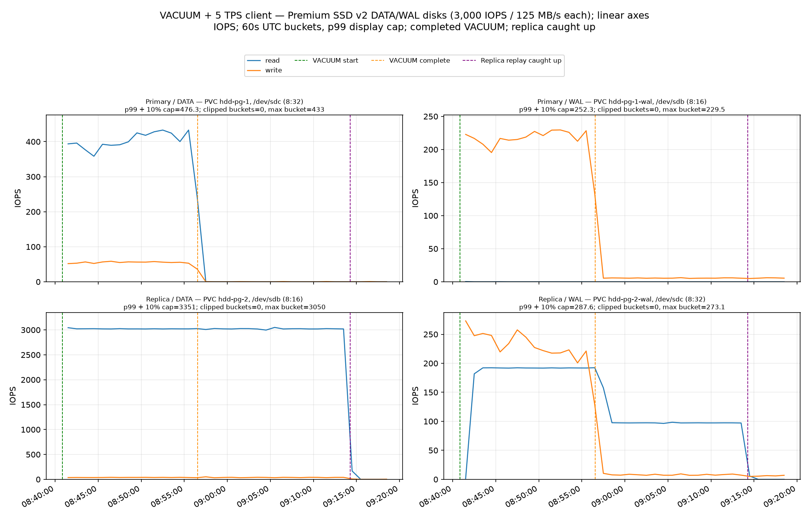
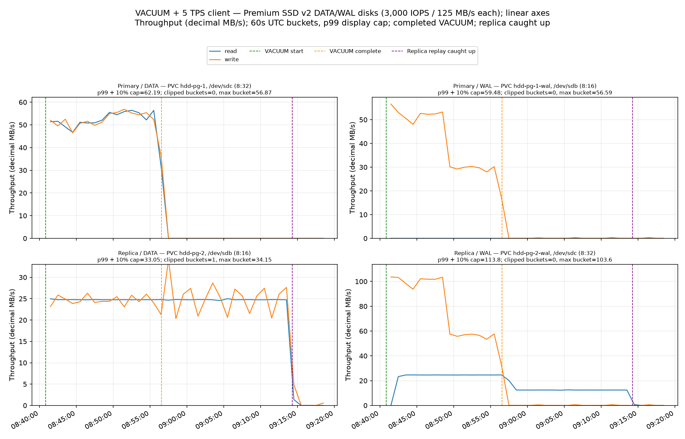

# Snapshot baseline with a tiny 5 TPS target-rate client

During the 302-second healthy warm-up, the primary committed **1,484 transactions (4.917 TPS from the exact server counter in [client-warmup.json](client-warmup.json))**. Across the full pre-VACUUM interval (warm-up plus checkpoint and replica replay wait), native client logs show **4.931 completed TPS**; during VACUUM they show **4.992 completed TPS**. VACUUM-period p95 end-to-end latency was **459.227 ms** (execution p95 **434.225 ms**). The longest consecutive run of full 10-second zero-completion buckets was **0 seconds during VACUUM** and **0 seconds across the measured client-active window**.

Measured run: VACUUM finished in **942.80 seconds**. The replica reached its completion LSN in **2,004.63 seconds from VACUUM start**, at **2026-10-09T09:14:15.922748679Z**, with the client still active. The full observation, including five healthy recovery minutes, graceful client drain and final replay verification, ended **2,320.85 seconds from VACUUM start**; final lag was **0 bytes**.

The client requested 5 TPS in total across ten persistent connections, updating one logged row per connection. pgbench ran inside the primary pod over localhost TCP with the app role. `synchronous_commit=on` was preserved: commits wait for standby WAL flush, while replica replay can fall behind. The run measures client transaction throughput and latency.

## Client impact

| Phase | Seconds | Completed TPS | p50 latency ms | p95 latency ms | p99 latency ms | Max latency ms | Max pending transaction age s |
|---|---:|---:|---:|---:|---:|---:|---:|
| healthy warm-up (subset of pre_vacuum) | 301.79 | 4.917 | 3.720 | 6.498 | 11.567 | 18.967 | 0.006 |
| pre_vacuum (full warm-up + checkpoint/replay interval) | 309.85 | 4.931 | 3.721 | 6.556 | 11.567 | 18.967 | 0.006 |
| vacuum | 942.80 | 4.992 | 11.252 | 459.227 | 951.539 | 3,561.564 | 1.397 |
| replay_catchup | 1,061.84 | 5.094 | 3.612 | 53.398 | 346.414 | 2,061.470 | 0.540 |
| recovery_verification | 299.98 | 5.070 | 3.728 | 7.595 | 15.235 | 313.759 | 0.293 |
| post_recovery_client | 0.12 | 8.530 | 3.707 | 3.707 | 3.707 | 3.707 | unavailable |
| stop_drain | 3.43 | unavailable | 4.140 | 4.140 | 4.140 | 4.154 | 0.000 |

The 6 disjoint phase rows contain 13,168 native completions. Another 8 startup completions preceded the healthy warm-up boundary; together they account for all 13,176 completed transactions.

Native completion logs contain 13,176 transactions. Client failures: 0; pgbench exit code: 0. Maximum observed replay backlog across the sampled post-warm-up client window: 12.907 GiB.

The opening healthy warm-up measurement uses the exact primary committed-transaction counter delta (1,484 over 301.817 seconds). Table TPS uses native-log completions; it can differ slightly because the client log assigns transactions by completion timestamps. The pre-VACUUM phase row aggregates the entire interval from warm-up start through the checkpoint and replica replay wait up to VACUUM start, and includes the healthy warm-up subset.

pgbench schedules Poisson arrivals around the target rate. Completed TPS and phase attribution use native completion timestamps, including buckets with zero completions while the client runs. A transaction can begin in an earlier phase. End-to-end latency includes schedule lag and commit wait; execution latency subtracts schedule lag but still includes commit wait. Commit-wait duration is not isolated. Latency distributions include only completed transactions, so the pending-age graph separately shows unfinished work. The zero-completion duration above counts consecutive full 10-second buckets only; partial edge buckets are excluded.

Pending-session samples: 2,602; errors: 0; maximum successful-sample gap: 6.614 seconds. Pending age is sampled and can miss short waits or work during missing intervals.

## Client throughput and replication

The combined [client and replication graph](client-replication.png) uses the five-minute healthy warm-up as time zero. Client throughput and latency span that warm-up; replication traces begin at the first pre-VACUUM sample, leaving the earlier warm-up blank in those panels. Replay backlog had 463 valid samples over 2,305.6 covered seconds (88.2% of the plotted window); first/last valid samples were 2026-10-09T08:40:50.302Z / 2026-10-09T09:19:15.897Z, with 308.9 seconds before the first valid sample and a maximum valid-sample gap of 8.1 seconds. The maximum observed primary-flush-to-replica-replay backlog was 12.907 GiB. See [client-replication.json](client-replication.json) for invalid fields, gaps, and coverage details.

Primary flush LSN marks WAL flushed on the primary; the sole replication sender flush LSN reports WAL flushed on the standby, while replica replay LSN marks WAL applied by recovery. The flush backlog and replay backlog are different quantities: synchronous_commit=on waits for synchronous standby flush, not remote apply/replay. Replay can therefore lag while commits continue to wait only for flush.

## Storage

Across the complete VACUUM and replay observation window, replica/primary DATA read operations were **15.809×**, and DATA bytes read were **0.994×**. These guest block counters describe operations and bytes; they do not establish repeated reads of the same physical block. The tiny client contributes additional DATA/WAL traffic.

| Device | Read IOPS | Write IOPS | Read MB/s | Write MB/s | Read await ms | Write await ms |
|---|---:|---:|---:|---:|---:|---:|
| primary_data | 164.264 | 22.618 | 21.416 | 21.443 | 1.967 | 103.840 |
| primary_wal | 0.012 | 92.390 | 0.001 | 17.033 | 1.145 | 2.325 |
| replica_data | 2,596.904 | 32.978 | 21.280 | 21.400 | 54.739 | 91.350 |
| replica_wal | 118.777 | 98.622 | 15.191 | 32.371 | 3.197 | 5.423 |

Mean DATA read requests were 127.32 KiB on the primary and 8.00 KiB on the replica. Similar bytes split into much smaller requests explain the operation ratio; this does not identify how often any individual page was read.

MB/s is decimal. Await is the operation-weighted guest block completion time. Linux read-ahead and merging, hypervisor, controller, firmware and hardware coalescing can change the operations visible at each layer; results can vary substantially by environment. All plots use linear y-axes.

The storage graphs mark the first verified arrival at the fixed VACUUM completion LSN (2026-10-09T09:14:15.922748679Z). Curves and storage totals retain the complete observation window, including the later healthy recovery interval and final post-client replay verification (2026-10-09T09:19:32.138817165Z). The [plot-boundary receipt](storage-plot-boundaries.json) preserves both endpoints and original collector plots; raw timing and counters are unchanged.

## Setup and source

23 GiB heap; separate 512 GiB DATA and WAL disks on both instances; Azure PremiumV2_LRS at 3000 IOPS and 125 MB/s per disk, caching None, logical sector size 512. East US zone 1; two Standard_D2s_v4 workers; AKS 1.35.8; CNPG 1.30.1; PostgreSQL 16.15. All four measurement disks completed hydration before client warm-up.

The existing 23 GiB paired online CNPG snapshot backup was restored to its verified backup-end LSN using preserved archive WAL. The large target fixture DML was not rerun. A fresh paired backup seeded the replica. The source has the same system identifier and physical fixture as the prior baseline. Live/dead tuple counts are inherited estimates; no full-table count warmed the test heap.

DATA source: `/subscriptions/00000000-0000-0000-0000-000000000000/resourceGroups/rg-vacuum-pv2-snap-4b1163091c697351e7725163a5a28e2e/providers/Microsoft.Compute/snapshots/snapshot-53ea286c-28a7-4225-b58f-ddd91ed93f57` (unique ID `1f377a1d-93eb-411b-8c91-e73955201414`).

WAL source: `/subscriptions/00000000-0000-0000-0000-000000000000/resourceGroups/rg-vacuum-pv2-snap-4b1163091c697351e7725163a5a28e2e/providers/Microsoft.Compute/snapshots/snapshot-caf74210-9ce8-4f42-8c47-9ee8076a0201` (unique ID `65caa339-28ed-4173-b9eb-804eac40aa49`).

Baseline PostgreSQL settings and synchronous quorum were verified in [preflight.json](preflight.json). Raw samples, native client logs, measurement events and phase receipts are retained. This is one measured repeat with a client workload; it does not isolate prefetch against an off control.

Preparation initially selected a base-backup join; it was stopped and its replica volumes were removed. The replica used for measurement was restored from the verified offline snapshot pair. After all four copies reached 100%, both PostgreSQL pods restarted onto the pinned measurement image. Before client setup, privileged one-shot pods ran sync and wrote 3 to Linux drop_caches on both isolated workers to remove possible OS cache warming from the aborted join. This clears Linux page cache, dentries and inodes; it does not clear PostgreSQL shared_buffers. The commands succeeded and the helper pods were removed. Two pre-VACUUM client launcher failures are retained with exact executed script copies and process receipts: the first occurred before client launch; the second client was gracefully drained with 531 completed/logged/server-committed transactions and zero failures. Only its ten-row client table was reset before the successful measurement. The complete preparation detour and conditioning are recorded below. Azure Monitor reported 100% VM uncached bandwidth utilization on both workers and 100% VM uncached IOPS utilization on the replica during 08:43–08:52 UTC. The live Standard_D2s_v4 SKU exposes aggregate limits of 3200 uncached IOPS and 48000000 bytes/s, in addition to each disk configuration. Guest DATA/WAL counters exceed that bandwidth figure; this layer discrepancy remains unresolved, and this run does not isolate the cause of client latency. The [storage review](../../verification/azure-d2sv4-storage-review.md) links Microsoft documentation, retained Azure responses and reproducible guest calculations. These are guest-observed disk operations; they should not be interpreted as a count of separately billed Azure transactions.

## Complete end-to-end UTC timeline

Exact resource/process timestamps are distinguished from observation times. Original source snapshots are historical inputs; restore and hydration below belong to this run. The table shows phase changes and copy progress; [timeline.json](timeline.json) also retains routine metadata polls, full details and evidence hashes.

| UTC timestamp | Event | Time precision | Evidence |
|---|---|---|---|
| 2026-10-06T16:29:31Z | Historical-VolumeSnapshot-created:vacuum-data-4b116309 | Kubernetes-resource-time | [volumesnapshot.json](../../run/recovery/source-evidence/volumesnapshot.json) |
| 2026-10-06T16:29:33Z | Historical-PersistentVolumeClaim-created:hdd-pg-1 | Kubernetes-resource-time | [pvc.json](../../run/recovery/source-evidence/pvc.json) |
| 2026-10-06T17:30:02Z | Historical-PersistentVolumeClaim-created:hdd-pg-1-wal | Kubernetes-resource-time | [pvc.json](../../run/recovery/source-evidence/pvc.json) |
| 2026-10-06T18:08:37Z | retained-source-backup-started | CNPG-backup-status | [backup.json](../../run/recovery/source-evidence/backup.json) |
| 2026-10-06T18:08:37Z | Historical-Backup-created:vacuum-backup-4b116309 | Kubernetes-resource-time | [backup.json](../../run/recovery/source-evidence/backup.json) |
| 2026-10-06T18:08:37Z | Historical-Backup-startedAt:vacuum-backup-4b116309 | CNPG-backup-status | [backup.json](../../run/recovery/source-evidence/backup.json) |
| 2026-10-06T18:08:47Z | Historical-VolumeSnapshot-created:vacuum-backup-4b116309 | Kubernetes-resource-time | [volumesnapshot.json](../../run/recovery/source-evidence/volumesnapshot.json) |
| 2026-10-06T18:08:47Z | Historical-VolumeSnapshot-created:vacuum-backup-4b116309-wal | Kubernetes-resource-time | [volumesnapshot.json](../../run/recovery/source-evidence/volumesnapshot.json) |
| 2026-10-06T18:08:48.204739Z | retained-source-snapshot-created | ARM-resource-time | [snapshot-53ea286c-28a7-4225-b58f-ddd91ed93f57.json](../../run/recovery/source-evidence/snapshot-53ea286c-28a7-4225-b58f-ddd91ed93f57.json) |
| 2026-10-06T18:08:48.204739Z | Historical-Azure-snapshots-created:snapshot-53ea286c-28a7-4225-b58f-ddd91ed93f57 | ARM-resource-creation-time | [20261009T042603.709895090Z-source-snapshot-verified-azureSnapshot-snapshot-53ea286c-28a7-4225-b58f-ddd91ed93f57-2eba68d3c378580c79c5d8521e30f6f7f204f0594f2b026c39252a72d86747b1.json](../../run/.state/recovery/evidence/20261009T042603.709895090Z-source-snapshot-verified-azureSnapshot-snapshot-53ea286c-28a7-4225-b58f-ddd91ed93f57-2eba68d3c378580c79c5d8521e30f6f7f204f0594f2b026c39252a72d86747b1.json) |
| 2026-10-06T18:08:48.607019Z | retained-source-snapshot-created | ARM-resource-time | [snapshot-caf74210-9ce8-4f42-8c47-9ee8076a0201.json](../../run/recovery/source-evidence/snapshot-caf74210-9ce8-4f42-8c47-9ee8076a0201.json) |
| 2026-10-06T18:08:48.607019Z | Historical-Azure-snapshots-created:snapshot-caf74210-9ce8-4f42-8c47-9ee8076a0201 | ARM-resource-creation-time | [20261009T042606.407398326Z-source-snapshot-verified-azureSnapshot-snapshot-caf74210-9ce8-4f42-8c47-9ee8076a0201-917b0b3e4ca9b1b7a6ae68acceb0764529d4abd6d6b96b7ba3a18ceb0eb89195.json](../../run/.state/recovery/evidence/20261009T042606.407398326Z-source-snapshot-verified-azureSnapshot-snapshot-caf74210-9ce8-4f42-8c47-9ee8076a0201-917b0b3e4ca9b1b7a6ae68acceb0764529d4abd6d6b96b7ba3a18ceb0eb89195.json) |
| 2026-10-06T19:03:21Z | retained-source-backup-completed | CNPG-backup-status | [backup.json](../../run/recovery/source-evidence/backup.json) |
| 2026-10-06T19:03:21Z | Historical-Backup-stoppedAt:vacuum-backup-4b116309 | CNPG-backup-status | [backup.json](../../run/recovery/source-evidence/backup.json) |
| 2026-10-09T04:05:07.725630Z | minimum-preflight-passed | local-observation | [timeline-events.jsonl](../../timeline-events.jsonl) |
| 2026-10-09T04:07:05.237496Z | provision-started | local-observation | [provision-process.json](../../run/.state/provision-process.json) |
| 2026-10-09T04:08:53.002868Z | owned-provisioning-state-observed | local-observation | [state.json](../../run/.state/state.json) |
| 2026-10-09T04:13:31.797718Z | provision-finished | exact-process-receipt | [provision-process.json](../../run/.state/provision-process.json) |
| 2026-10-09T04:20:38.140816Z | provision-verified-two-ready-pinned-workers | local-observation | [provision-nodes.json](../../verification/provision-nodes.json) |
| 2026-10-09T04:25:03.648823Z | prepare-started | exact-process-receipt | [prepare-process.json](../../run/.state/prepare-process.json) |
| 2026-10-09T04:25:03.871296Z | prepare-started:hdd-pg | local-event-receipt | [phase-events.jsonl](../../run/.state/recovery/phase-events.jsonl) |
| 2026-10-09T04:26:03.715411Z | source-snapshot-verified:snapshot-53ea286c-28a7-4225-b58f-ddd91ed93f57 | local-event-receipt | [phase-events.jsonl](../../run/.state/recovery/phase-events.jsonl) |
| 2026-10-09T04:26:06.411351Z | source-snapshot-verified:snapshot-caf74210-9ce8-4f42-8c47-9ee8076a0201 | local-event-receipt | [phase-events.jsonl](../../run/.state/recovery/phase-events.jsonl) |
| 2026-10-09T04:26:08.227391Z | retained-source-verified:data+wal | local-event-receipt | [phase-events.jsonl](../../run/.state/recovery/phase-events.jsonl) |
| 2026-10-09T04:26:19.938653Z | reader-assignment-intent:cc3aea3e-cd8c-4d47-b176-82492f726691 | local-event-receipt | [phase-events.jsonl](../../run/.state/recovery/phase-events.jsonl) |
| 2026-10-09T04:26:22.513370Z | reader-assignment-created:cc3aea3e-cd8c-4d47-b176-82492f726691 | local-event-receipt | [phase-events.jsonl](../../run/.state/recovery/phase-events.jsonl) |
| 2026-10-09T04:26:22.561095Z | reader-assignment-intent:bd670074-2bbb-427a-9375-9836839a02d0 | local-event-receipt | [phase-events.jsonl](../../run/.state/recovery/phase-events.jsonl) |
| 2026-10-09T04:26:25.030835Z | reader-assignment-created:bd670074-2bbb-427a-9375-9836839a02d0 | local-event-receipt | [phase-events.jsonl](../../run/.state/recovery/phase-events.jsonl) |
| 2026-10-09T04:26:25.134975Z | source-bindings-validated:paired-source | local-event-receipt | [phase-events.jsonl](../../run/.state/recovery/phase-events.jsonl) |
| 2026-10-09T04:26:34Z | VolumeSnapshot-created:source-data-5203346e | Kubernetes-resource-time | [20261009T042635.205209455Z-source-vss-ready-volumeSnapshot-source-data-5203346e-04c47b48ed2b135ce9efd44b5ef99f184d2623b0b72b2cdce8a51805c42cbcc7.json](../../run/.state/recovery/evidence/20261009T042635.205209455Z-source-vss-ready-volumeSnapshot-source-data-5203346e-04c47b48ed2b135ce9efd44b5ef99f184d2623b0b72b2cdce8a51805c42cbcc7.json) |
| 2026-10-09T04:26:34Z | VolumeSnapshot-created:source-wal-5203346e | Kubernetes-resource-time | [20261009T042636.190235429Z-source-vss-ready-volumeSnapshot-source-wal-5203346e-4391f0a8301ba2e748f02cbe69da5f133baaaca8c1f94eb3dd252d1ed2570524.json](../../run/.state/recovery/evidence/20261009T042636.190235429Z-source-vss-ready-volumeSnapshot-source-wal-5203346e-4391f0a8301ba2e748f02cbe69da5f133baaaca8c1f94eb3dd252d1ed2570524.json) |
| 2026-10-09T04:26:35.216640Z | source-vss-ready:source-data-5203346e | local-event-receipt | [phase-events.jsonl](../../run/.state/recovery/phase-events.jsonl) |
| 2026-10-09T04:26:35.664591Z | source-vsc-ready:source-content-data-5203346e | local-event-receipt | [phase-events.jsonl](../../run/.state/recovery/phase-events.jsonl) |
| 2026-10-09T04:26:36.196015Z | source-vss-ready:source-wal-5203346e | local-event-receipt | [phase-events.jsonl](../../run/.state/recovery/phase-events.jsonl) |
| 2026-10-09T04:26:36.596220Z | source-vsc-ready:source-content-wal-5203346e | local-event-receipt | [phase-events.jsonl](../../run/.state/recovery/phase-events.jsonl) |
| 2026-10-09T04:26:51.551189Z | source-wal-object-ready:000000010000004E00000050 | local-event-receipt | [phase-events.jsonl](../../run/.state/recovery/phase-events.jsonl) |
| 2026-10-09T04:26:58.078301Z | source-wal-object-ready:000000010000004E00000050.00000028.backup | local-event-receipt | [phase-events.jsonl](../../run/.state/recovery/phase-events.jsonl) |
| 2026-10-09T04:27:01.678625Z | cluster-recovery-manifest-validated:hdd-pg | local-event-receipt | [phase-events.jsonl](../../run/.state/recovery/phase-events.jsonl) |
| 2026-10-09T04:27:03Z | PersistentVolumeClaim-created:hdd-pg-1 | Kubernetes-resource-time | [20261009T055556.439973038Z-primary-pvcs-before-seed-persistentVolumeClaims-hdd-pg-062e0568cf3dc48652c9965bfc3609d88f5b24f7d0189030dc6855c2e107a4a3.json](../../run/.state/recovery/evidence/20261009T055556.439973038Z-primary-pvcs-before-seed-persistentVolumeClaims-hdd-pg-062e0568cf3dc48652c9965bfc3609d88f5b24f7d0189030dc6855c2e107a4a3.json) |
| 2026-10-09T04:27:03Z | PersistentVolumeClaim-created:hdd-pg-1-wal | Kubernetes-resource-time | [20261009T055556.439973038Z-primary-pvcs-before-seed-persistentVolumeClaims-hdd-pg-062e0568cf3dc48652c9965bfc3609d88f5b24f7d0189030dc6855c2e107a4a3.json](../../run/.state/recovery/evidence/20261009T055556.439973038Z-primary-pvcs-before-seed-persistentVolumeClaims-hdd-pg-062e0568cf3dc48652c9965bfc3609d88f5b24f7d0189030dc6855c2e107a4a3.json) |
| 2026-10-09T04:28:28.492695Z | source-disk-provisioning-awaiting-Reader-permission-propagation | local-observation | [restore-permission-warnings-initial.json](../../verification/restore-permission-warnings-initial.json) |
| 2026-10-09T04:42:47.826885Z | instrumentation-version-gate-corrected-and-verified | local-verification-time | [test_client_instrumentation.py](../../client/test_client_instrumentation.py) |
| 2026-10-09T04:51:39.929447Z | restore-started | exact-process-receipt | [restore-process.json](../../run/.state/restore-process.json) |
| 2026-10-09T04:51:40.029484Z | restore-intents-written:restore.json | local-event-receipt | [events.jsonl](../../run/.state/recovery/pending-disk-restore/events.jsonl) |
| 2026-10-09T04:51:51.000803Z | source-snapshot-revalidated:data | local-event-receipt | [events.jsonl](../../run/.state/recovery/pending-disk-restore/events.jsonl) |
| 2026-10-09T04:51:52.848454Z | disk-create-intent:restore-data-5203346e | local-event-receipt | [events.jsonl](../../run/.state/recovery/pending-disk-restore/events.jsonl) |
| 2026-10-09T04:51:55.511627Z | Azure-disks-created:restore-data-5203346e | ARM-resource-creation-time | [20261009T055558.294887661Z-disk-hydration-progress-azureDisk-hdd-pg-1-f9f435d7594fda5561bb340e35af66d0335c72338c4c55049090a55656a43cb9.json](../../run/.state/recovery/evidence/20261009T055558.294887661Z-disk-hydration-progress-azureDisk-hdd-pg-1-f9f435d7594fda5561bb340e35af66d0335c72338c4c55049090a55656a43cb9.json) |
| 2026-10-09T04:51:56.136898Z | disk-create-submitted:data | local-event-receipt | [events.jsonl](../../run/.state/recovery/pending-disk-restore/events.jsonl) |
| 2026-10-09T04:51:57.353011Z | disk-hydration-progress:restore-data-5203346e | local-event-receipt | [events.jsonl](../../run/.state/recovery/pending-disk-restore/events.jsonl) |
| 2026-10-09T04:52:18.360523Z | disk-hydration-progress:restore-data-5203346e | local-event-receipt | [events.jsonl](../../run/.state/recovery/pending-disk-restore/events.jsonl) |
| 2026-10-09T04:52:40.756608Z | executed-restore-helper-source-preserved | local-audit-time | [restore-pending-disks-executed.py](../../recovery/restore-pending-disks-executed.py) |
| 2026-10-09T05:09:57.576626Z | cleanup-retention-guard-verified | local-verification-time | [cleanup-run-review.md](../../verification/cleanup-run-review.md) |
| 2026-10-09T05:13:25.016210Z | disk-hydration-progress:restore-data-5203346e | local-event-receipt | [events.jsonl](../../run/.state/recovery/pending-disk-restore/events.jsonl) |
| 2026-10-09T05:22:11.609548Z | disk-hydration-progress:restore-data-5203346e | local-event-receipt | [events.jsonl](../../run/.state/recovery/pending-disk-restore/events.jsonl) |
| 2026-10-09T05:28:09.704341Z | disk-hydration-progress:restore-data-5203346e | local-event-receipt | [events.jsonl](../../run/.state/recovery/pending-disk-restore/events.jsonl) |
| 2026-10-09T05:31:19.804265Z | disk-hydration-progress:restore-data-5203346e | local-event-receipt | [events.jsonl](../../run/.state/recovery/pending-disk-restore/events.jsonl) |
| 2026-10-09T05:37:17.298879Z | disk-hydration-progress:restore-data-5203346e | local-event-receipt | [events.jsonl](../../run/.state/recovery/pending-disk-restore/events.jsonl) |
| 2026-10-09T05:37:18.136514Z | source-snapshot-revalidated:data | local-event-receipt | [events.jsonl](../../run/.state/recovery/pending-disk-restore/events.jsonl) |
| 2026-10-09T05:37:18.902044Z | disk-copy-hydrated:restore-data-5203346e | local-event-receipt | [events.jsonl](../../run/.state/recovery/pending-disk-restore/events.jsonl) |
| 2026-10-09T05:37:24.001741Z | source-snapshot-revalidated:wal | local-event-receipt | [events.jsonl](../../run/.state/recovery/pending-disk-restore/events.jsonl) |
| 2026-10-09T05:37:25.722865Z | disk-create-intent:restore-wal-5203346e | local-event-receipt | [events.jsonl](../../run/.state/recovery/pending-disk-restore/events.jsonl) |
| 2026-10-09T05:37:27.252082Z | Azure-disks-created:restore-wal-5203346e | ARM-resource-creation-time | [20261009T055600.407445247Z-disk-hydration-progress-azureDisk-hdd-pg-1-wal-0ca2df071f3c16c33998022f4d96a0422ee1375e8f7d1cfe3d4f316caa28969d.json](../../run/.state/recovery/evidence/20261009T055600.407445247Z-disk-hydration-progress-azureDisk-hdd-pg-1-wal-0ca2df071f3c16c33998022f4d96a0422ee1375e8f7d1cfe3d4f316caa28969d.json) |
| 2026-10-09T05:37:27.567770Z | disk-create-submitted:wal | local-event-receipt | [events.jsonl](../../run/.state/recovery/pending-disk-restore/events.jsonl) |
| 2026-10-09T05:37:28.497835Z | disk-hydration-progress:restore-wal-5203346e | local-event-receipt | [events.jsonl](../../run/.state/recovery/pending-disk-restore/events.jsonl) |
| 2026-10-09T05:37:49.560190Z | disk-hydration-progress:restore-wal-5203346e | local-event-receipt | [events.jsonl](../../run/.state/recovery/pending-disk-restore/events.jsonl) |
| 2026-10-09T05:39:13.781838Z | disk-hydration-progress:restore-wal-5203346e | local-event-receipt | [events.jsonl](../../run/.state/recovery/pending-disk-restore/events.jsonl) |
| 2026-10-09T05:42:23.584151Z | disk-hydration-progress:restore-wal-5203346e | local-event-receipt | [events.jsonl](../../run/.state/recovery/pending-disk-restore/events.jsonl) |
| 2026-10-09T05:45:11.645416Z | disk-hydration-progress:restore-wal-5203346e | local-event-receipt | [events.jsonl](../../run/.state/recovery/pending-disk-restore/events.jsonl) |
| 2026-10-09T05:50:59.264768Z | restore-status-call-timeout | exact-process-receipt | [restore-process.json](../../run/.state/restore-process.json) |
| 2026-10-09T05:50:59.264768Z | restore-finished | exact-process-receipt | [restore-process.json](../../run/.state/restore-process.json) |
| 2026-10-09T05:53:48.273879Z | restore-attempt-2-started | exact-process-receipt | [restore-process-attempt-2.json](../../run/.state/restore-process-attempt-2.json) |
| 2026-10-09T05:53:59.373926Z | source-snapshot-revalidated:data | local-event-receipt | [events.jsonl](../../run/.state/recovery/pending-disk-restore/events.jsonl) |
| 2026-10-09T05:54:01.320608Z | existing-planned-disk-validated:restore-data-5203346e | local-event-receipt | [events.jsonl](../../run/.state/recovery/pending-disk-restore/events.jsonl) |
| 2026-10-09T05:54:02.193116Z | disk-hydration-progress:restore-data-5203346e | local-event-receipt | [events.jsonl](../../run/.state/recovery/pending-disk-restore/events.jsonl) |
| 2026-10-09T05:54:02.984300Z | source-snapshot-revalidated:data | local-event-receipt | [events.jsonl](../../run/.state/recovery/pending-disk-restore/events.jsonl) |
| 2026-10-09T05:54:03.734460Z | disk-copy-hydrated:restore-data-5203346e | local-event-receipt | [events.jsonl](../../run/.state/recovery/pending-disk-restore/events.jsonl) |
| 2026-10-09T05:54:09.673209Z | source-snapshot-revalidated:wal | local-event-receipt | [events.jsonl](../../run/.state/recovery/pending-disk-restore/events.jsonl) |
| 2026-10-09T05:54:11.385335Z | existing-planned-disk-validated:restore-wal-5203346e | local-event-receipt | [events.jsonl](../../run/.state/recovery/pending-disk-restore/events.jsonl) |
| 2026-10-09T05:54:12.316416Z | disk-hydration-progress:restore-wal-5203346e | local-event-receipt | [events.jsonl](../../run/.state/recovery/pending-disk-restore/events.jsonl) |
| 2026-10-09T05:54:13.219065Z | source-snapshot-revalidated:wal | local-event-receipt | [events.jsonl](../../run/.state/recovery/pending-disk-restore/events.jsonl) |
| 2026-10-09T05:54:14.049693Z | disk-copy-hydrated:restore-wal-5203346e | local-event-receipt | [events.jsonl](../../run/.state/recovery/pending-disk-restore/events.jsonl) |
| 2026-10-09T05:54:19.950629Z | static-pv-created:restore-data-5203346e | local-event-receipt | [events.jsonl](../../run/.state/recovery/pending-disk-restore/events.jsonl) |
| 2026-10-09T05:54:21.955229Z | static-pv-created:restore-wal-5203346e | local-event-receipt | [events.jsonl](../../run/.state/recovery/pending-disk-restore/events.jsonl) |
| 2026-10-09T05:54:27.543934Z | pvc-bound-to-static-pv:hdd-pg-1 | local-event-receipt | [events.jsonl](../../run/.state/recovery/pending-disk-restore/events.jsonl) |
| 2026-10-09T05:54:33.443142Z | pvc-bound-to-static-pv:hdd-pg-1-wal | local-event-receipt | [events.jsonl](../../run/.state/recovery/pending-disk-restore/events.jsonl) |
| 2026-10-09T05:54:33.446034Z | restore-pending-disks-ready:restore.json | local-event-receipt | [events.jsonl](../../run/.state/recovery/pending-disk-restore/events.jsonl) |
| 2026-10-09T05:54:33.465577Z | restore-attempt-2-finished | exact-process-receipt | [restore-process-attempt-2.json](../../run/.state/restore-process-attempt-2.json) |
| 2026-10-09T05:55:54.022790Z | primary-recovery-ready:hdd-pg | local-event-receipt | [phase-events.jsonl](../../run/.state/recovery/phase-events.jsonl) |
| 2026-10-09T05:55:54.067795Z | paired-source-recovery-complete:hdd-pg | local-event-receipt | [phase-events.jsonl](../../run/.state/recovery/phase-events.jsonl) |
| 2026-10-09T05:55:55.159252Z | primary-fixture-verified:hdd-pg-1 | local-event-receipt | [phase-events.jsonl](../../run/.state/recovery/phase-events.jsonl) |
| 2026-10-09T05:55:56.040909Z | primary-copy-hydration-started:hdd-pg | local-event-receipt | [phase-events.jsonl](../../run/.state/recovery/phase-events.jsonl) |
| 2026-10-09T05:55:56.449356Z | primary-pvcs-before-seed:hdd-pg | local-event-receipt | [phase-events.jsonl](../../run/.state/recovery/phase-events.jsonl) |
| 2026-10-09T05:55:56.863390Z | primary-pvc-source:hdd-pg-1 | local-event-receipt | [phase-events.jsonl](../../run/.state/recovery/phase-events.jsonl) |
| 2026-10-09T05:55:57.287656Z | primary-pv-source:hdd-pg-1 | local-event-receipt | [phase-events.jsonl](../../run/.state/recovery/phase-events.jsonl) |
| 2026-10-09T05:55:58.299654Z | disk-hydration-progress:hdd-pg-1 | local-event-receipt | [phase-events.jsonl](../../run/.state/recovery/phase-events.jsonl) |
| 2026-10-09T05:55:58.336538Z | primary-copy-hydration-complete:hdd-pg-1 | local-event-receipt | [phase-events.jsonl](../../run/.state/recovery/phase-events.jsonl) |
| 2026-10-09T05:55:58.756186Z | primary-pvc-source:hdd-pg-1-wal | local-event-receipt | [phase-events.jsonl](../../run/.state/recovery/phase-events.jsonl) |
| 2026-10-09T05:55:59.183533Z | primary-pv-source:hdd-pg-1-wal | local-event-receipt | [phase-events.jsonl](../../run/.state/recovery/phase-events.jsonl) |
| 2026-10-09T05:56:00.417394Z | disk-hydration-progress:hdd-pg-1-wal | local-event-receipt | [phase-events.jsonl](../../run/.state/recovery/phase-events.jsonl) |
| 2026-10-09T05:56:00.465541Z | primary-copy-hydration-complete:hdd-pg-1-wal | local-event-receipt | [phase-events.jsonl](../../run/.state/recovery/phase-events.jsonl) |
| 2026-10-09T05:56:00.937753Z | offline-seed-backup-requested:vacuum-seed-5203346e | local-event-receipt | [phase-events.jsonl](../../run/.state/recovery/phase-events.jsonl) |
| 2026-10-09T05:56:01Z | Backup-created:vacuum-seed-5203346e | Kubernetes-resource-time | [20261009T055602.160526207Z-seed-backup-started-backup-vacuum-seed-5203346e-10c068a74722501fb032ee0e5ba9cfb51c1ab409892536dbaa6cdd5e7214e641.json](../../run/.state/recovery/evidence/20261009T055602.160526207Z-seed-backup-started-backup-vacuum-seed-5203346e-10c068a74722501fb032ee0e5ba9cfb51c1ab409892536dbaa6cdd5e7214e641.json) |
| 2026-10-09T05:56:01Z | Backup-startedAt:vacuum-seed-5203346e | CNPG-backup-status | [20261009T055602.160526207Z-seed-backup-started-backup-vacuum-seed-5203346e-10c068a74722501fb032ee0e5ba9cfb51c1ab409892536dbaa6cdd5e7214e641.json](../../run/.state/recovery/evidence/20261009T055602.160526207Z-seed-backup-started-backup-vacuum-seed-5203346e-10c068a74722501fb032ee0e5ba9cfb51c1ab409892536dbaa6cdd5e7214e641.json) |
| 2026-10-09T05:56:02.170940Z | seed-backup-started:vacuum-seed-5203346e | local-event-receipt | [phase-events.jsonl](../../run/.state/recovery/phase-events.jsonl) |
| 2026-10-09T05:56:29Z | VolumeSnapshot-created:vacuum-seed-5203346e | Kubernetes-resource-time | [20261009T065636.280565882Z-seed-vss-observed-volumeSnapshot-vacuum-seed-5203346e-0545db5c557a2b0bb00a46dec81bdcceec6c402de025a34d24759a8bd888a6db.json](../../run/.state/recovery/evidence/20261009T065636.280565882Z-seed-vss-observed-volumeSnapshot-vacuum-seed-5203346e-0545db5c557a2b0bb00a46dec81bdcceec6c402de025a34d24759a8bd888a6db.json) |
| 2026-10-09T05:56:29Z | VolumeSnapshot-created:vacuum-seed-5203346e-wal | Kubernetes-resource-time | [20261009T065641.323575486Z-seed-vss-observed-volumeSnapshot-vacuum-seed-5203346e-wal-b743d78264ee46fb630a97fb0208075865df3c7f38a1be7686c72676b21ca3e5.json](../../run/.state/recovery/evidence/20261009T065641.323575486Z-seed-vss-observed-volumeSnapshot-vacuum-seed-5203346e-wal-b743d78264ee46fb630a97fb0208075865df3c7f38a1be7686c72676b21ca3e5.json) |
| 2026-10-09T05:56:29.623148Z | Azure-snapshots-created:snapshot-8ebad2c1-4518-4b11-87ff-f543032663f2 | ARM-resource-creation-time | [20261009T065644.847909103Z-seed-arm-snapshot-observed-azureSnapshot-snapshot-8ebad2c1-4518-4b11-87ff-f543032663f2-17fd5e9de078df4fb889f14a84379e2966a9f32ca98ec14c3f97d66e630e2329.json](../../run/.state/recovery/evidence/20261009T065644.847909103Z-seed-arm-snapshot-observed-azureSnapshot-snapshot-8ebad2c1-4518-4b11-87ff-f543032663f2-17fd5e9de078df4fb889f14a84379e2966a9f32ca98ec14c3f97d66e630e2329.json) |
| 2026-10-09T05:56:29.779505Z | Azure-snapshots-created:snapshot-a9f05e13-dcf6-40e7-9e5b-ff5fc0b11f24 | ARM-resource-creation-time | [20261009T065639.858569404Z-seed-arm-snapshot-observed-azureSnapshot-snapshot-a9f05e13-dcf6-40e7-9e5b-ff5fc0b11f24-3d20bd93287a50d89dd03dcea2d2863c44d904cf8ca4fd46a88de31cca36ea51.json](../../run/.state/recovery/evidence/20261009T065639.858569404Z-seed-arm-snapshot-observed-azureSnapshot-snapshot-a9f05e13-dcf6-40e7-9e5b-ff5fc0b11f24-3d20bd93287a50d89dd03dcea2d2863c44d904cf8ca4fd46a88de31cca36ea51.json) |
| 2026-10-09T05:56:43.905152Z | seed-backup-finalizing:vacuum-seed-5203346e | local-event-receipt | [phase-events.jsonl](../../run/.state/recovery/phase-events.jsonl) |
| 2026-10-09T06:01:59.295772Z | seed-snapshot-copy-progress | local-observation | [20261009T060158Z-seed-snapshots-copy-progress.json](../../run/.state/recovery/evidence/20261009T060158Z-seed-snapshots-copy-progress.json) |
| 2026-10-09T06:09:05.125445Z | seed-snapshot-copy-progress | local-observation | [20261009T060904Z-seed-snapshots-copy-progress.json](../../run/.state/recovery/evidence/20261009T060904Z-seed-snapshots-copy-progress.json) |
| 2026-10-09T06:17:36.342180Z | seed-snapshot-copy-progress | local-observation | [20261009T061735Z-seed-snapshots-copy-progress.json](../../run/.state/recovery/evidence/20261009T061735Z-seed-snapshots-copy-progress.json) |
| 2026-10-09T06:18:26.693110Z | seed-backup-finalizing:vacuum-seed-5203346e | local-event-receipt | [phase-events.jsonl](../../run/.state/recovery/phase-events.jsonl) |
| 2026-10-09T06:18:47.610181Z | seed-backup-finalizing:vacuum-seed-5203346e | local-event-receipt | [phase-events.jsonl](../../run/.state/recovery/phase-events.jsonl) |
| 2026-10-09T06:24:16.240898Z | seed-snapshot-copy-progress | local-observation | [20261009T062415Z-seed-snapshots-copy-progress.json](../../run/.state/recovery/evidence/20261009T062415Z-seed-snapshots-copy-progress.json) |
| 2026-10-09T06:29:17.715836Z | seed-snapshot-copy-progress | local-observation | [20261009T062917Z-seed-snapshots-copy-progress.json](../../run/.state/recovery/evidence/20261009T062917Z-seed-snapshots-copy-progress.json) |
| 2026-10-09T06:35:09.123578Z | seed-snapshot-copy-progress | local-observation | [20261009T063508Z-seed-snapshots-copy-progress.json](../../run/.state/recovery/evidence/20261009T063508Z-seed-snapshots-copy-progress.json) |
| 2026-10-09T06:39:04.686066Z | seed-backup-finalizing:vacuum-seed-5203346e | local-event-receipt | [phase-events.jsonl](../../run/.state/recovery/phase-events.jsonl) |
| 2026-10-09T06:39:15.003545Z | seed-backup-finalizing:vacuum-seed-5203346e | local-event-receipt | [phase-events.jsonl](../../run/.state/recovery/phase-events.jsonl) |
| 2026-10-09T06:40:19.485489Z | seed-snapshot-copy-progress | local-observation | [20261009T064018Z-seed-snapshots-copy-progress.json](../../run/.state/recovery/evidence/20261009T064018Z-seed-snapshots-copy-progress.json) |
| 2026-10-09T06:46:12.658394Z | seed-snapshot-copy-progress | local-observation | [20261009T064534Z-seed-snapshots-copy-progress.json](../../run/.state/recovery/evidence/20261009T064534Z-seed-snapshots-copy-progress.json) |
| 2026-10-09T06:56:29Z | Backup-stoppedAt:vacuum-seed-5203346e | CNPG-backup-status | [20261009T065635.878062625Z-seed-backup-completed-backup-vacuum-seed-5203346e-57202b597daf5639aa78676d30f592cc9540c819c244799bcaf95c49627ce224.json](../../run/.state/recovery/evidence/20261009T065635.878062625Z-seed-backup-completed-backup-vacuum-seed-5203346e-57202b597daf5639aa78676d30f592cc9540c819c244799bcaf95c49627ce224.json) |
| 2026-10-09T06:56:35.881422Z | seed-backup-completed:vacuum-seed-5203346e | local-event-receipt | [phase-events.jsonl](../../run/.state/recovery/phase-events.jsonl) |
| 2026-10-09T06:56:35.895184Z | offline-seed-backup-complete:vacuum-seed-5203346e | local-event-receipt | [phase-events.jsonl](../../run/.state/recovery/phase-events.jsonl) |
| 2026-10-09T06:56:36.284018Z | seed-vss-observed:vacuum-seed-5203346e | local-event-receipt | [phase-events.jsonl](../../run/.state/recovery/phase-events.jsonl) |
| 2026-10-09T06:56:36.574721Z | seed-primary-pvc-source:hdd-pg-1 | local-event-receipt | [phase-events.jsonl](../../run/.state/recovery/phase-events.jsonl) |
| 2026-10-09T06:56:36.897934Z | seed-vsc-observed:snapcontent-a9f05e13-dcf6-40e7-9e5b-ff5fc0b11f24 | local-event-receipt | [phase-events.jsonl](../../run/.state/recovery/phase-events.jsonl) |
| 2026-10-09T06:56:38.947750Z | seed-vss-owned:vacuum-seed-5203346e | local-event-receipt | [phase-events.jsonl](../../run/.state/recovery/phase-events.jsonl) |
| 2026-10-09T06:56:39.239056Z | seed-vsc-owned:snapcontent-a9f05e13-dcf6-40e7-9e5b-ff5fc0b11f24 | local-event-receipt | [phase-events.jsonl](../../run/.state/recovery/phase-events.jsonl) |
| 2026-10-09T06:56:39.862065Z | seed-arm-snapshot-observed:snapshot-a9f05e13-dcf6-40e7-9e5b-ff5fc0b11f24 | local-event-receipt | [phase-events.jsonl](../../run/.state/recovery/phase-events.jsonl) |
| 2026-10-09T06:56:41.327485Z | seed-vss-observed:vacuum-seed-5203346e-wal | local-event-receipt | [phase-events.jsonl](../../run/.state/recovery/phase-events.jsonl) |
| 2026-10-09T06:56:41.619637Z | seed-primary-pvc-source:hdd-pg-1-wal | local-event-receipt | [phase-events.jsonl](../../run/.state/recovery/phase-events.jsonl) |
| 2026-10-09T06:56:41.939039Z | seed-vsc-observed:snapcontent-8ebad2c1-4518-4b11-87ff-f543032663f2 | local-event-receipt | [phase-events.jsonl](../../run/.state/recovery/phase-events.jsonl) |
| 2026-10-09T06:56:43.950494Z | seed-vss-owned:vacuum-seed-5203346e-wal | local-event-receipt | [phase-events.jsonl](../../run/.state/recovery/phase-events.jsonl) |
| 2026-10-09T06:56:44.250707Z | seed-vsc-owned:snapcontent-8ebad2c1-4518-4b11-87ff-f543032663f2 | local-event-receipt | [phase-events.jsonl](../../run/.state/recovery/phase-events.jsonl) |
| 2026-10-09T06:56:44.851375Z | seed-arm-snapshot-observed:snapshot-8ebad2c1-4518-4b11-87ff-f543032663f2 | local-event-receipt | [phase-events.jsonl](../../run/.state/recovery/phase-events.jsonl) |
| 2026-10-09T07:02:15.684582Z | prepare-finished | exact-process-receipt | [prepare-process.json](../../run/.state/prepare-process.json) |
| 2026-10-09T07:02:42.638881Z | incorrect-basebackup-join-stop-requested | local-mutation-receipt | [20261009T070242Z-stop-basebackup-cluster.json](../../run/.state/recovery/evidence/20261009T070242Z-stop-basebackup-cluster.json) |
| 2026-10-09T07:15:20.947860Z | incorrect-join-disks-confirmed-removed | local-inventory-observation | [20261009T071446Z-root-owned-node-disks.json](../../run/.state/recovery/evidence/20261009T071446Z-root-owned-node-disks.json) |
| 2026-10-09T07:15:59.559789Z | seed-dry-run-proof:run | local-event-receipt | [phase-events.jsonl](../../run/.state/recovery/phase-events.jsonl) |
| 2026-10-09T07:18:27.521647Z | seed-dry-run-proof:run | local-event-receipt | [phase-events.jsonl](../../run/.state/recovery/phase-events.jsonl) |
| 2026-10-09T07:18:42.176895Z | seed-dry-run-proof:run | local-event-receipt | [phase-events.jsonl](../../run/.state/recovery/phase-events.jsonl) |
| 2026-10-09T07:18:50.624939Z | seed-dry-run-proof:run | local-event-receipt | [phase-events.jsonl](../../run/.state/recovery/phase-events.jsonl) |
| 2026-10-09T07:19:06.368243Z | seed-started | exact-process-receipt | [seed-process.json](../../run/.state/seed-process.json) |
| 2026-10-09T07:19:06.417570Z | continuation-started:run | local-event-receipt | [phase-events.jsonl](../../run/.state/recovery/phase-events.jsonl) |
| 2026-10-09T07:19:07.385569Z | continuation-primary-one-ready:hdd-pg | local-event-receipt | [phase-events.jsonl](../../run/.state/recovery/phase-events.jsonl) |
| 2026-10-09T07:19:07.945512Z | continuation-seed-backup-verified:vacuum-seed-5203346e | local-event-receipt | [phase-events.jsonl](../../run/.state/recovery/phase-events.jsonl) |
| 2026-10-09T07:19:09.198809Z | continuation-source-snapshot-verified:data | local-event-receipt | [phase-events.jsonl](../../run/.state/recovery/phase-events.jsonl) |
| 2026-10-09T07:19:10.158542Z | continuation-source-snapshot-verified:wal | local-event-receipt | [phase-events.jsonl](../../run/.state/recovery/phase-events.jsonl) |
| 2026-10-09T07:19:12.949255Z | continuation-seed-snapshot-verified:PG_DATA | local-event-receipt | [phase-events.jsonl](../../run/.state/recovery/phase-events.jsonl) |
| 2026-10-09T07:19:12.950459Z | continuation-seed-vss-verified:vacuum-seed-5203346e | local-event-receipt | [phase-events.jsonl](../../run/.state/recovery/phase-events.jsonl) |
| 2026-10-09T07:19:12.951478Z | continuation-seed-vsc-verified:snapcontent-a9f05e13-dcf6-40e7-9e5b-ff5fc0b11f24 | local-event-receipt | [phase-events.jsonl](../../run/.state/recovery/phase-events.jsonl) |
| 2026-10-09T07:19:12.952524Z | continuation-primary-pvc-pv-source-verified:hdd-pg-1 | local-event-receipt | [phase-events.jsonl](../../run/.state/recovery/phase-events.jsonl) |
| 2026-10-09T07:19:15.342350Z | continuation-seed-snapshot-verified:PG_WAL | local-event-receipt | [phase-events.jsonl](../../run/.state/recovery/phase-events.jsonl) |
| 2026-10-09T07:19:15.343537Z | continuation-seed-vss-verified:vacuum-seed-5203346e-wal | local-event-receipt | [phase-events.jsonl](../../run/.state/recovery/phase-events.jsonl) |
| 2026-10-09T07:19:15.344429Z | continuation-seed-vsc-verified:snapcontent-8ebad2c1-4518-4b11-87ff-f543032663f2 | local-event-receipt | [phase-events.jsonl](../../run/.state/recovery/phase-events.jsonl) |
| 2026-10-09T07:19:15.345523Z | continuation-primary-pvc-pv-source-verified:hdd-pg-1-wal | local-event-receipt | [phase-events.jsonl](../../run/.state/recovery/phase-events.jsonl) |
| 2026-10-09T07:19:15.345917Z | active-archive-writer-patch-intent:hdd-pg | local-event-receipt | [phase-events.jsonl](../../run/.state/recovery/phase-events.jsonl) |
| 2026-10-09T07:19:16.399277Z | active-archive-writer-enabled:hdd-pg | local-event-receipt | [phase-events.jsonl](../../run/.state/recovery/phase-events.jsonl) |
| 2026-10-09T07:19:18.031680Z | replica-seed-wal-switch-requested:hdd-pg-1 | local-event-receipt | [phase-events.jsonl](../../run/.state/recovery/phase-events.jsonl) |
| 2026-10-09T07:20:40.920063Z | idle-primary-wal-generation-for-archive-verification | local-action-request | [seed-process.json](../../run/.state/seed-process.json) |
| 2026-10-09T07:20:41.754391Z | idle-primary-checkpoint-wal-switch-complete | local-action-request | [seed-process.json](../../run/.state/seed-process.json) |
| 2026-10-09T07:20:45.778876Z | replica-seed-wal-archive-verified:hdd-pg-1 | local-event-receipt | [phase-events.jsonl](../../run/.state/recovery/phase-events.jsonl) |
| 2026-10-09T07:20:46.958315Z | snapshot-replica-scale-intent:hdd-pg | local-event-receipt | [phase-events.jsonl](../../run/.state/recovery/phase-events.jsonl) |
| 2026-10-09T07:20:47Z | PersistentVolumeClaim-created:hdd-pg-2 | Kubernetes-resource-time | [20261009T072157.493539Z-four-pvcs-snapshot-source-verified-persistentVolumeClaims-hdd-pg-06f8f0bf4c8ac4733fce76d405b67cd750d4ca3ebfce667c1940dca37e1535ec.json](../../run/.state/recovery/evidence/20261009T072157.493539Z-four-pvcs-snapshot-source-verified-persistentVolumeClaims-hdd-pg-06f8f0bf4c8ac4733fce76d405b67cd750d4ca3ebfce667c1940dca37e1535ec.json) |
| 2026-10-09T07:20:47Z | PersistentVolumeClaim-created:hdd-pg-2-wal | Kubernetes-resource-time | [20261009T072157.493539Z-four-pvcs-snapshot-source-verified-persistentVolumeClaims-hdd-pg-06f8f0bf4c8ac4733fce76d405b67cd750d4ca3ebfce667c1940dca37e1535ec.json](../../run/.state/recovery/evidence/20261009T072157.493539Z-four-pvcs-snapshot-source-verified-persistentVolumeClaims-hdd-pg-06f8f0bf4c8ac4733fce76d405b67cd750d4ca3ebfce667c1940dca37e1535ec.json) |
| 2026-10-09T07:20:47.547383Z | snapshot-replica-scale-requested:hdd-pg | local-event-receipt | [phase-events.jsonl](../../run/.state/recovery/phase-events.jsonl) |
| 2026-10-09T07:20:48.221657Z | snapshot-recovery-job-observed:hdd-pg-2-snapshot-recovery | local-event-receipt | [phase-events.jsonl](../../run/.state/recovery/phase-events.jsonl) |
| 2026-10-09T07:20:48.498196Z | Azure-disks-created:pvc-d20dc696-488b-43ba-addc-fa60e66fb832 | ARM-resource-creation-time | [20261009T080651.427324Z-disk-hydration-complete-azureDisk-hdd-pg-2-wal-aa312fb44cf4cbdc4fd469aa15ce0d046d340bc06d153d3926c8dfcb6e3d1c39.json](../../run/.state/recovery/evidence/20261009T080651.427324Z-disk-hydration-complete-azureDisk-hdd-pg-2-wal-aa312fb44cf4cbdc4fd469aa15ce0d046d340bc06d153d3926c8dfcb6e3d1c39.json) |
| 2026-10-09T07:20:48.703167Z | Azure-disks-created:pvc-61ddcbe2-22de-4d38-9ca2-b693d893a664 | ARM-resource-creation-time | [20261009T080650.308701Z-disk-hydration-complete-azureDisk-hdd-pg-2-a1ba87ed0ac283fa3cb0906dfe8b9c9b4463ad9b094dac15b6b52626bd033a89.json](../../run/.state/recovery/evidence/20261009T080650.308701Z-disk-hydration-complete-azureDisk-hdd-pg-2-a1ba87ed0ac283fa3cb0906dfe8b9c9b4463ad9b094dac15b6b52626bd033a89.json) |
| 2026-10-09T07:20:53.890996Z | snapshot-recovery-job-observed:hdd-pg-2-snapshot-recovery | local-event-receipt | [phase-events.jsonl](../../run/.state/recovery/phase-events.jsonl) |
| 2026-10-09T07:20:59.949599Z | snapshot-recovery-job-observed:hdd-pg-2-snapshot-recovery | local-event-receipt | [phase-events.jsonl](../../run/.state/recovery/phase-events.jsonl) |
| 2026-10-09T07:21:05.579556Z | snapshot-recovery-job-observed:hdd-pg-2-snapshot-recovery | local-event-receipt | [phase-events.jsonl](../../run/.state/recovery/phase-events.jsonl) |
| 2026-10-09T07:21:11.227474Z | snapshot-recovery-job-observed:hdd-pg-2-snapshot-recovery | local-event-receipt | [phase-events.jsonl](../../run/.state/recovery/phase-events.jsonl) |
| 2026-10-09T07:21:16.904410Z | snapshot-recovery-job-observed:hdd-pg-2-snapshot-recovery | local-event-receipt | [phase-events.jsonl](../../run/.state/recovery/phase-events.jsonl) |
| 2026-10-09T07:21:22.549875Z | snapshot-recovery-job-observed:hdd-pg-2-snapshot-recovery | local-event-receipt | [phase-events.jsonl](../../run/.state/recovery/phase-events.jsonl) |
| 2026-10-09T07:21:28.247736Z | snapshot-recovery-job-observed:hdd-pg-2-snapshot-recovery | local-event-receipt | [phase-events.jsonl](../../run/.state/recovery/phase-events.jsonl) |
| 2026-10-09T07:21:33.877912Z | snapshot-recovery-job-observed:hdd-pg-2-snapshot-recovery | local-event-receipt | [phase-events.jsonl](../../run/.state/recovery/phase-events.jsonl) |
| 2026-10-09T07:21:39.489139Z | snapshot-recovery-job-observed:hdd-pg-2-snapshot-recovery | local-event-receipt | [phase-events.jsonl](../../run/.state/recovery/phase-events.jsonl) |
| 2026-10-09T07:21:45.117318Z | snapshot-recovery-job-observed:hdd-pg-2-snapshot-recovery | local-event-receipt | [phase-events.jsonl](../../run/.state/recovery/phase-events.jsonl) |
| 2026-10-09T07:21:50.737984Z | snapshot-recovery-job-observed:hdd-pg-2-snapshot-recovery | local-event-receipt | [phase-events.jsonl](../../run/.state/recovery/phase-events.jsonl) |
| 2026-10-09T07:21:56.711583Z | snapshot-recovery-primary-and-replica-ready:hdd-pg | local-event-receipt | [phase-events.jsonl](../../run/.state/recovery/phase-events.jsonl) |
| 2026-10-09T07:21:56.712681Z | snapshot-recovery-job-complete:hdd-pg-2-snapshot-recovery | local-event-receipt | [phase-events.jsonl](../../run/.state/recovery/phase-events.jsonl) |
| 2026-10-09T07:21:57.153313Z | snapshot-recovery-completion-event:hdd-pg-2-snapshot-recovery | local-event-receipt | [phase-events.jsonl](../../run/.state/recovery/phase-events.jsonl) |
| 2026-10-09T07:21:57.495583Z | four-pvcs-snapshot-source-verified:hdd-pg | local-event-receipt | [phase-events.jsonl](../../run/.state/recovery/phase-events.jsonl) |
| 2026-10-09T07:21:57.779561Z | snapshot-pv-lineage-verified:hdd-pg-1 | local-event-receipt | [phase-events.jsonl](../../run/.state/recovery/phase-events.jsonl) |
| 2026-10-09T07:21:58.064599Z | snapshot-pv-lineage-verified:hdd-pg-1-wal | local-event-receipt | [phase-events.jsonl](../../run/.state/recovery/phase-events.jsonl) |
| 2026-10-09T07:21:58.347603Z | snapshot-pv-lineage-verified:hdd-pg-2 | local-event-receipt | [phase-events.jsonl](../../run/.state/recovery/phase-events.jsonl) |
| 2026-10-09T07:21:58.642122Z | snapshot-pv-lineage-verified:hdd-pg-2-wal | local-event-receipt | [phase-events.jsonl](../../run/.state/recovery/phase-events.jsonl) |
| 2026-10-09T07:21:58.642580Z | disk-hydration-wait-started:hdd-pg-1 | local-event-receipt | [phase-events.jsonl](../../run/.state/recovery/phase-events.jsonl) |
| 2026-10-09T07:21:59.956741Z | disk-hydration-complete:hdd-pg-1 | local-event-receipt | [phase-events.jsonl](../../run/.state/recovery/phase-events.jsonl) |
| 2026-10-09T07:21:59.957302Z | disk-hydration-wait-started:hdd-pg-1-wal | local-event-receipt | [phase-events.jsonl](../../run/.state/recovery/phase-events.jsonl) |
| 2026-10-09T07:22:01.384493Z | disk-hydration-complete:hdd-pg-1-wal | local-event-receipt | [phase-events.jsonl](../../run/.state/recovery/phase-events.jsonl) |
| 2026-10-09T07:22:01.384971Z | disk-hydration-wait-started:hdd-pg-2 | local-event-receipt | [phase-events.jsonl](../../run/.state/recovery/phase-events.jsonl) |
| 2026-10-09T07:22:31.918553Z | snapshot-retention-audit-during-replica-seeding | inventory-observation | [snapshot-audit-replica-seeding.json](../../preflight/snapshot-audit-replica-seeding.json) |
| 2026-10-09T07:24:11.370308Z | four-disk-hydration-progress | observed-completion-percent | [20261009T072411Z-root-hydration-progress-list.json](../../run/.state/recovery/evidence/20261009T072411Z-root-hydration-progress-list.json) |
| 2026-10-09T07:27:13.090128Z | four-disk-hydration-progress | observed-completion-percent | [20261009T072713Z-root-hydration-progress-list.json](../../run/.state/recovery/evidence/20261009T072713Z-root-hydration-progress-list.json) |
| 2026-10-09T07:33:16.937944Z | four-disk-hydration-progress | observed-completion-percent | [20261009T073316Z-root-hydration-progress-list.json](../../run/.state/recovery/evidence/20261009T073316Z-root-hydration-progress-list.json) |
| 2026-10-09T07:34:17.551497Z | four-disk-hydration-progress | observed-completion-percent | [20261009T073417Z-root-hydration-progress-list.json](../../run/.state/recovery/evidence/20261009T073417Z-root-hydration-progress-list.json) |
| 2026-10-09T07:36:18.998225Z | four-disk-hydration-progress | observed-completion-percent | [20261009T073618Z-root-hydration-progress-list.json](../../run/.state/recovery/evidence/20261009T073618Z-root-hydration-progress-list.json) |
| 2026-10-09T07:46:26.125332Z | four-disk-hydration-progress | observed-completion-percent | [20261009T074626Z-root-hydration-progress-list.json](../../run/.state/recovery/evidence/20261009T074626Z-root-hydration-progress-list.json) |
| 2026-10-09T07:52:29.919640Z | four-disk-hydration-progress | observed-completion-percent | [20261009T075229Z-root-hydration-progress-list.json](../../run/.state/recovery/evidence/20261009T075229Z-root-hydration-progress-list.json) |
| 2026-10-09T07:55:31.859354Z | four-disk-hydration-progress | observed-completion-percent | [20261009T075531Z-root-hydration-progress-list.json](../../run/.state/recovery/evidence/20261009T075531Z-root-hydration-progress-list.json) |
| 2026-10-09T07:58:34.139970Z | four-disk-hydration-progress | observed-completion-percent | [20261009T075834Z-root-hydration-progress-list.json](../../run/.state/recovery/evidence/20261009T075834Z-root-hydration-progress-list.json) |
| 2026-10-09T08:01:36.039318Z | four-disk-hydration-progress | observed-completion-percent | [20261009T080136Z-root-hydration-progress-list.json](../../run/.state/recovery/evidence/20261009T080136Z-root-hydration-progress-list.json) |
| 2026-10-09T08:04:38.382766Z | four-disk-hydration-progress | observed-completion-percent | [20261009T080438Z-root-hydration-progress-list.json](../../run/.state/recovery/evidence/20261009T080438Z-root-hydration-progress-list.json) |
| 2026-10-09T08:06:39.730446Z | four-disk-hydration-progress | observed-completion-percent | [20261009T080639Z-root-hydration-progress-list.json](../../run/.state/recovery/evidence/20261009T080639Z-root-hydration-progress-list.json) |
| 2026-10-09T08:06:50.311029Z | disk-hydration-complete:hdd-pg-2 | local-event-receipt | [phase-events.jsonl](../../run/.state/recovery/phase-events.jsonl) |
| 2026-10-09T08:06:50.311501Z | disk-hydration-wait-started:hdd-pg-2-wal | local-event-receipt | [phase-events.jsonl](../../run/.state/recovery/phase-events.jsonl) |
| 2026-10-09T08:06:51.429465Z | disk-hydration-complete:hdd-pg-2-wal | local-event-receipt | [phase-events.jsonl](../../run/.state/recovery/phase-events.jsonl) |
| 2026-10-09T08:06:53.252568Z | primary-fixture-cached-read-only-verified:hdd-pg-1 | local-event-receipt | [phase-events.jsonl](../../run/.state/recovery/phase-events.jsonl) |
| 2026-10-09T08:06:53.253727Z | replica-fixture-cached-read-only-verified:hdd-pg-2 | local-event-receipt | [phase-events.jsonl](../../run/.state/recovery/phase-events.jsonl) |
| 2026-10-09T08:06:55.660225Z | replica-caught-up:hdd-pg-2 | local-event-receipt | [phase-events.jsonl](../../run/.state/recovery/phase-events.jsonl) |
| 2026-10-09T08:08:01.705744Z | measurement-image-pods-ready:hdd-pg | local-event-receipt | [phase-events.jsonl](../../run/.state/recovery/phase-events.jsonl) |
| 2026-10-09T08:08:04.060305Z | measurement-image-replica-caught-up:hdd-pg-2 | local-event-receipt | [phase-events.jsonl](../../run/.state/recovery/phase-events.jsonl) |
| 2026-10-09T08:08:04.062103Z | archive-reference-removal-dryrun-started:hdd-pg | local-event-receipt | [phase-events.jsonl](../../run/.state/recovery/phase-events.jsonl) |
| 2026-10-09T08:08:04.652310Z | continuation-failed:run | local-event-receipt | [phase-events.jsonl](../../run/.state/recovery/phase-events.jsonl) |
| 2026-10-09T08:08:04.659732Z | seed-finalization-webhook-rejected-archive-removal | local-preflight-observation | [seed-process.json](../../run/.state/seed-process.json) |
| 2026-10-09T08:08:04.659732Z | seed-finished | exact-process-receipt | [seed-process.json](../../run/.state/seed-process.json) |
| 2026-10-09T08:12:14.374262Z | pgbench-runtime-and-tcp-app-auth-verified | local-preflight-observation | [pgbench-live-runtime-auth.json](../../preflight/pgbench-live-runtime-auth.json) |
| 2026-10-09T08:12:49.955973Z | pgbench-private-auth-path-corrected-before-workload | local-preflight-observation | [03-test.py](../../run/03-test.py) |
| 2026-10-09T08:14:56.210416Z | finalize-failed:run | local-event-receipt | [phase-events.jsonl](../../run/.state/recovery/phase-events.jsonl) |
| 2026-10-09T08:15:45.351285Z | finalize-dryrun-proof:20261009T081545.347669Z-finalize-dryrun-proof-711ef8b1ebf6bf6e466ea2c97fd38f1dd31b2d79cbd34e5bd43f1f23dd9d096b.json | local-event-receipt | [phase-events.jsonl](../../run/.state/recovery/phase-events.jsonl) |
| 2026-10-09T08:15:58.176994Z | finalize-dryrun-proof:20261009T081558.174878Z-finalize-dryrun-proof-4647a989bde2ddd4cfd6ee816d9964afe26d624c4328771d27922c21393bf188.json | local-event-receipt | [phase-events.jsonl](../../run/.state/recovery/phase-events.jsonl) |
| 2026-10-09T08:16:27.190189Z | finalize-dryrun-proof:20261009T081627.187602Z-finalize-dryrun-proof-976162ced879528f268b5c999e36fd9b3d0b0d605f53387fae8adde8d6ee6464.json | local-event-receipt | [phase-events.jsonl](../../run/.state/recovery/phase-events.jsonl) |
| 2026-10-09T08:17:26.097764Z | finalize-started | exact-process-receipt | [finalize-process.json](../../run/.state/finalize-process.json) |
| 2026-10-09T08:17:26.516024Z | finalize-cluster-live:20261009T081726.513752Z-finalize-cluster-live-613ef75bea0bf8d728fe2c94b73afce32d6e1546ff2100d445fe10c20f1176de.json | local-event-receipt | [phase-events.jsonl](../../run/.state/recovery/phase-events.jsonl) |
| 2026-10-09T08:17:27.076138Z | finalize-offline-seed-backup:20261009T081727.075176Z-finalize-offline-seed-backup-40f7875f5e4aa90b2a73beb8a976cc6c683fd45fbbaaf3a7019b55255ac4adc1.json | local-event-receipt | [phase-events.jsonl](../../run/.state/recovery/phase-events.jsonl) |
| 2026-10-09T08:17:29.142050Z | finalize-seed-paired-snapshot:20261009T081729.139822Z-finalize-seed-paired-snapshot-47613645e950198e60f1e7a2fe6a9d3acb2e53ae9b1e6312717e60fb880128c8.json | local-event-receipt | [phase-events.jsonl](../../run/.state/recovery/phase-events.jsonl) |
| 2026-10-09T08:17:30.682203Z | finalize-seed-paired-snapshot:20261009T081730.680837Z-finalize-seed-paired-snapshot-f63e2ce7497ab1452feaadec660e32a3fc7c762a6c1674e772d51e39746855c2.json | local-event-receipt | [phase-events.jsonl](../../run/.state/recovery/phase-events.jsonl) |
| 2026-10-09T08:17:31.537095Z | finalize-disk-pvc-pv-verified:20261009T081731.535005Z-finalize-disk-pvc-pv-verified-fabb12837bc2d2a35af4ea5f6d7871487ec1e0d2697014762f41fefa72606768.json | local-event-receipt | [phase-events.jsonl](../../run/.state/recovery/phase-events.jsonl) |
| 2026-10-09T08:17:32.477706Z | finalize-disk-pvc-pv-verified:20261009T081732.476562Z-finalize-disk-pvc-pv-verified-2e59c4d7bbbbe196a8dbc8bf2d800c34bff47710fc3ad541cc5ddfa1662132cc.json | local-event-receipt | [phase-events.jsonl](../../run/.state/recovery/phase-events.jsonl) |
| 2026-10-09T08:17:33.330754Z | finalize-disk-pvc-pv-verified:20261009T081733.329581Z-finalize-disk-pvc-pv-verified-f98c91e53b436c15aa7af116d64c3fcadf370d064e3d2c217cda2f6ed543f0d8.json | local-event-receipt | [phase-events.jsonl](../../run/.state/recovery/phase-events.jsonl) |
| 2026-10-09T08:17:34.261227Z | finalize-disk-pvc-pv-verified:20261009T081734.259545Z-finalize-disk-pvc-pv-verified-29919ecb5cdbc05a21aa49a37302b5d960a8ba4679c72b80926facb4c9b07714.json | local-event-receipt | [phase-events.jsonl](../../run/.state/recovery/phase-events.jsonl) |
| 2026-10-09T08:17:37.620745Z | finalize-retained-source-snapshot:20261009T081737.619109Z-finalize-retained-source-snapshot-8b8c0f94845a6e9c6149be4163472670e610196345e4698320c68158dffe0b07.json | local-event-receipt | [phase-events.jsonl](../../run/.state/recovery/phase-events.jsonl) |
| 2026-10-09T08:17:38.307135Z | finalize-retained-source-snapshot:20261009T081738.305094Z-finalize-retained-source-snapshot-87dc5d71aa0dd7fb7e6947ef897b08aff0da6c3520b641bcc7b482558fecb788.json | local-event-receipt | [phase-events.jsonl](../../run/.state/recovery/phase-events.jsonl) |
| 2026-10-09T08:17:38.308276Z | finalize-retention-lock-audit:20261009T081738.307640Z-finalize-retention-lock-audit-63a1cf8367f45c5e18e7f649b958ad6dd0e7d2336e1537c305d9143309bd5cd9.json | local-event-receipt | [phase-events.jsonl](../../run/.state/recovery/phase-events.jsonl) |
| 2026-10-09T08:17:39.493087Z | finalize-failed:run | local-event-receipt | [phase-events.jsonl](../../run/.state/recovery/phase-events.jsonl) |
| 2026-10-09T08:17:39.498908Z | finalize-finished | exact-process-receipt | [finalize-process.json](../../run/.state/finalize-process.json) |
| 2026-10-09T08:19:57.429075Z | finalize-dryrun-proof:20261009T081957.426830Z-finalize-dryrun-proof-d9d2b910a6766902403aadc4c56970ad42bff910b562fe7c09648e9b13bd1d2f.json | local-event-receipt | [phase-events.jsonl](../../run/.state/recovery/phase-events.jsonl) |
| 2026-10-09T08:20:09.830645Z | finalize-attempt-2-started | exact-process-receipt | [finalize-process-attempt-2.json](../../run/.state/finalize-process-attempt-2.json) |
| 2026-10-09T08:20:10.228044Z | finalize-cluster-live:20261009T082010.225863Z-finalize-cluster-live-613ef75bea0bf8d728fe2c94b73afce32d6e1546ff2100d445fe10c20f1176de.json | local-event-receipt | [phase-events.jsonl](../../run/.state/recovery/phase-events.jsonl) |
| 2026-10-09T08:20:10.782422Z | finalize-offline-seed-backup:20261009T082010.780443Z-finalize-offline-seed-backup-40f7875f5e4aa90b2a73beb8a976cc6c683fd45fbbaaf3a7019b55255ac4adc1.json | local-event-receipt | [phase-events.jsonl](../../run/.state/recovery/phase-events.jsonl) |
| 2026-10-09T08:20:12.872996Z | finalize-seed-paired-snapshot:20261009T082012.870482Z-finalize-seed-paired-snapshot-47613645e950198e60f1e7a2fe6a9d3acb2e53ae9b1e6312717e60fb880128c8.json | local-event-receipt | [phase-events.jsonl](../../run/.state/recovery/phase-events.jsonl) |
| 2026-10-09T08:20:14.370119Z | finalize-seed-paired-snapshot:20261009T082014.367771Z-finalize-seed-paired-snapshot-f63e2ce7497ab1452feaadec660e32a3fc7c762a6c1674e772d51e39746855c2.json | local-event-receipt | [phase-events.jsonl](../../run/.state/recovery/phase-events.jsonl) |
| 2026-10-09T08:20:15.369812Z | finalize-disk-pvc-pv-verified:20261009T082015.367746Z-finalize-disk-pvc-pv-verified-fabb12837bc2d2a35af4ea5f6d7871487ec1e0d2697014762f41fefa72606768.json | local-event-receipt | [phase-events.jsonl](../../run/.state/recovery/phase-events.jsonl) |
| 2026-10-09T08:20:16.329648Z | finalize-disk-pvc-pv-verified:20261009T082016.327562Z-finalize-disk-pvc-pv-verified-2e59c4d7bbbbe196a8dbc8bf2d800c34bff47710fc3ad541cc5ddfa1662132cc.json | local-event-receipt | [phase-events.jsonl](../../run/.state/recovery/phase-events.jsonl) |
| 2026-10-09T08:20:17.252025Z | finalize-disk-pvc-pv-verified:20261009T082017.249292Z-finalize-disk-pvc-pv-verified-f98c91e53b436c15aa7af116d64c3fcadf370d064e3d2c217cda2f6ed543f0d8.json | local-event-receipt | [phase-events.jsonl](../../run/.state/recovery/phase-events.jsonl) |
| 2026-10-09T08:20:18.138210Z | finalize-disk-pvc-pv-verified:20261009T082018.137204Z-finalize-disk-pvc-pv-verified-29919ecb5cdbc05a21aa49a37302b5d960a8ba4679c72b80926facb4c9b07714.json | local-event-receipt | [phase-events.jsonl](../../run/.state/recovery/phase-events.jsonl) |
| 2026-10-09T08:20:21.555714Z | finalize-retained-source-snapshot:20261009T082021.553550Z-finalize-retained-source-snapshot-8b8c0f94845a6e9c6149be4163472670e610196345e4698320c68158dffe0b07.json | local-event-receipt | [phase-events.jsonl](../../run/.state/recovery/phase-events.jsonl) |
| 2026-10-09T08:20:22.050819Z | finalize-retained-source-snapshot:20261009T082022.048130Z-finalize-retained-source-snapshot-87dc5d71aa0dd7fb7e6947ef897b08aff0da6c3520b641bcc7b482558fecb788.json | local-event-receipt | [phase-events.jsonl](../../run/.state/recovery/phase-events.jsonl) |
| 2026-10-09T08:20:22.052165Z | finalize-retention-lock-audit:20261009T082022.051479Z-finalize-retention-lock-audit-63a1cf8367f45c5e18e7f649b958ad6dd0e7d2336e1537c305d9143309bd5cd9.json | local-event-receipt | [phase-events.jsonl](../../run/.state/recovery/phase-events.jsonl) |
| 2026-10-09T08:20:24.825113Z | finalize-replica-caught-up-prepatch:hdd-pg-2 | local-event-receipt | [phase-events.jsonl](../../run/.state/recovery/phase-events.jsonl) |
| 2026-10-09T08:20:24.827772Z | finalize-fixture-and-guc-prepatch:20261009T082024.827145Z-finalize-fixture-and-guc-prepatch-afaaf46541a4943689556ce247cd770a8f9c4dee404c185fd58ea2c0823d3159.json | local-event-receipt | [phase-events.jsonl](../../run/.state/recovery/phase-events.jsonl) |
| 2026-10-09T08:20:25.393489Z | finalize-archive-secret-prepatch:20261009T082025.390751Z-finalize-archive-secret-prepatch-945fec3df555cb4482db1d66c301dd07b2eba6aa39ac4a52d407c4256d26eeff.json | local-event-receipt | [phase-events.jsonl](../../run/.state/recovery/phase-events.jsonl) |
| 2026-10-09T08:20:26.075461Z | finalize-bootstrap-archive-removal-dryrun:20261009T082026.073349Z-finalize-bootstrap-archive-removal-dryrun-26631328ff6b453774a4dd061b4b3a9a0f15e1652438719041add3e1bdd0e8d4.json | local-event-receipt | [phase-events.jsonl](../../run/.state/recovery/phase-events.jsonl) |
| 2026-10-09T08:20:26.076001Z | finalize-bootstrap-archive-removal-intent:hdd-pg | local-event-receipt | [phase-events.jsonl](../../run/.state/recovery/phase-events.jsonl) |
| 2026-10-09T08:20:26.669597Z | finalize-bootstrap-archive-references-removed:hdd-pg | local-event-receipt | [phase-events.jsonl](../../run/.state/recovery/phase-events.jsonl) |
| 2026-10-09T08:20:27.723459Z | finalize-archive-secret-removed:azure-barman-credentials | local-event-receipt | [phase-events.jsonl](../../run/.state/recovery/phase-events.jsonl) |
| 2026-10-09T08:20:30.425296Z | finalize-replica-caught-up-final:hdd-pg-2 | local-event-receipt | [phase-events.jsonl](../../run/.state/recovery/phase-events.jsonl) |
| 2026-10-09T08:20:31.143423Z | finalize-cluster-ready:20261009T082031.142315Z-finalize-cluster-ready-a1bbb2ae7f161eb2306024b65f0060b29bc5acea55aaf324fd6b778d898a57c3.json | local-event-receipt | [phase-events.jsonl](../../run/.state/recovery/phase-events.jsonl) |
| 2026-10-09T08:20:31.144726Z | finalize-postpatch-fixture-guc:20261009T082031.144138Z-finalize-postpatch-fixture-guc-afaaf46541a4943689556ce247cd770a8f9c4dee404c185fd58ea2c0823d3159.json | local-event-receipt | [phase-events.jsonl](../../run/.state/recovery/phase-events.jsonl) |
| 2026-10-09T08:20:31.147229Z | finalize-preparation-complete:hdd-pg | local-event-receipt | [phase-events.jsonl](../../run/.state/recovery/phase-events.jsonl) |
| 2026-10-09T08:20:31.152928Z | finalize-attempt-2-finished | exact-process-receipt | [finalize-process-attempt-2.json](../../run/.state/finalize-process-attempt-2.json) |
| 2026-10-09T08:20:46.747788Z | condition-started | exact-process-receipt | [condition-process.json](../../run/.state/condition-process.json) |
| 2026-10-09T08:20:55.828117Z | condition-finished | exact-process-receipt | [condition-process.json](../../run/.state/condition-process.json) |
| 2026-10-09T08:23:01.334376Z | condition-attempt-2-started | exact-process-receipt | [condition-process-attempt-2.json](../../run/.state/condition-process-attempt-2.json) |
| 2026-10-09T08:23:13.253293Z | cache-conditioning-preflight-complete:experiments-20261009-pgbench-baseline | local-event-receipt | [cache-conditioning-events.jsonl](../../run/.state/recovery/cache-conditioning-events.jsonl) |
| 2026-10-09T08:23:13.256037Z | cache-conditioning-started:experiments-20261009-pgbench-baseline | local-event-receipt | [cache-conditioning-events.jsonl](../../run/.state/recovery/cache-conditioning-events.jsonl) |
| 2026-10-09T08:23:13.888671Z | cache-conditioning-pods-created:primary+replica | local-event-receipt | [cache-conditioning-events.jsonl](../../run/.state/recovery/cache-conditioning-events.jsonl) |
| 2026-10-09T08:23:29.496055Z | cache-drop-commands-complete:primary+replica | local-event-receipt | [cache-conditioning-events.jsonl](../../run/.state/recovery/cache-conditioning-events.jsonl) |
| 2026-10-09T08:23:30.430890Z | cache-conditioning-pod-deleted:cache-drop-5203346e-primary | local-event-receipt | [cache-conditioning-events.jsonl](../../run/.state/recovery/cache-conditioning-events.jsonl) |
| 2026-10-09T08:23:31.364463Z | cache-conditioning-pod-deleted:cache-drop-5203346e-replica | local-event-receipt | [cache-conditioning-events.jsonl](../../run/.state/recovery/cache-conditioning-events.jsonl) |
| 2026-10-09T08:23:31.669410Z | condition-attempt-2-finished | exact-process-receipt | [condition-process-attempt-2.json](../../run/.state/condition-process-attempt-2.json) |
| 2026-10-09T08:29:31.756649Z | test-started | exact-process-receipt | [test-process-attempt-1.json](../../run/.state/test-process-attempt-1.json) |
| 2026-10-09T08:29:44.166524Z | test-finished | exact-process-receipt | [test-process-attempt-1.json](../../run/.state/test-process-attempt-1.json) |
| 2026-10-09T08:31:48.883429Z | test-prelaunch-logger-failure-corrected | local-process-and-sql-observation | [test-process-attempt-1.json](../../run/.state/test-process-attempt-1.json) |
| 2026-10-09T08:31:48.957369Z | test-attempt-2-started | exact-process-receipt | [test-process-attempt-2.json](../../run/.state/test-process-attempt-2.json) |
| 2026-10-09T08:32:06.267285Z | test-attempt-2-finished | exact-process-receipt | [test-process-attempt-2.json](../../run/.state/test-process-attempt-2.json) |
| 2026-10-09T08:32:06.304761Z | failed-attempt-2-client-first-completion | native-pgbench-client-clock-completion | [pgbench-log.1006.9](../../run/results-attempt-2/client/raw/pgbench-log.1006.9) |
| 2026-10-09T08:34:01.614987Z | failed-attempt-2-client-last-completion | native-pgbench-client-clock-completion | [pgbench-log.1006.5](../../run/results-attempt-2/client/raw/pgbench-log.1006.5) |
| 2026-10-09T08:35:24.784543Z | pre-vacuum-client-launch-parser-corrected | local-process-sql-and-native-log-proof | [pre-vacuum-launch-recovery.json](../../run/results-attempt-2/pre-vacuum-launch-recovery.json) |
| 2026-10-09T08:35:24.857629Z | test-attempt-3-started | exact-process-receipt | [test-process.json](../../run/.state/test-process.json) |
| 2026-10-09T08:35:32.336000Z | preflight_complete | local-measurement-event | [events.jsonl](../../run/results/events.jsonl) |
| 2026-10-09T08:35:36.514000Z | pgbench_runtime_verified | local-measurement-event | [events.jsonl](../../run/results/events.jsonl) |
| 2026-10-09T08:35:36.514000Z | client_fixture_created | local-measurement-event | [events.jsonl](../../run/results/events.jsonl) |
| 2026-10-09T08:35:38.987000Z | checkpoint_complete | local-measurement-event | [events.jsonl](../../run/results/events.jsonl) |
| 2026-10-09T08:35:40.518000Z | client_started | local-measurement-event | [events.jsonl](../../run/results/events.jsonl) |
| 2026-10-09T08:40:44.032000Z | client_warmup_complete | local-measurement-event | [events.jsonl](../../run/results/events.jsonl) |
| 2026-10-09T08:40:44.858000Z | pre_vacuum_checkpoint_started | local-measurement-event | [events.jsonl](../../run/results/events.jsonl) |
| 2026-10-09T08:40:46.486000Z | pre_vacuum_checkpoint_completed | local-measurement-event | [events.jsonl](../../run/results/events.jsonl) |
| 2026-10-09T08:40:48.802000Z | pre_vacuum_checkpoint_replay_complete | local-measurement-event | [events.jsonl](../../run/results/events.jsonl) |
| 2026-10-09T08:40:50.544000Z | pre_vacuum_initial_sample | local-measurement-event | [events.jsonl](../../run/results/events.jsonl) |
| 2026-10-09T08:40:51.289000Z | observation_started | local-measurement-event | [events.jsonl](../../run/results/events.jsonl) |
| 2026-10-09T08:40:52.433025Z | vacuum_progress_phase | local-measurement-event | [events.jsonl](../../run/results/events.jsonl) |
| 2026-10-09T08:49:02.378382Z | vacuum_progress_phase | local-measurement-event | [events.jsonl](../../run/results/events.jsonl) |
| 2026-10-09T08:49:07.374317Z | vacuum_progress_phase | local-measurement-event | [events.jsonl](../../run/results/events.jsonl) |
| 2026-10-09T08:56:39.009000Z | vacuum_started | local-measurement-event | [events.jsonl](../../run/results/events.jsonl) |
| 2026-10-09T08:56:39.009000Z | vacuum_completed | local-measurement-event | [events.jsonl](../../run/results/events.jsonl) |
| 2026-10-09T08:56:39.828000Z | replay_drain_started | local-measurement-event | [events.jsonl](../../run/results/events.jsonl) |
| 2026-10-09T09:14:15.922748Z | replica_reached_vacuum_target_with_client | local-measurement-event | [events.jsonl](../../run/results/events.jsonl) |
| 2026-10-09T09:14:22.926929Z | regional-watcher-reviewed-preserve-shared-use-and-changed-etag | local-observation-of-fresh-azure-responses | [regional-watcher-safety-gate.json](../../.state/regional-watcher-safety-gate.json) |
| 2026-10-09T09:19:15.898647Z | client_post_recovery_healthy_complete | local-measurement-event | [events.jsonl](../../run/results/events.jsonl) |
| 2026-10-09T09:19:19.446970Z | client_sessions_drained | local-measurement-event | [events.jsonl](../../run/results/events.jsonl) |
| 2026-10-09T09:19:20.283000Z | client_stop_requested_and_drained | local-measurement-event | [events.jsonl](../../run/results/events.jsonl) |
| 2026-10-09T09:19:21.070000Z | final_replay_drain_started | local-measurement-event | [events.jsonl](../../run/results/events.jsonl) |
| 2026-10-09T09:19:32.138817Z | replica_caught_up_after_client_stop | local-measurement-event | [events.jsonl](../../run/results/events.jsonl) |
| 2026-10-09T09:19:34.106000Z | pgbench_logs_captured | local-measurement-event | [events.jsonl](../../run/results/events.jsonl) |
| 2026-10-09T09:19:38.538000Z | observation_finished | local-measurement-event | [events.jsonl](../../run/results/events.jsonl) |
| 2026-10-09T09:19:39.295782Z | test-attempt-3-finished | exact-process-receipt | [test-process.json](../../run/.state/test-process.json) |
| 2026-10-09T09:34:48.781917Z | cleanup-local-gates-passed | exact-local-cleanup-receipt | [cleanup-run.json](../../run/.state/cleanup-run.json) |
| 2026-10-09T09:34:51.132647Z | cleanup-before-audit-complete | exact-local-cleanup-receipt | [cleanup-run.json](../../run/.state/cleanup-run.json) |
| 2026-10-09T09:34:51.136469Z | 04-teardown-authorized | exact-local-cleanup-receipt | [cleanup-run.json](../../run/.state/cleanup-run.json) |
| 2026-10-09T09:34:51.137064Z | 04-teardown-started | exact-local-cleanup-receipt | [cleanup-run.json](../../run/.state/cleanup-run.json) |
| 2026-10-09T09:41:50.454819Z | 04-teardown-complete | exact-local-cleanup-receipt | [cleanup-run.json](../../run/.state/cleanup-run.json) |
| 2026-10-09T09:42:01.155862Z | source-reader-cleanup-complete | exact-local-cleanup-receipt | [cleanup-run.json](../../run/.state/cleanup-run.json) |
| 2026-10-09T09:42:01.156446Z | owned-watcher-preserved | exact-local-cleanup-receipt | [cleanup-run.json](../../run/.state/cleanup-run.json) |
| 2026-10-09T09:42:02.928089Z | cleanup-run-complete | exact-local-cleanup-receipt | [cleanup-run.json](../../run/.state/cleanup-run.json) |
| 2026-10-09T09:44:05.131136Z | root-final-owned-group-absence-and-retained-group-presence-verified | local-observation | [final-root-cloud-check.json](../../verification/final-root-cloud-check.json) |

## Cleanup and retention

The [final retention audit](../../preflight/snapshot-audit-final.json) verifies all 42 prior snapshot identities and protection of all 44 current snapshots.

The [guarded cleanup receipt](../../run/.state/cleanup-run.json) completed at 2026-10-09T09:42:02.926110Z. Owned AKS, worker/node resources, all four measurement disks and the temporary Blob account were removed with the exact owned test/node resource groups. Snapshot resource groups and all protection locks were preserved.

Regional Network Watcher disposition: `preserve-invalid-gate`. The root review found two other East US AKS stacks outside this run's ownership and a changed live watcher ETag; the watcher and its resource group remain preserved. No unrelated resources were adopted or deleted.

Source Reader assignments retained because of snapshot protection locks: 2. New snapshot-group role assignment status: `not_configured`. The retained Reader grants refer to the AKS principal removed with this stack; no locks were removed to delete grants. Their IDs and scopes are recorded in the cleanup/teardown receipts.
