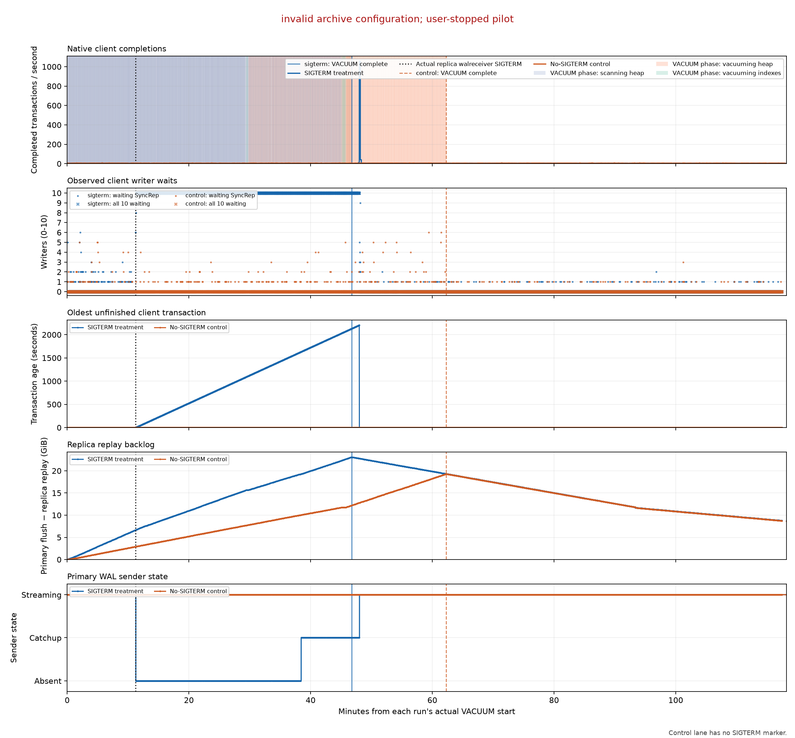

# INVALID PILOT — invalid archive configuration; user-stopped pilot

The two runs were deliberately stopped because the restored fixture lacked the required archive configuration. Both completed VACUUM successfully and their stopped-client native logs and count reconciliation are validated, but both observation windows ended before the required minimum. This is an invalid, incomplete pilot: the >2-hour outcome was not evaluated, and it is not a negative result from a completed two-hour test. Replay/catch-up fields below retain only recorded values.

Both runs restored the same retained paired DATA/WAL backup, using two Standard_D2s_v4 workers per stack, four separate 512 GiB Standard_LRS disks, host caching disabled, PostgreSQL 16.15 and CNPG 1.30.1. The tiny logged client offers 5 TPS over ten persistent connections with synchronous_commit=on and no statement timeout.

| Run | VACUUM seconds | Observation seconds | Client-offer seconds | Longest no-completion interval | Longest stable ten-writer statement span | >2 h all-write hang |
|---|---:|---:|---:|---:|---:|---|
| sigterm | 2805.31 | 7091.41 | 7078.45 | 2206.03 s | 2199.11 s | NOT EVALUATED — INVALID PILOT |
| control | 3736.36 | 7091.71 | 7078.47 | 2.99 s | 0.00 s | NOT EVALUATED — INVALID PILOT |

The pilot did not have an object-storage WAL backend: inherited preparation removed archive references. See [DIAGNOSIS.md](DIAGNOSIS.md) and the per-lane diagnostic captures for why writes resumed when the sender reached synchronous quorum. This run cannot establish object-storage restore behavior.

Preparation included a corrected pre-client logging error, an Azure VM endpoint correction, a failed timestamp COPY that stopped before VACUUM, and a recovered auxiliary collector transport reset. Both VACUUM commands were launched after correcting their timestamp paths; timing and the intervention use the actual server marker. Failed attempts, restore-path differences and collector gaps remain in the evidence.

The treatment scheduled SIGTERM at VACUUM start plus ten minutes. PostgreSQL pg_terminate_backend returned false without sending it; the verified OS SIGTERM was sent at +673.729 seconds (73.729 seconds late). The control records its +600-second boundary without a signal. This is a controlled receiver disconnect. It does not itself exercise the sender-timeout code path. Raw signal receipts and PostgreSQL logs establish what followed.

The report distinguishes a completion gap, individual transaction latency, and all ten writers waiting. A completion gap alone is insufficient evidence that every write hung. Coverage errors and timing bounds are retained in comparison.json and per-run client-impact.json. stable-writer-evidence.json separately follows the same ten query/transaction identities across recorded sampler gaps; it validates no native completions and does not infer wait events inside gaps.

Each run includes separate linear-axis await, IOPS, and throughput graphs for primary/replica DATA/WAL reads and writes, client throughput/latency/pending-session graphs, PostgreSQL IO/prefetch/progress/wait counters, Linux diskstats/controller/queue metadata, and Azure per-disk and exact-VM measurements with metric definitions and explicit gaps. BCC histograms are diagnostic and their coverage is recorded.

Full end-to-end UTC events are in controller-events.jsonl, per-run preparation receipts, measurement/events.jsonl and timing.json, signal receipts, and cleanup evidence. Private kubeconfig/credentials and source access metadata stay outside this checkout. No Git push was performed.
