# Recovered analysis: walreceiver SIGTERM and control

This report keeps the original failed harness result intact and evaluates retained native evidence separately. Both stacks used the same 23 GiB PostgreSQL fixture from the retained paired DATA/WAL restore source, 512 GiB `Standard_LRS` DATA and WAL disks with host caching disabled, `Standard_D2s_v4` nodes, PostgreSQL 16.15, and CNPG 1.30.1. The ten persistent pgbench writers targeted 5 aggregate transactions per second with synchronous commit enabled. The treatment reproduced a greater-than-two-hour write stall for these measured writers. It does not establish that every write in the whole database was blocked, and it does not prove the first client completion time after the stall.

The intervention SIGTERM was accepted at 2026-10-13T05:28:14.077112Z, 601.377 seconds after VACUUM start. From 2026-10-13T05:28:27.302017Z through the last sample at 2026-10-13T07:38:13.543359Z (the conservative pre-stop cutoff 2026-10-13T07:38:14.222643Z), all ten same backend/query/transaction identities remained active on `IPC/SyncRep`. The independently counted sample streak spans 7786.2 seconds, with a maximum sample gap of 1.623 seconds. Their committed transaction counter remained 4610.

The native `pgbench -P` capture independently shows only zero-TPS, zero-failure buckets after the initial post-SIGTERM bucket through the stop cutoff. These are aggregate progress buckets rather than per-transaction latency records. The two-hour claim ends at the runner’s final observation before its failed client stop/capture; later samples are not counted as offered-load proof.

| Measurement | SIGTERM treatment | Control |
|---|---:|---:|
| VACUUM duration | 3390.8 s | 2989.3 s |
| Completed client transactions | Not recoverable from deleted treatment logs | 43670 |
| Control failures / reconciliation difference | — | 0 / 0 |
| Control client latency p50 / p95 / p99 / max | — | 7.479 / 41.705 / 172.928 / 2145.598 ms |

Treatment archive evidence records 2054 contiguous WAL restore events after SIGTERM, matching the same count of Azure Blob `GetBlob` successes. The control recorded 0 archive restores and 0 post-marker successful `GetBlob` requests. The last observed treatment archive restore was 2026-10-13T08:31:02.121197419Z; streaming resumed at 2026-10-13T08:31:05.336166710Z, about 3.21 seconds later. This confirms the archive path was active and Azure requests accompanied restore logs; it does not identify the first completed client write or prove a specific failed-object restore.

The primary’s later read-only fixture counter was 4620, ten above the last blocked-sample counter. That establishes eventual additional commits by the later capture, but the exact first completion time is unknown. No treatment per-transaction completion logs survived, so treatment latency percentiles, completion rate after recovery, and a finalized native client summary are unavailable.

## Original harness status

Both original lane timing records remain `testComplete: false`. The treatment native VACUUM process exited zero and marker files independently confirm completion, but its timing record has no parsed completion marker and client drain/capture failed at 2026-10-13T07:53:16.827Z. The control client stopped cleanly and its transactions reconcile, though the same missing-marker issue kept the original control harness from finalizing. The run source subsequently removed the treatment remote client work directory; this is an artifact-loss limitation, not evidence of zero transactions. The separate recovered JSON keeps these facts explicit and does not rewrite original state.

## Figures

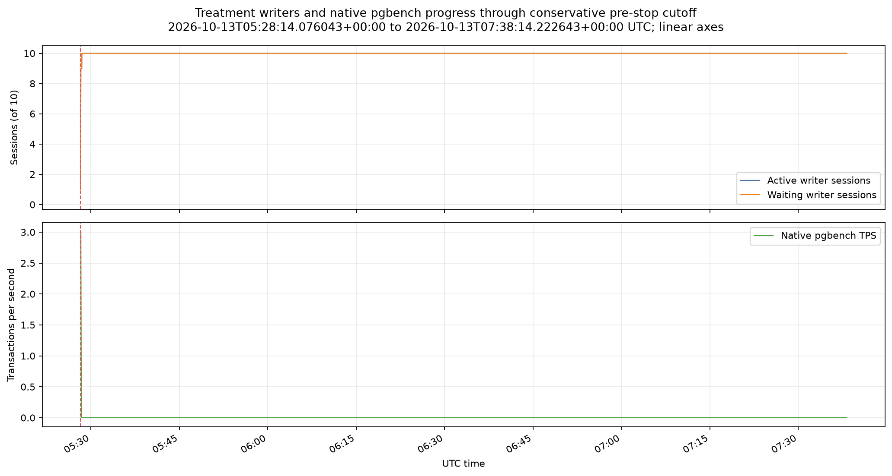

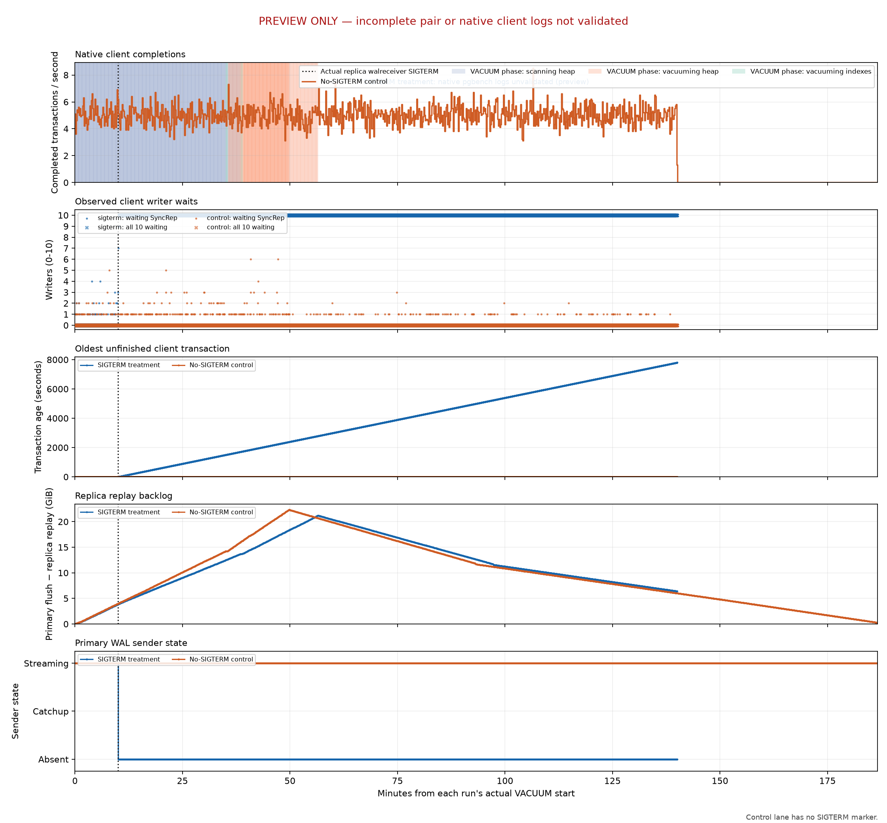

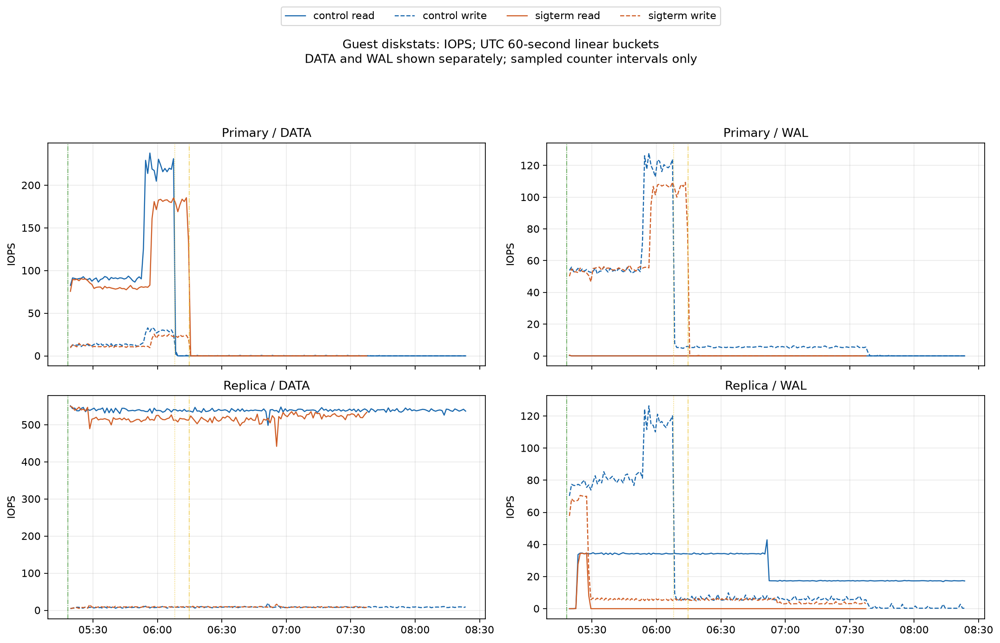

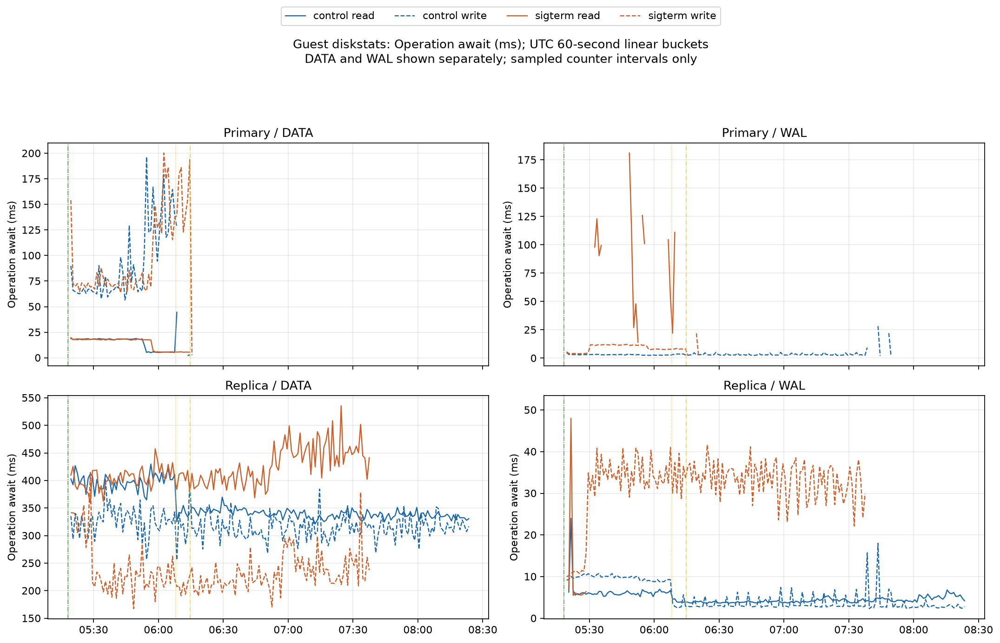

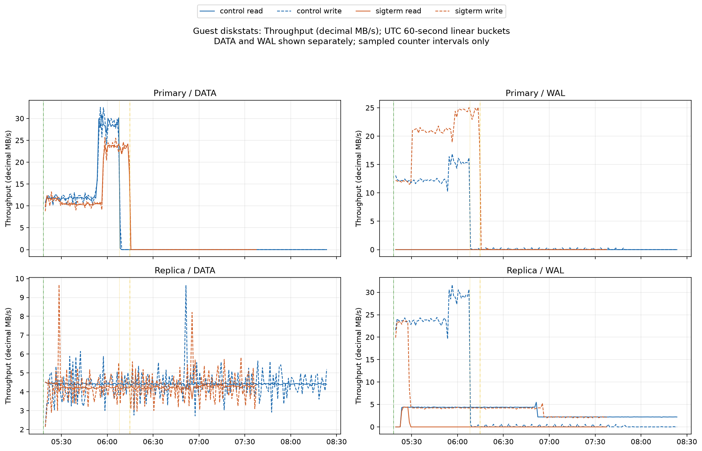

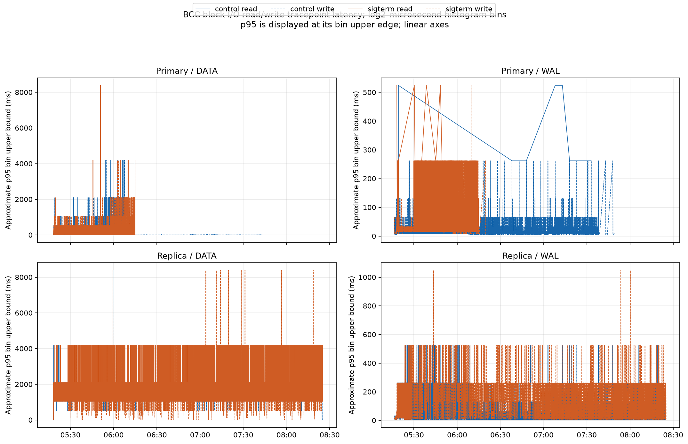

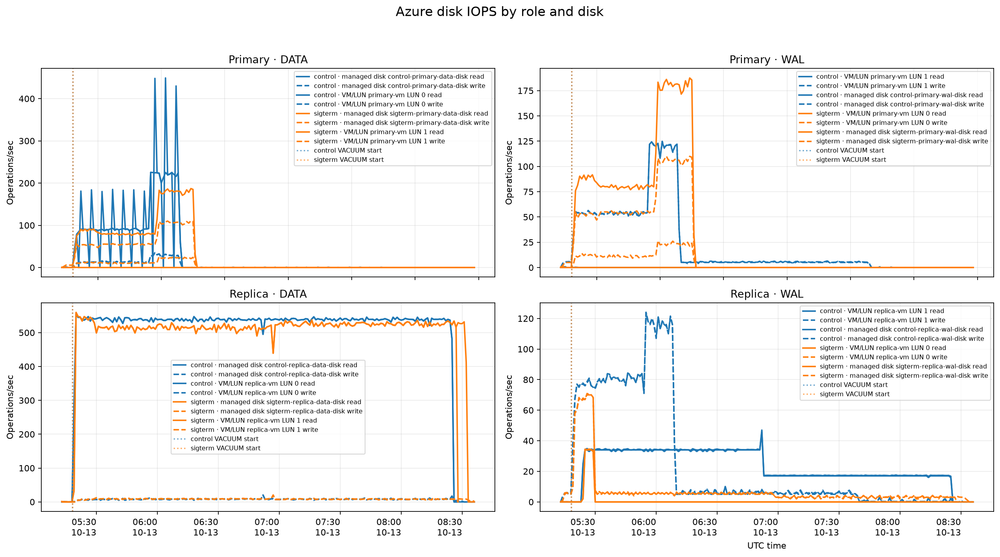

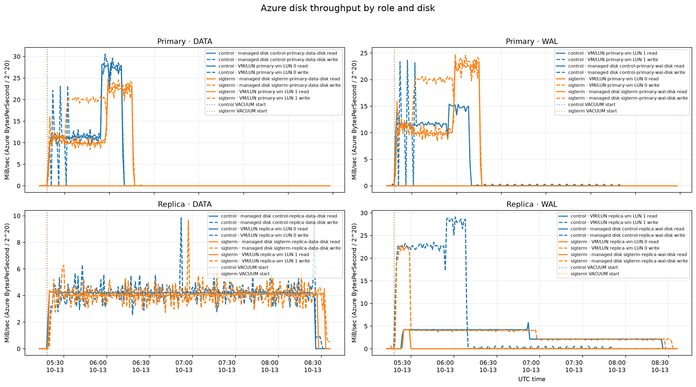

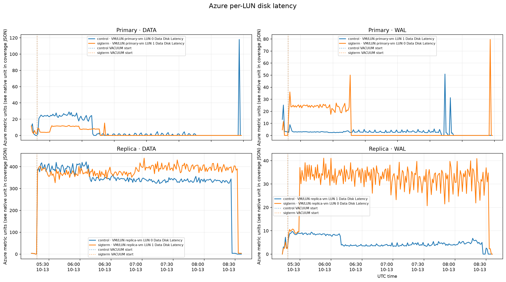

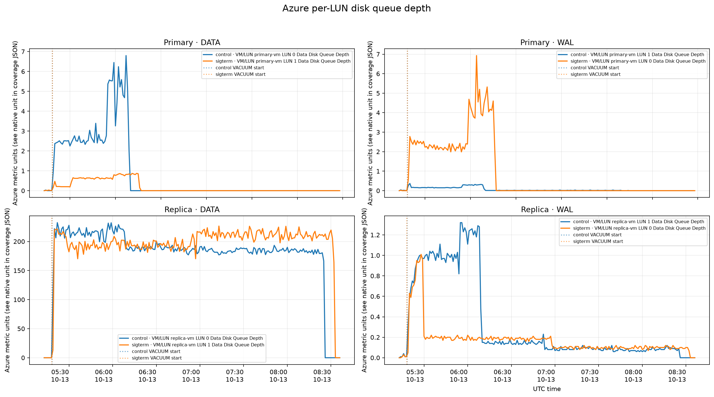

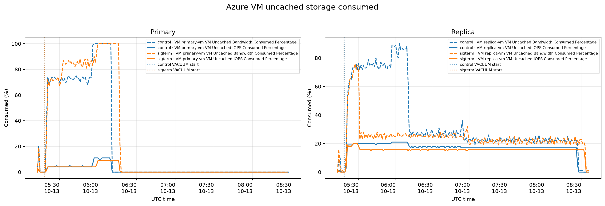

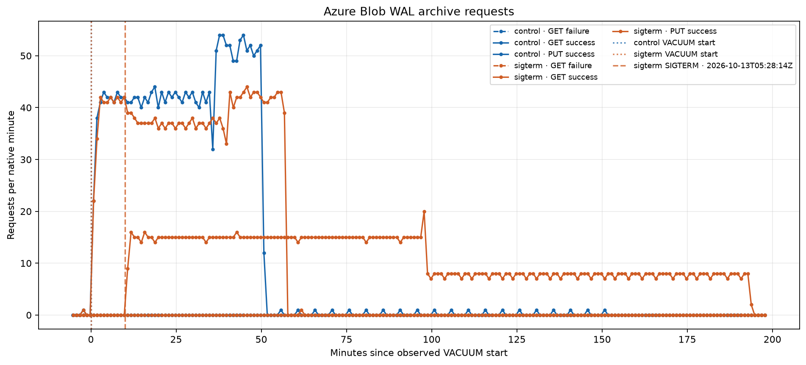

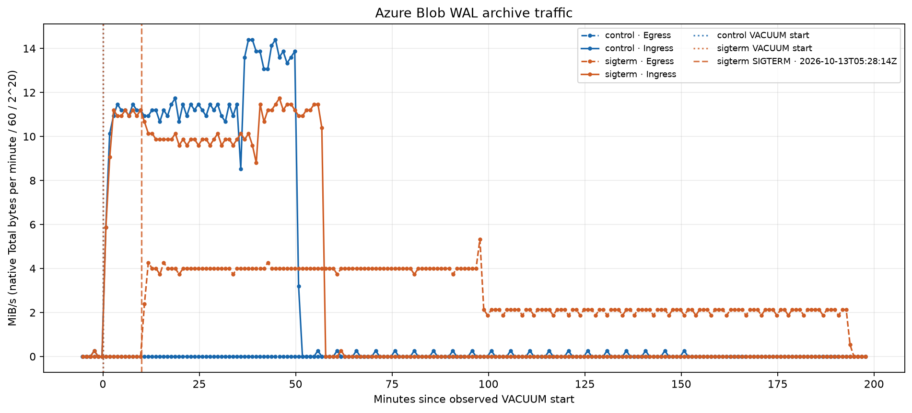

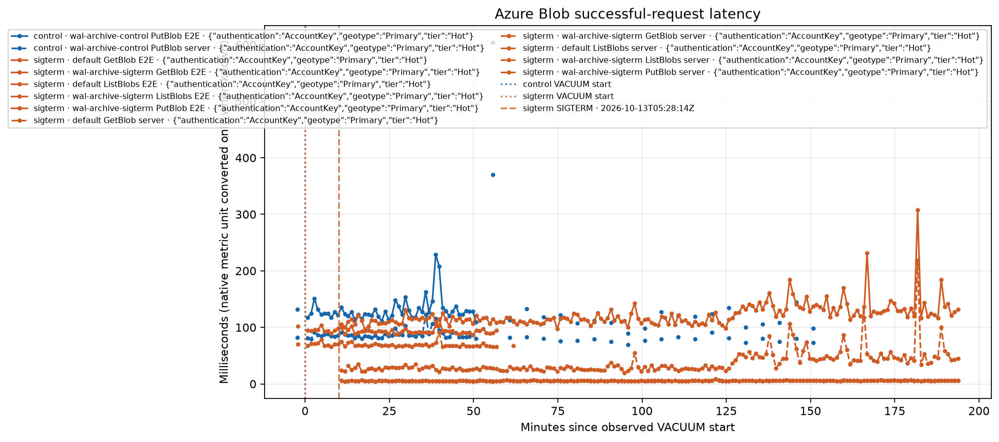

All plotted axes are linear. The guest diskstats streams end around 08:25 UTC. Azure Monitor figures are clipped to 05:13–08:36 UTC, covering the client start through five minutes after replica streaming resumed. The offered-load proof ends at 07:38 UTC. Native metric gaps remain gaps; the figures do not extend zero activity across unobserved intervals. `graph-coverage.json` records clipped windows and chart coverage without Azure resource identifiers. These are diagnostic views and do not change original run completion state.

## Machine-readable evidence

`comparison.json` contains the verified cutoffs, proof counts, reconciliation, archive correlation, and safe evidence hashes. It excludes backend PIDs, Azure resource identifiers, credentials, owner tokens, and raw private receipts.

## Retention and cleanup

The user stopped the optional full WAL download and requested cleanup. The verified subset already copied and recovery metadata remain private; the retained offline snapshot pair does not depend on the experiment’s new archive. Cleanup completed on October 14 after refreshing an expired Azure credential. Both owned stacks, their nodes and test disks, temporary Blob accounts, and the owned Network Watcher were removed. All five original retained snapshot IDs were independently verified unchanged. Cleanup receipts and the final verification are recorded separately. No Git staging, commit, or push is authorized.
